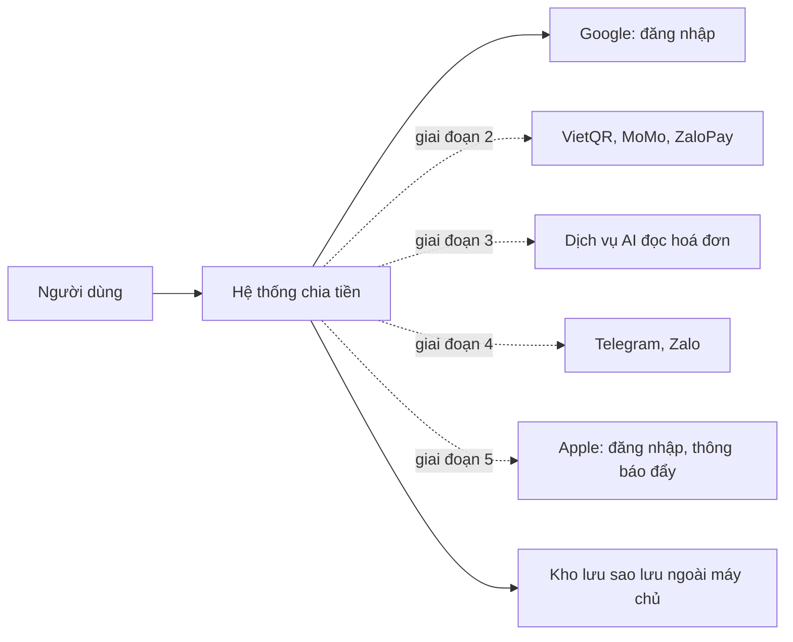
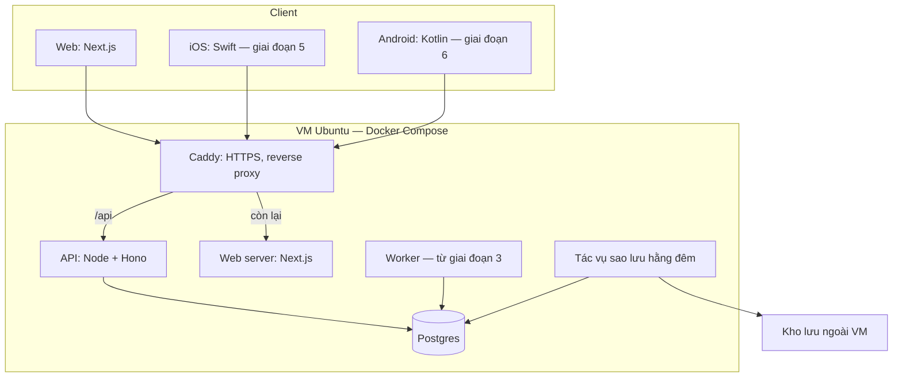
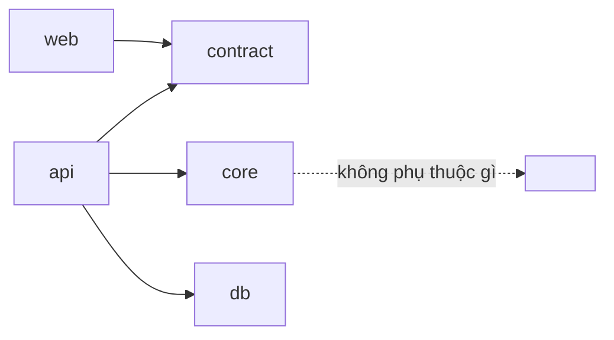
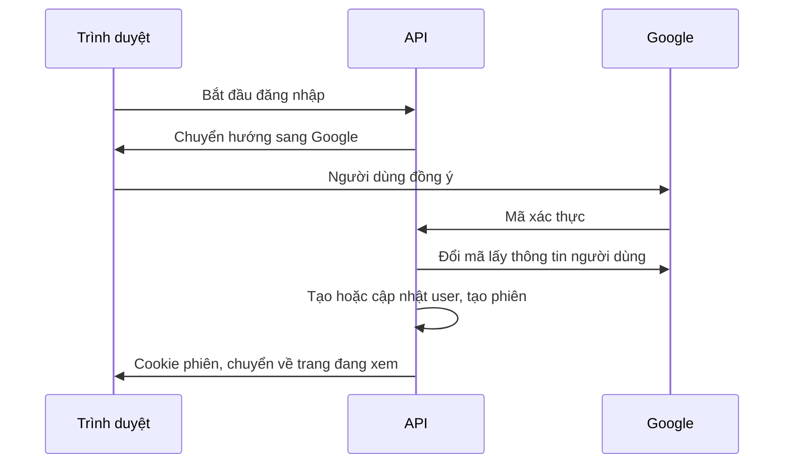
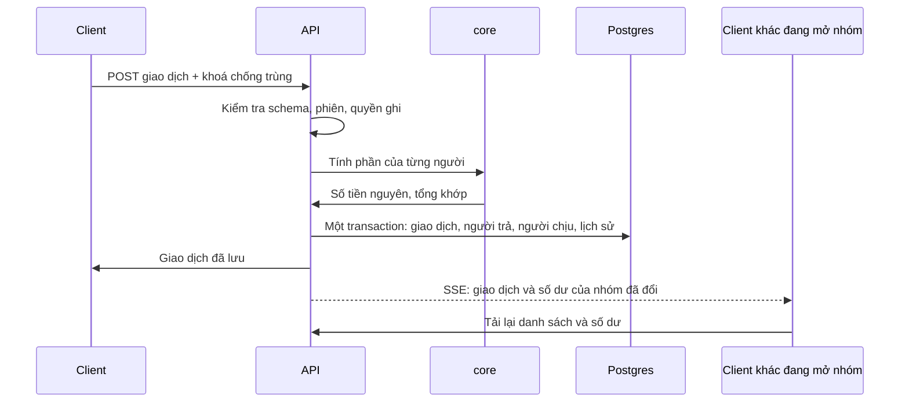

# 04 — SAD (Kiến trúc phần mềm)

Cập nhật: 2026-11-11. Trạng thái: đã duyệt ngày 2026-11-11; bản sửa đổi cùng ngày (bộ đọc câu gõ trong `core`) đã duyệt. Bản sửa đổi thứ ba (nội bộ trước, phát hành công khai sau; đăng ký bằng email) đã duyệt.

Tài liệu mô tả hệ thống ở mức khối và quan hệ giữa các khối. Lý do của từng lựa chọn nằm trong [04 — ADR](04-adr.md). Chi tiết bảng và endpoint nằm trong [05 — Thiết kế database](05-database-design.md) và [05 — Đặc tả API](05-api-spec.md).

## 1. Các yếu tố định hình kiến trúc

| Yếu tố | Hệ quả |
|---|---|
| Ba client không chia sẻ code (TS, Swift, Kotlin) | Logic nghiệp vụ nằm hết ở server; hợp đồng API là thứ dùng chung |
| Sai số về tiền là không chấp nhận được | Logic tính toán tách thành gói thuần, dễ đọc và dễ kiểm |
| Dùng nội bộ, một máy chủ | Một tiến trình API, không cần cân bằng tải hay hàng đợi ngoài |
| Realtime nhưng cần mạng để ghi | Kênh thông báo một chiều; không cần đồng bộ hai chiều hay giải quyết xung đột ở client |
| Sẽ có tác vụ nền (OCR, bot, nhắc nợ) | API phải tách khỏi web; hàng đợi đặt trong Postgres |
| Một người phát triển và vận hành | Ít thành phần, ít dịch vụ ngoài, một ngôn ngữ ở web và server |

## 2. Sơ đồ ngữ cảnh



## 3. Sơ đồ thành phần triển khai



| Thành phần | Trách nhiệm | Không làm |
|---|---|---|
| Caddy | Chứng chỉ HTTPS, định tuyến `/api` tới API và phần còn lại tới web | Không chứa logic |
| API | Xác thực, phân quyền, nghiệp vụ, đọc ghi database, phát sự kiện SSE | Không render giao diện |
| Web server | Phục vụ ứng dụng Next.js | Không truy cập database, không tính tiền |
| Worker | Chạy tác vụ nền lấy từ hàng đợi trong Postgres | Không nhận yêu cầu HTTP |
| Postgres | Kho dữ liệu duy nhất, kể cả phiên đăng nhập và hàng đợi | — |

Web và API nằm chung một tên miền (API ở đường dẫn `/api`), nên cookie phiên là cookie cùng nguồn và không cần cấu hình CORS.

## 4. Cấu trúc mã nguồn

```
apps/
  api/        Dịch vụ API
  web/        Ứng dụng Next.js
packages/
  core/       Logic thuần: chia tiền, làm tròn, số dư, lượt chuyển, đọc câu gõ theo quy tắc
  contract/   Schema Zod của mọi yêu cầu và phản hồi; nguồn sinh OpenAPI
  db/         Schema database, migration, truy vấn
docs/         Bộ tài liệu này; `docs/agents/` là quy ước code cho agent
.agents/      Skill dùng chung cho các agent; `AGENTS.md` ở gốc là luật làm việc
infra/        Docker Compose, Caddyfile, script sao lưu
```

**Quy tắc phụ thuộc**



- `core` không biết đến HTTP, database hay thời gian hệ thống; nhận dữ liệu thuần và trả dữ liệu thuần.
- `web` chỉ phụ thuộc `contract`. Nếu web cần xem trước kết quả chia tiền trong lúc nhập, nó được phép dùng `core`, nhưng con số chính thức luôn là con số API trả về.
- iOS và Android dùng client sinh từ file OpenAPI do `contract` xuất ra.
- Bộ đọc câu gõ là hàm thuần trong `core`: nhận câu và danh sách thành viên, trả bản nháp và vị trí các cụm đã hiểu. Mọi client gọi nó qua API (`…/transactions/parse`) để ba nền tảng cho cùng kết quả. Ở giai đoạn 3, AI là bộ đọc thứ hai đứng sau nó, cùng định dạng đầu ra.

## 5. Cấu trúc bên trong API

| Tầng | Vai trò |
|---|---|
| Route | Khai báo endpoint, gắn schema từ `contract`, không chứa logic |
| Middleware | Phiên đăng nhập, quyền theo nhóm, khoá chống trùng, định dạng lỗi, log |
| Service | Một hàm cho mỗi thao tác nghiệp vụ; mở transaction, gọi `core`, ghi dữ liệu và lịch sử |
| Repository (`db`) | Truy vấn có kiểu; không chứa quy tắc nghiệp vụ |
| Event hub | Giữ danh sách kết nối SSE theo nhóm; phát sự kiện sau khi transaction thành công |

**Phân quyền** được thực hiện ở một middleware duy nhất cho mọi route có `groupId`: tải vai trò của người gọi trong nhóm, so với mức tối thiểu khai báo trên route. Không thuộc nhóm trả 404; thiếu quyền trả 403.

## 6. Các luồng chính

### 6.1 Đăng nhập



App mobile sau này dùng cùng bảng phiên, nhưng gửi mã phiên qua header `Authorization`.

### 6.2 Thêm một khoản chi



### 6.3 Realtime

- Client mở một kết nối SSE cho nhóm đang xem.
- Sự kiện chỉ mang tên loại dữ liệu vừa đổi (`transactions`, `balances`, `members`, `group`, `activity`), không mang dữ liệu.
- Client đánh dấu phần dữ liệu đó là cũ và tải lại qua API thông thường. Như vậy chỉ có một đường đọc và một chỗ kiểm tra quyền.
- Khi kết nối đứt rồi nối lại, client tải lại toàn bộ dữ liệu của nhóm đang xem.
- Giai đoạn 1 chỉ có một tiến trình API, nên event hub nằm trong bộ nhớ. Khi có worker (giai đoạn 3), worker báo cho API qua `LISTEN/NOTIFY` của Postgres.

### 6.4 Tính số dư và lượt chuyển

- Số dư không được lưu. Mỗi lần đọc, một câu truy vấn cộng tổng đã trả và tổng phải chịu của từng thành viên trên các giao dịch chưa xoá.
- `core` nhận bảng số dư và trả danh sách lượt chuyển.
- **Bật tối giản:** lặp lại việc ghép người nợ nhiều nhất với người được nợ nhiều nhất, chuyển số nhỏ hơn trong hai số, cho đến khi mọi số dư bằng 0.
- **Tắt tối giản:** với mỗi giao dịch, phần của mỗi người chịu được ghi nợ cho các người trả theo tỉ lệ họ đã trả; cộng dồn theo cặp và bù trừ hai chiều.

## 7. Các mối quan tâm xuyên suốt

| Chủ đề | Cách xử lý |
|---|---|
| Tính đúng của tiền | Số nguyên; làm tròn tại một hàm duy nhất trong `core`; ràng buộc trong database kiểm tra tổng phần chịu và tổng phần trả bằng tổng tiền |
| Chống tạo trùng | Client gửi header `Idempotency-Key`; server lưu khoá và phản hồi trong 24 giờ |
| Sửa đồng thời | Cột `version` trên giao dịch; yêu cầu sửa phải gửi phiên bản đang có, lệch thì trả 409 |
| Định dạng lỗi | Một cấu trúc chung: mã dạng chữ, thông điệp, chi tiết theo trường |
| Bảo mật | HTTPS; cookie HttpOnly, Secure, SameSite=Lax; kiểm tra nguồn gốc cho yêu cầu ghi; giới hạn tần suất theo người dùng và IP; mã mời ngẫu nhiên đủ dài |
| Quan sát | Log JSON có mã yêu cầu; endpoint kiểm tra sức khoẻ; dịch vụ ping ngoài |
| Cấu hình | Biến môi trường, kiểm tra bằng schema khi khởi động; bí mật không vào git |
| Ngôn ngữ | Chuỗi hiển thị tách khỏi code ở web; API trả mã lỗi, client tự dịch |
| Thời gian | Lưu UTC; client hiển thị theo múi giờ thiết bị |

## 8. Triển khai và vận hành

- Một file Docker Compose chạy Caddy, API, web và Postgres; dữ liệu Postgres trên volume riêng.
- Migration chạy tự động trước khi API mới nhận yêu cầu.
- Cập nhật phiên bản bằng một lệnh: kéo code, build, khởi động lại.
- Sao lưu hằng đêm: xuất toàn bộ database, nén, mã hoá, đẩy ra kho lưu ngoài VM, giữ 30 bản. Quy trình khôi phục được chạy thử trước khi đưa người dùng thật vào.
- Hai môi trường: máy phát triển (Docker Compose cục bộ) và production. Không có staging ở giai đoạn 1.

## 9. Lộ trình tiến hoá kiến trúc

| Giai đoạn | Thay đổi kiến trúc |
|---|---|
| 2 | Thêm bảng và module cho thông tin nhận tiền, quỹ, ngân sách; module sinh chuỗi VietQR trong `core` |
| 3 | Thêm tiến trình worker và hàng đợi trong Postgres; lưu ảnh trên đĩa của VM sau một lớp trừu tượng; module gọi dịch vụ AI |
| 4 | Webhook cho bot; module thông báo; gửi email |
| 5–6 | Xuất OpenAPI ổn định và sinh client Swift, Kotlin; đăng nhập Apple; thông báo đẩy qua APNs và FCM |

Không có giai đoạn nào đòi hỏi viết lại phần lõi: mọi bổ sung là module mới bên cạnh, dùng lại lớp phân quyền và event hub.

## 10. Giới hạn đã chấp nhận

| Giới hạn | Vì sao chấp nhận | Khi nào xem lại |
|---|---|---|
| Một máy chủ, không dự phòng | Chặng nội bộ; vài giờ gián đoạn là chấp nhận được | Bắt buộc xem lại trước giai đoạn 7 (phát hành công khai) |
| Event hub trong bộ nhớ, một tiến trình API | Đủ cho vài trăm kết nối | Trước giai đoạn 7: chuyển sang Postgres LISTEN/NOTIFY hoặc Redis để chạy nhiều bản API |
| Không ghi được khi mất mạng | Giữ client mỏng | Khi có phản hồi thực tế rằng điều này gây cản trở |
| Tính số dư mỗi lần đọc | Nhanh ở quy mô dưới vài nghìn giao dịch mỗi nhóm | Khi một nhóm vượt khoảng 10.000 giao dịch |

## Phase 3 architecture amendment — approved 2026-11-17, not implemented

This amendment supersedes earlier Phase 3 sketches where they differ. Approval authorizes preparation; the owner has explicitly withheld execution approval. Current main still has no worker application, queue, storage package or AI adapter; `apps/worker/fixtures` is advisor data only.

| Planned unit | Responsibility and permitted dependencies |
|---|---|
| apps/worker | pg-boss jobs, scan lifecycle and orphan cleanup; imports contract/db/core and the planned storage/AI workspace packages; no API imports or HTTP server |
| apps/api | enqueue and group-authorized endpoints; never runs queue handlers; sentence AI stays inside parse request |
| packages/storage | shared FileStore/disk implementation used by API and worker when extracted; no client path strings |
| packages/ai | shared single-attempt HTTP transport with per-purpose timeout policy; no money or authorization logic |
| packages/contract | bounded request/response/job schemas, receipt reading and provider reference shapes |
| packages/db | schema, typed queries, reservation/claim metadata and transaction-bound durable enqueue adapter |
| packages/core | item sums/allocations/receipt check, quota calendar windows and category suggestion; no provider or clock dependency |

API and worker resolve STORAGE_DIR to one repository-root-based absolute directory. Uploads use a six-MiB actual streaming body bound only on their route, preserving the existing 100-KiB bound elsewhere. Size/type checks, same-group authorization and a serialized 200-MiB group quota precede successful attachment creation. Server-generated keys are group UUID/file UUID pairs; files are served only by authorized content endpoints with nosniff and private,no-store.

The API has a dedicated LISTEN connection with validated, bounded group/resource payloads and reconnect backoff. Worker NOTIFY carries only groupId/resources (receiptScans), never images, prompts, readings or account information. The existing in-memory SSE hub remains the final dispatcher; database authorization remains authoritative.

Scan admission locks the group, rechecks access and returns an existing unique scan before spending quota. Reservation, scan insert and pg-boss enqueue share the caller transaction. Do not hold a transaction or advisory lock during provider I/O. The exact installed queue adapter must pass the rollback gate before 3B; no non-atomic fallback is approved. Provider attempts are atomically claimed and finished; a crashed uncertain claim is recovered to failure rather than blindly repeated.

All attachment mutations/cleanup coordinate through group locking. Untracked files and temporary files have a 24-hour grace period; fresh uploads are not orphan candidates. Group deletion reads keys before cascade and schedules idempotent deletion. Soft-deleted transactions retain their photos for restoration.

The sentence adapter sees only active people's display names and nonce-scoped references. The service maps references to UUIDs, validates again, calls core and returns per-draft status/issues/shares. No adapter writes the ledger. Existing Phase 2 categories, archived-category edits, budget/fund warning baselines and authorization guards remain required.

Planned development configuration: STORAGE_DIR (default ./.data/uploads), AI_PROVIDER (unset/fake/anthropic), AI_MODEL, ANTHROPIC_API_KEY, AI_RECEIPTS_PER_USER_PER_DAY (20 attempts), AI_SENTENCES_PER_USER_PER_DAY (100), AI_CALLS_PER_MONTH (1000 across purposes), AI_FAKE_RECEIPT_FIXTURE (local named fixture only). Implementation must add schema/example/README entries together. No actual environment/configuration change is made in this preparation.
