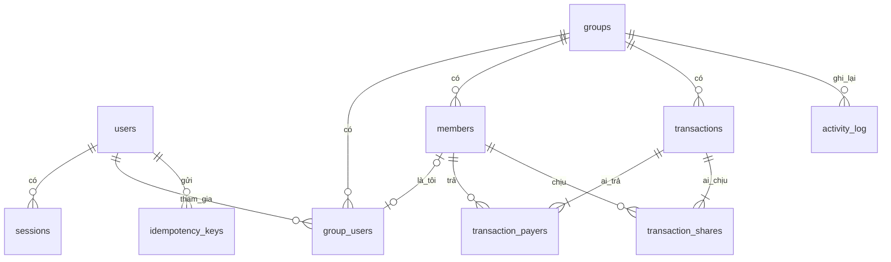

# 05 — Thiết kế database (giai đoạn 1)

Cập nhật: 2026-11-11. Trạng thái: đã duyệt ngày 2026-11-11; bản sửa đổi cùng ngày (cột `shape`, `color` của members) đã duyệt. Bản sửa đổi thứ ba (nội bộ trước, phát hành công khai sau; đăng ký bằng email) đã duyệt.

Hệ quản trị: PostgreSQL. Tài liệu này là bản thiết kế; schema chính thức là code trong `packages/db` và các file migration.

## 1. Quy ước

| Chủ đề | Quy ước |
|---|---|
| Tên | Bảng số nhiều, `snake_case` |
| Khoá chính | `id` kiểu UUID phiên bản 7 (sắp xếp được theo thời gian), sinh ở server |
| Thời gian | `timestamptz`, lưu UTC; mọi bảng có `created_at`, bảng sửa được có `updated_at` |
| Tiền | `bigint`, đơn vị nhỏ nhất của tiền tệ (VND: đồng); luôn đi kèm mã tiền tệ ISO 4217 |
| Xoá | Giao dịch xoá mềm bằng `deleted_at`; các bảng khác xoá thật hoặc dùng cờ trạng thái |
| Liệt kê | Kiểu `text` với ràng buộc `CHECK`, không dùng kiểu enum của Postgres để dễ thêm giá trị |

## 2. Sơ đồ quan hệ



## 3. Từ điển dữ liệu

### users

| Cột | Kiểu | Ràng buộc | Ghi chú |
|---|---|---|---|
| id | uuid | PK | |
| email | text | UNIQUE (không phân biệt hoa thường), NOT NULL | |
| email_verified_at | timestamptz | | NULL là chưa xác minh; tài khoản Google coi như đã xác minh |
| name | text | NOT NULL | |
| avatar_url | text | | |
| created_at, updated_at | timestamptz | NOT NULL | |

### user_identities

| Cột | Kiểu | Ràng buộc | Ghi chú |
|---|---|---|---|
| id | uuid | PK | |
| user_id | uuid | FK users, ON DELETE CASCADE | |
| provider | text | NOT NULL | `google` hoặc `password`; thêm `apple` ở giai đoạn 5 |
| provider_subject | text | | Mã định danh ổn định phía nhà cung cấp; NULL với `password` |
| password_hash | text | | Chỉ có với `password` |
| created_at | timestamptz | NOT NULL | |

Ràng buộc: `UNIQUE (provider, provider_subject)`; mỗi người dùng có nhiều nhất một định danh cho mỗi `provider`.

Mã xác minh email và mã đặt lại mật khẩu lưu ở một bảng riêng, chỉ lưu giá trị băm, có hạn dùng và dùng một lần. Cấu trúc cuối cùng của các bảng tài khoản theo thư viện đăng nhập được chọn (ADR-007, ADR-015).

Khi một người dùng bị xoá (FR-1.9), các dòng `group_users` của họ bị xoá theo; bảng `members` không tham chiếu `users` nên thành viên và giao dịch giữ nguyên.

### sessions

| Cột | Kiểu | Ràng buộc | Ghi chú |
|---|---|---|---|
| id | uuid | PK | |
| user_id | uuid | FK users, ON DELETE CASCADE | |
| token_hash | text | UNIQUE, NOT NULL | Chỉ lưu giá trị băm của mã phiên |
| expires_at | timestamptz | NOT NULL | |
| user_agent | text | | |
| created_at, last_seen_at | timestamptz | NOT NULL | |

Cấu trúc cuối cùng của bảng này theo thư viện đăng nhập được chọn (ADR-007).

### groups

| Cột | Kiểu | Ràng buộc | Ghi chú |
|---|---|---|---|
| id | uuid | PK | |
| name | text | NOT NULL, 1–80 ký tự | |
| currency | text | NOT NULL, mặc định `'VND'` | |
| minimize_debts | boolean | NOT NULL, mặc định `true` | |
| invite_token | text | UNIQUE, NOT NULL | Ngẫu nhiên, tối thiểu 128 bit |
| invite_active | boolean | NOT NULL, mặc định `true` | |
| default_role | text | NOT NULL, `'editor'` hoặc `'viewer'`, mặc định `'editor'` | Vai trò cho người tham gia qua link |
| created_by | uuid | FK users | |
| created_at, updated_at | timestamptz | NOT NULL | |

### members

| Cột | Kiểu | Ràng buộc | Ghi chú |
|---|---|---|---|
| id | uuid | PK | |
| group_id | uuid | FK groups, ON DELETE CASCADE | |
| name | text | NOT NULL, 1–50 ký tự | |
| active | boolean | NOT NULL, mặc định `true` | |
| default_weight | numeric(6,2) | NOT NULL, mặc định `1`, ≥ 0 | Trọng số gợi ý khi chia theo phần |
| position | integer | NOT NULL | Thứ tự thêm vào nhóm; dùng để phân phần dư khi làm tròn |
| shape | text | NOT NULL | Mã hình của thành viên, lấy từ một danh sách cố định (FR-1.25) |
| color | text | NOT NULL | Mã màu của thành viên, lấy từ một danh sách cố định (FR-1.25) |
| created_at, updated_at | timestamptz | NOT NULL | |

Ràng buộc: `UNIQUE (group_id, position)`.

`shape` và `color` do server gán lúc tạo thành viên: chọn cặp chưa dùng trong nhóm theo một thứ tự cố định, dùng lại từ đầu khi hết cặp. Lưu mã (ví dụ `circle`, `mint`), không lưu giá trị vẽ; mỗi client tự ánh xạ mã sang hình và màu của nền tảng mình. Ô gõ nhanh không thêm bảng hay cột nào: nó tạo ra cùng `split_input` như form.

### group_users

| Cột | Kiểu | Ràng buộc | Ghi chú |
|---|---|---|---|
| group_id | uuid | FK groups, ON DELETE CASCADE | |
| user_id | uuid | FK users, ON DELETE CASCADE | |
| role | text | NOT NULL, `'owner'`, `'editor'` hoặc `'viewer'` | |
| member_id | uuid | FK members, ON DELETE SET NULL | "Tôi là thành viên này" |
| created_at | timestamptz | NOT NULL | |

Ràng buộc:
- `PRIMARY KEY (group_id, user_id)`.
- `UNIQUE (group_id, member_id)`: một thành viên chỉ gắn với một người dùng.
- Chỉ mục duy nhất một phần trên `(group_id) WHERE role = 'owner'`: mỗi nhóm đúng một chủ nhóm.

### transactions

| Cột | Kiểu | Ràng buộc | Ghi chú |
|---|---|---|---|
| id | uuid | PK | |
| group_id | uuid | FK groups, ON DELETE CASCADE | |
| type | text | NOT NULL, `'expense'`, `'transfer'` hoặc `'income'` | |
| description | text | NOT NULL, 1–200 ký tự | Chuyển khoản có mô tả mặc định |
| amount | bigint | NOT NULL, > 0 | Tổng tiền |
| currency | text | NOT NULL | Giai đoạn 1 luôn bằng tiền tệ của nhóm |
| occurred_at | timestamptz | NOT NULL | Thời điểm phát sinh do người dùng chọn |
| category | text | | Một trong các danh mục cố định |
| split_method | text | NOT NULL, `'equal'`, `'exact'`, `'shares'` hoặc `'percent'` | |
| split_input | jsonb | NOT NULL | Đầu vào gốc người dùng đã nhập, để hiện lại khi sửa |
| version | integer | NOT NULL, mặc định `1` | Tăng mỗi lần sửa |
| created_by, updated_by | uuid | FK users | |
| created_at, updated_at | timestamptz | NOT NULL | |
| deleted_at | timestamptz | | Khác null nghĩa là đã xoá |

Chỉ mục: `(group_id, occurred_at DESC, id DESC) WHERE deleted_at IS NULL` cho danh sách và phân trang.

### transaction_payers

| Cột | Kiểu | Ràng buộc | Ghi chú |
|---|---|---|---|
| transaction_id | uuid | FK transactions, ON DELETE CASCADE | |
| member_id | uuid | FK members, ON DELETE RESTRICT | |
| amount | bigint | NOT NULL, > 0 | |

Khoá chính `(transaction_id, member_id)`.

### transaction_shares

| Cột | Kiểu | Ràng buộc | Ghi chú |
|---|---|---|---|
| transaction_id | uuid | FK transactions, ON DELETE CASCADE | |
| member_id | uuid | FK members, ON DELETE RESTRICT | |
| amount | bigint | NOT NULL, ≥ 0 | Số tiền server đã tính |

Khoá chính `(transaction_id, member_id)`. `ON DELETE RESTRICT` trên `member_id` là thứ ngăn xoá thành viên đã có giao dịch (FR-1.22).

### activity_log

| Cột | Kiểu | Ràng buộc | Ghi chú |
|---|---|---|---|
| id | uuid | PK | |
| group_id | uuid | FK groups, ON DELETE CASCADE | |
| actor_user_id | uuid | FK users, ON DELETE SET NULL | |
| action | text | NOT NULL | `create`, `update`, `delete`, `restore`, `join`, `leave`, `role_change`, … |
| entity_type | text | NOT NULL | `transaction`, `member`, `group`, `group_user` |
| entity_id | uuid | | |
| summary | text | NOT NULL | Tên hiển thị tại thời điểm ghi, ví dụ mô tả giao dịch |
| before, after | jsonb | | Bản chụp các trường liên quan |
| created_at | timestamptz | NOT NULL | |

Chỉ mục: `(group_id, created_at DESC)`. Bảng chỉ thêm, không sửa, không xoá từng dòng.

### idempotency_keys

| Cột | Kiểu | Ràng buộc | Ghi chú |
|---|---|---|---|
| user_id | uuid | FK users, ON DELETE CASCADE | |
| key | text | NOT NULL | Do client sinh |
| request_hash | text | NOT NULL | Phát hiện dùng lại khoá với nội dung khác |
| response_status | integer | NOT NULL | |
| response_body | jsonb | NOT NULL | |
| created_at | timestamptz | NOT NULL | Dòng quá 24 giờ được dọn định kỳ |

Khoá chính `(user_id, key)`.

## 4. Quy tắc toàn vẹn về tiền

| Quy tắc | Nơi thực thi |
|---|---|
| Tổng `transaction_payers.amount` bằng `transactions.amount` | Service, trong cùng transaction; trigger ràng buộc hoãn đến lúc commit |
| Tổng `transaction_shares.amount` bằng `transactions.amount` | Như trên |
| Người trả và người chịu thuộc đúng nhóm của giao dịch | Service; khoá ngoại kết hợp `(group_id, member_id)` |
| Chuyển khoản có đúng một người trả, một người chịu, khác nhau | Service |

## 5. Cấu trúc `split_input`

Lưu đúng những gì người dùng nhập, không lưu kết quả tính.

```json
{ "method": "equal",   "members": ["m1", "m2", "m3"] }

{ "method": "exact",   "entries": [{ "memberId": "m1", "amount": 150000 }],
  "remainder": "equal_among_blank", "members": ["m1", "m2", "m3"] }

{ "method": "exact",   "entries": [{ "memberId": "m1", "amount": 80000 },
                                    { "memberId": "m2", "amount": 60000 },
                                    { "memberId": "m3", "amount": 40000 }],
  "remainder": "equal_among_all", "members": ["m1", "m2", "m3"] }

{ "method": "shares",  "entries": [{ "memberId": "m1", "weight": "2" },
                                    { "memberId": "m2", "weight": "1" }] }

{ "method": "percent", "entries": [{ "memberId": "m1", "percent": "50" },
                                    { "memberId": "m2", "percent": "50" }] }
```

`remainder` có ba giá trị: `none` (tổng phải khớp), `equal_among_blank` (FR-1.52), `equal_among_all` (FR-1.53).

## 6. Quy tắc làm tròn

Áp dụng cho mọi phép chia, tại một hàm duy nhất trong `packages/core`:

1. Tính phần chính xác của từng người dưới dạng phân số.
2. Lấy phần nguyên.
3. Số đơn vị còn dư bằng tổng tiền trừ tổng các phần nguyên.
4. Phân mỗi đơn vị dư cho người có phần lẻ lớn nhất; bằng nhau thì người có `position` nhỏ hơn nhận trước.

Ví dụ: 100.000 đ chia đều cho ba người thành 33.334, 33.333, 33.333.

## 7. Truy vấn số dư

Số dư của một thành viên là tổng đã trả trừ tổng phải chịu, đảo dấu với thu nhập:

```sql
SELECT m.id,
       COALESCE(SUM(x.signed), 0) AS balance
FROM members m
LEFT JOIN (
    SELECT p.member_id,
           CASE WHEN t.type = 'income' THEN -p.amount ELSE p.amount END AS signed
    FROM transaction_payers p
    JOIN transactions t ON t.id = p.transaction_id
    WHERE t.group_id = $1 AND t.deleted_at IS NULL
  UNION ALL
    SELECT s.member_id,
           CASE WHEN t.type = 'income' THEN s.amount ELSE -s.amount END
    FROM transaction_shares s
    JOIN transactions t ON t.id = s.transaction_id
    WHERE t.group_id = $1 AND t.deleted_at IS NULL
) x ON x.member_id = m.id
WHERE m.group_id = $1
GROUP BY m.id;
```

Cách ba loại giao dịch dùng chung công thức:

| Loại | Người trả | Người chịu | Tác động |
|---|---|---|---|
| Chi tiêu | Người bỏ tiền | Người hưởng | Người trả được nợ, người chịu mắc nợ |
| Chuyển khoản | Người chuyển | Người nhận | Nợ của người chuyển giảm đúng bằng số đã chuyển |
| Thu nhập | Người cầm tiền nhận về | Người được hưởng | Đảo dấu: người cầm tiền mắc nợ những người được hưởng |

Bất biến: tổng số dư của mọi thành viên trong một nhóm luôn bằng 0.

## 8. Chừa chỗ cho các giai đoạn sau

| Giai đoạn | Bổ sung dự kiến | Tác động lên bảng hiện có |
|---|---|---|
| 2 | `member_payment_methods`, `funds`, `budgets`, `group_categories` | Không |
| 3 | `transaction_items`, `item_assignments`, `attachments`, bảng hàng đợi | Thêm cột tham chiếu tuỳ chọn trên `transactions` |
| 4 | `comments`, `notifications`, `chat_links` | Thêm cột trạng thái tuỳ chọn trên `transactions` |
| 5 | `user_identities`, `push_devices` | Chuyển `google_sub` sang `user_identities` |
| Chưa xếp | Đa tiền tệ: thêm `exchange_rate` trên `transactions` | `currency` đã có sẵn trên từng giao dịch |

## 9. Amendment 2026-11-12

Approved with the phase 1 spec.

### auth_tokens

| Column | Type | Constraints | Note |
|---|---|---|---|
| id | uuid | PK | |
| user_id | uuid | FK users, ON DELETE CASCADE | |
| purpose | text | NOT NULL, `'verify_email'` or `'reset_password'` | |
| token_hash | text | UNIQUE, NOT NULL | SHA-256 of the token; the token itself is never stored |
| expires_at | timestamptz | NOT NULL | 24 hours for verification, 1 hour for reset |
| used_at | timestamptz | | Set on first use; a token works once |
| created_at | timestamptz | NOT NULL | |

Membership of payers and sharers in the transaction's group is enforced by the same deferred constraint trigger that checks the totals, not by a composite foreign key. `user_identities` stays as designed; section 8's note about moving `google_sub` is obsolete.


## Phase 2 amendment — approved 2026-11-17

This supersedes section 8's Phase 2 reservation. Exact table/column definitions follow Phase 2 spec sections 3.1, 5.1, 6.1, 7.1, 7.3 and 8, with plan refinements below. All money columns remain bigint; all writes retain Phase 1 locking and deferred ledger integrity.

| Table | Phase 2 structure and integrity |
|---|---|
| member_payment_methods | UUID PK; member_id cascade FK; kind bank/momo/zalopay; bank_bin six digits for banks and null otherwise; account_number required; account_name required for banks; created_at/updated_at; unique member_id/kind |
| settlement_requests | UUID PK; group_id cascade FK; distinct from_member_id/to_member_id restricted FKs; positive bigint amount; pending/confirmed/rejected/cancelled status; nullable transaction_id set-null FK; nullable created_by/resolved_by set-null user FKs; created_at/resolved_at; unique pending ordered pair per group |
| group_categories | UUID PK; group_id cascade FK; name 1–30; normalized name_key; approved member color; archived_at and timestamps; unique live group_id/name_key; at most 30 live categories serialized under group lock |
| budgets | group_id PK cascade FK; period month/total; positive bigint amount; updated_by user FK; timestamps |
| members additions | kind person/fund default person; optional fund_holder_member_id set-null member FK; person cannot have holder; one fund per group partial unique index; fund counts toward 100-member integrity limit |
| transactions additions | category_id set-null category FK; CHECK category IS NULL OR category_id IS NULL; description_search NOT NULL with normalizer backfill and writes on create/edit |

A deferred constraint trigger rejects fund shares for expense/income but permits a transfer's fund receiver row. A group_users trigger forbids linking a fund. Services additionally enforce same-group holder/category/member references, no payment methods on funds and no closure with nonzero cash. Existing integer balance formula remains unchanged: cash is negative fund balance; contributions are live incoming minus outgoing transfers per person.
