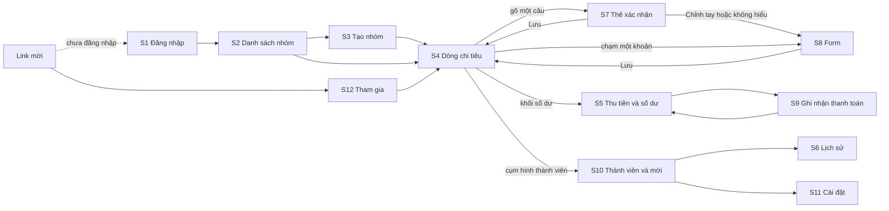
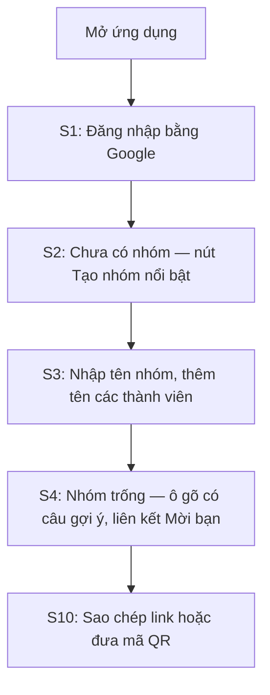
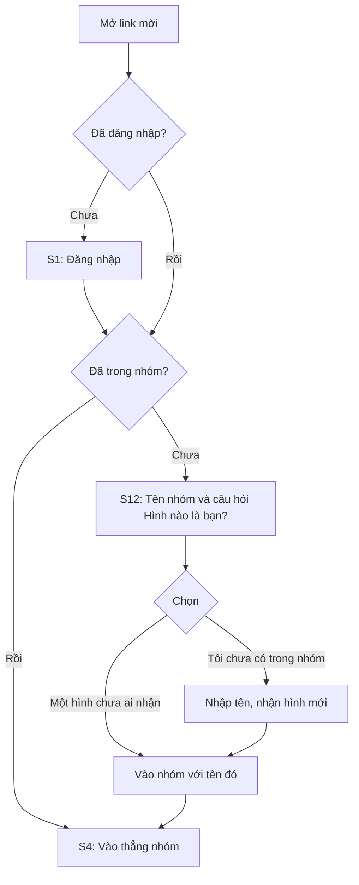
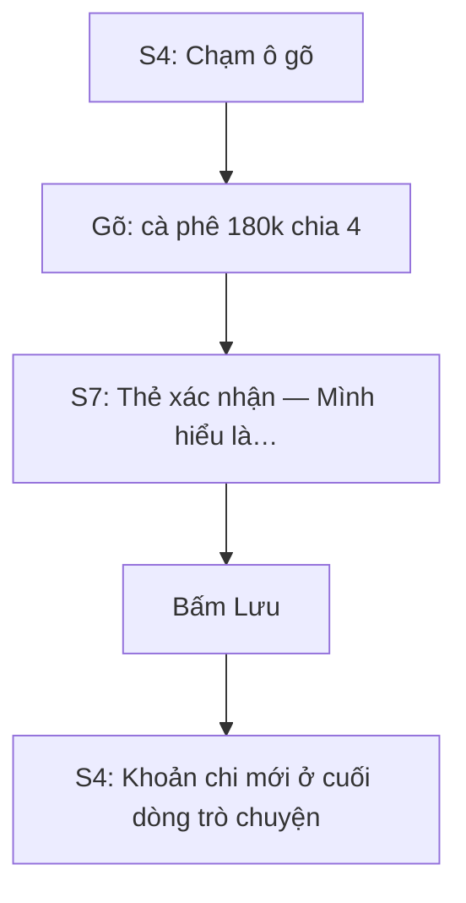
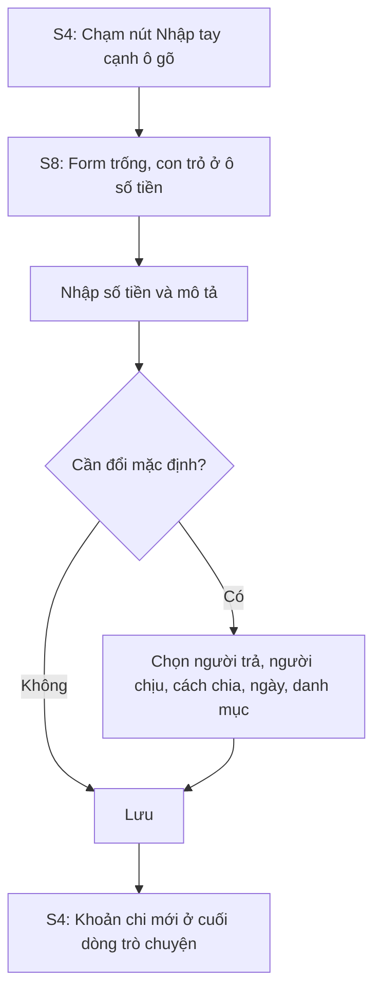
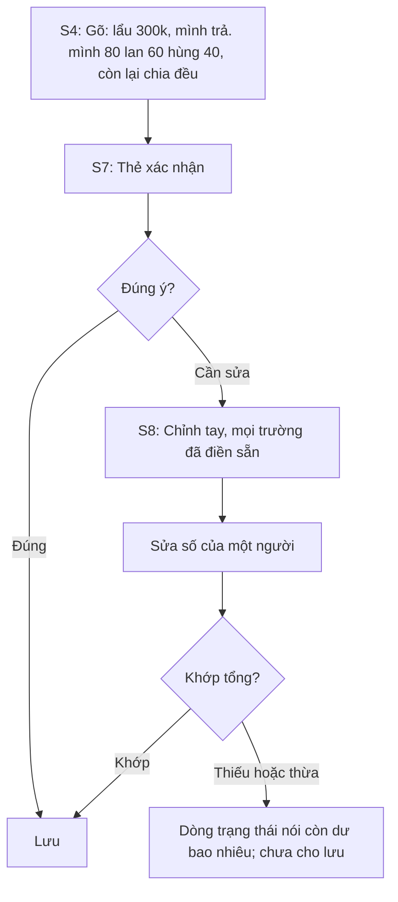
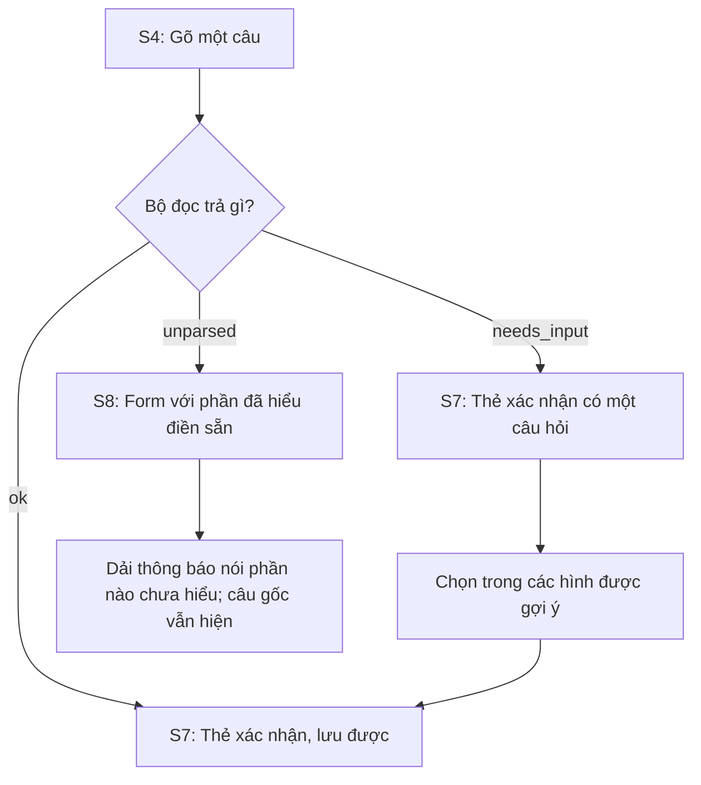
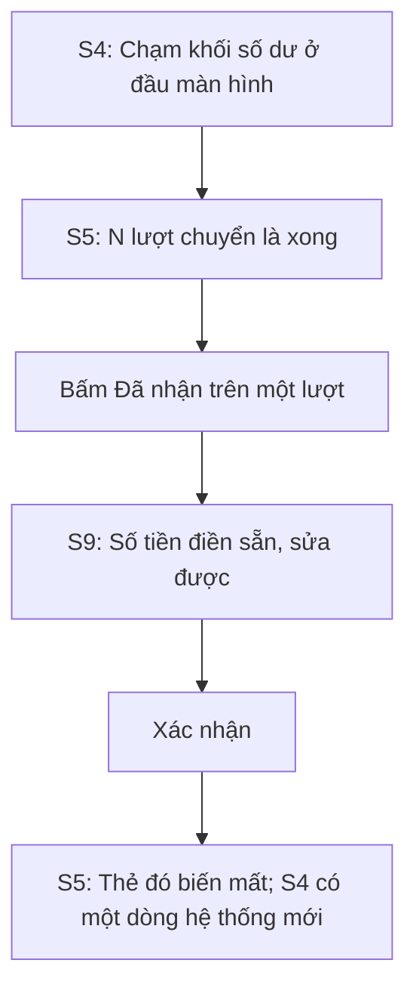
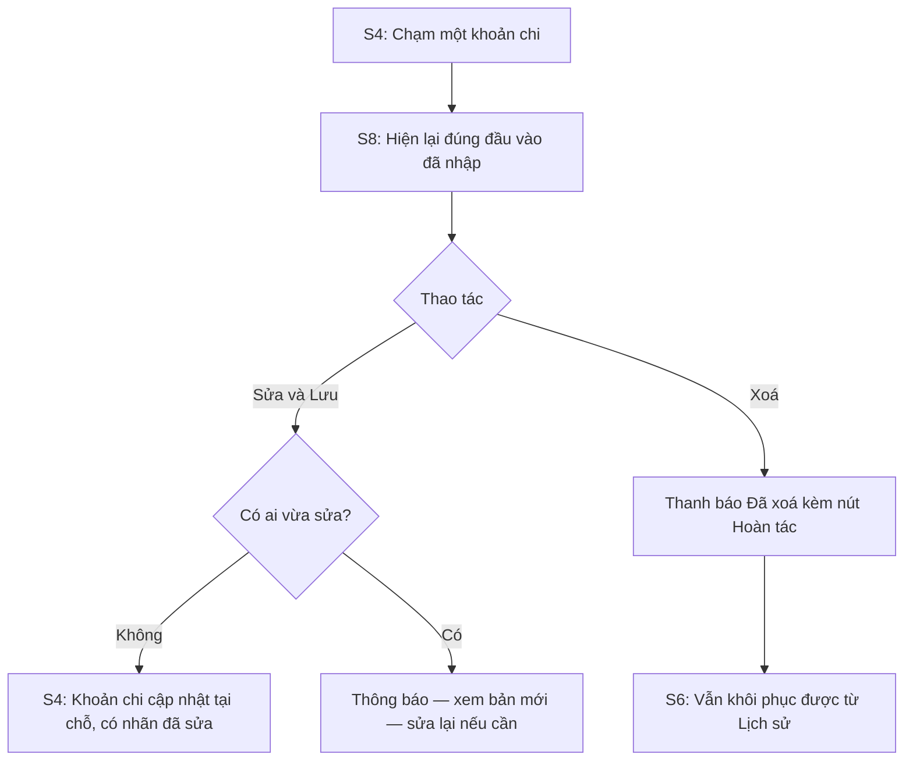

# 06 — User flow và ngôn ngữ thiết kế (giai đoạn 1)

Cập nhật: 2026-11-11. Trạng thái: bản viết lại theo hướng thiết kế "G + E", đã duyệt ngày 2026-11-11. Bản trước (giao diện dạng tab và form) đã duyệt ngày 2026-11-11 và được thay bằng bản này.

Tài liệu mô tả đường đi của người dùng qua các màn hình và các quy tắc thiết kế chung. Hình ảnh nằm trên [canvas thiết kế](https://claude.ai/artifact/VEWSdwY25ULTJUSM1pBH5X), hàng "Vòng 3" đến "Vòng 5". File [mockups.html](mockups.html) là bản cũ, chỉ giữ để tham khảo.

## 1. Ý tưởng thiết kế

Hướng "G + E" ghép hai ý:

- **G — Trò chuyện.** Sổ chi tiêu của nhóm là một dòng trò chuyện. Thêm khoản chi là gõ một câu vào ô ở đáy màn hình, như nhắn tin.
- **E — Biểu cảm.** Mỗi thành viên có một hình và một màu riêng; chữ số rất lớn; hình to nhỏ theo số tiền.

Ba điểm làm ứng dụng khác các ứng dụng chia tiền khác:

1. **Gõ hoặc nhập tay, tuỳ người.** Gõ một câu rồi Lưu; hoặc chạm nút Nhập tay cạnh ô gõ để điền form. Hai cách cho ra cùng một khoản chi.
2. **Thấy ứng dụng hiểu gì.** Từng cụm từ trong câu được tô màu theo loại, và thẻ xác nhận nói lại bằng con số. Không có gì được lưu do đoán.
3. **Người là hình.** Hình của một người giống nhau ở mọi nơi, nên nhìn lướt là biết khoản nào của ai, ai chịu phần lớn hơn.

## 2. Danh sách màn hình

| Mã | Màn hình | Đường dẫn | Ai vào được | Trên canvas |
|---|---|---|---|---|
| S1 | Đăng nhập | `/login` | Mọi người | GE7 |
| S2 | Danh sách nhóm | `/` | Đã đăng nhập | GE1 |
| S3 | Tạo nhóm | `/groups/new` | Đã đăng nhập | GE8 |
| S4 | Nhóm — dòng chi tiêu | `/g/{id}` | Thuộc nhóm | GE2; trống GE14; mất mạng GE17 |
| S5 | Thu tiền và số dư | `/g/{id}/balances` | Thuộc nhóm | GE5; người cần trả GE13; đã xong GE18 |
| S6 | Lịch sử thay đổi | `/g/{id}/activity` | Thuộc nhóm | GE10 |
| S7 | Gõ khoản chi — thẻ xác nhận | `/g/{id}/tx/new` | Đọc-ghi | GE3; hỏi lại GE15 |
| S8 | Chỉnh tay (form thêm hoặc sửa) | `/g/{id}/tx/new?form`, `/g/{id}/tx/{txId}` | Đọc-ghi | Form trống GE19; cách chia GE4; câu chưa đọc được GE16 |
| S9 | Ghi nhận thanh toán | `/g/{id}/settle` | Đọc-ghi | GE12 |
| S10 | Thành viên và lời mời | `/g/{id}/members` | Thuộc nhóm; sửa cần đọc-ghi | GE9 |
| S11 | Cài đặt nhóm | `/g/{id}/settings` | Chủ nhóm | GE11 |
| S12 | Tham gia nhóm | `/join/{token}` | Đã đăng nhập | GE6 |

So với bản trước: ba tab Giao dịch, Số dư, Lịch sử không còn. S4 là màn hình chính của nhóm; S5 mở từ khối số dư ở đầu S4; S6, S10 và S11 mở từ cụm hình thành viên ở góc trên S4.

## 3. Sơ đồ điều hướng

## 4. Các luồng chính

### Luồng A — Lần đầu: tạo nhóm và mời bạn (US-1.1, 1.2, 1.3)

- Ở S3, người tạo đã là thành viên đầu tiên với tên lấy từ Google. Mỗi tên gõ thêm lập tức hiện ra thành một hình mới (FR-1.25), để người tạo thấy nhóm thành hình ngay.
- Thêm thành viên ở bước này là tuỳ chọn.

### Luồng B — Tham gia qua link mời (US-1.4)

- Sau khi đăng nhập, người dùng quay lại đúng link mời.
- Hình có tên trùng tên tài khoản Google được chọn sẵn, kèm dòng "trùng tên tài khoản của bạn".
- Hình đã có người nhận bị mờ và không chọn được.
- Khi một hình đang được chọn, S12 hiện số dư hiện tại của thành viên đó, để người tham gia biết mình đang nhận vai nào.
- Link sai hoặc đã tắt: trang giải thích, gợi ý xin link mới từ chủ nhóm.

### Luồng C — Gõ một khoản chi chia đều (US-1.20, 1.22)

- Trong lúc gõ, các cụm đã hiểu được tô màu ngay trong ô gõ: số tiền vàng, người trả xanh dương, phần chia xanh lá, phần còn lại tím. Màu luôn đi kèm vị trí và nhãn trên thẻ, không phải tín hiệu duy nhất.
- Thẻ xác nhận nói lại: mô tả, tổng tiền, ai trả, và hình của từng người chịu với số tiền bên dưới. Dòng "Chưa có gì được lưu" luôn hiện cho đến khi bấm Lưu.
- Người không có trong khoản chi được nêu tên ("Thu không có trong khoản này").

### Luồng C2 — Nhập tay một khoản chi (US-1.5)

- Form gồm, từ trên xuống: loại giao dịch (Chi, Chuyển, Thu), số tiền, mô tả, danh mục, "Ai trả?", "Chia cho ai?", ngày giờ và nút Lưu. Mọi thứ nằm trên một màn hình, không cuộn ở nhóm tới bốn người.
- Mặc định như FR-1.41: bạn trả, chia đều cho mọi người, bây giờ. Khoản chia đều chỉ cần ba thao tác: số tiền, mô tả, Lưu.
- "Ai trả?" và "Chia cho ai?" là hai hàng hình; chạm để chọn hoặc bỏ. Dưới mỗi hình ở hàng "Chia cho ai?" là số tiền người đó chịu, cập nhật theo từng thay đổi.
- Nút "đổi cách chia" mở màn hình cách chia (GE4) cho chia theo số tiền, phần, phần trăm.
- Chuyển khoản và thu nhập chỉ tạo được ở đây, bằng nút loại giao dịch ở đầu form.

### Luồng D — Gõ một hoá đơn chia không đều (US-1.21, 1.6, 1.7)

- Trên thẻ xác nhận, hình của mỗi người to nhỏ theo phần họ chịu. Kích thước có giới hạn dưới để hình nhỏ nhất vẫn đọc được chữ.
- Ở S8, bốn cách chia là bốn nút: Đều, Số tiền, Phần, Phần trăm. Chế độ Số tiền hiện hàng hình ở trên và ô số cho từng người ở dưới. Hai phần luôn khớp nhau.
- **Bơm hình:** giữ một hình để tăng phần của người đó; phần của những người còn lại giảm theo tỉ lệ để tổng không đổi. Đây là cách chỉnh nhanh bằng ngón tay; ô số bên dưới là cách chỉnh chính xác và là cách duy nhất cần cho bàn phím và trình đọc màn hình.
- Dòng trạng thái ở đáy S8 có ba dạng: "Khớp 300.000 đ", "Còn dư 20.000 đ", "Vượt 20.000 đ". Chỉ dạng đầu cho phép lưu.

### Luồng E — Câu không đọc được (US-1.22)

- Ví dụ `needs_input`: nhóm có Minh Anh và Minh Đức, câu ghi "minh trả" — thẻ hỏi "Minh nào?" với hai hình. Hoặc "chia 3" trong nhóm bốn người — thẻ hỏi "Ba người nào?".
- Ví dụ `unparsed`: không có số tiền; các phần riêng cộng lại khác tổng mà không có "còn lại chia đều".
- Không có trường hợp nào ứng dụng tự chọn hộ rồi lưu.
- Người không muốn gõ câu dùng nút Nhập tay cạnh ô gõ (luồng C2). Nút này màu vàng, có chữ, đứng riêng bên trái ô gõ và cao bằng ô gõ.

### Luồng F — Xem nợ và thu tiền (US-1.10, 1.11, 1.12)

- Khối số dư ở đầu S4 đổi theo người xem: "Bạn được nhận 450.000 đ" với nút Thu về; "Bạn cần trả 250.000 đ" với nút Trả; hoặc "Bạn đã xong" khi số dư bằng 0.
- S5 đưa các lượt chuyển liên quan đến người xem lên đầu. Người cần trả thấy "Bạn trả Minh" với nút Đã trả; người được nhận thấy "Hùng trả bạn" với nút Đã nhận.
- Dưới các lượt chuyển là "Cán cân của nhóm": mỗi người một thanh, bên phải là được nhận, bên trái là cần trả, kèm con số có dấu.
- Khi mọi số dư bằng 0, S5 hiện trạng thái "Cả nhóm đã xong".

### Luồng G — Sửa, xoá, khôi phục (US-1.13, 1.14)

Khoản chi tạo bằng câu gõ và khoản chi tạo bằng form mở ra cùng một màn hình sửa; câu gõ gốc không được lưu lại.

### Luồng H — Quản lý thành viên và quyền (US-1.15, 1.19)

- Từ S10, người đọc-ghi thêm thành viên, đổi tên, cho ngừng hoạt động. Hình và màu của một thành viên không đổi khi đổi tên.
- Chủ nhóm thấy thêm: vai trò của từng người dùng, nút gỡ khỏi nhóm, nút tắt link và tạo link mới.
- Cho ngừng hoạt động một thành viên còn số dư khác 0 sẽ hiện cảnh báo, nhưng vẫn cho thực hiện.

## 5. Dòng chi tiêu (S4)

| Loại dòng | Vị trí | Nội dung |
|---|---|---|
| Khoản người xem trả | Bên phải, nền đen | Mô tả, tổng tiền, hàng hình nhỏ kèm phần của từng người (nghìn đồng) |
| Khoản người khác trả | Bên trái, nền trắng, có hình người trả | "Lan trả", mô tả, tổng tiền, cách chia và phần của người xem |
| Chuyển khoản | Giữa, dạng viên nhỏ | "Thu đã chuyển cho bạn 200.000 đ" |
| Thay đổi khác | Giữa, dạng viên nhỏ | "Minh đã sửa Vé cáp treo", "Hùng đã vào nhóm" |
| Ngăn ngày | Giữa | "Hôm nay", "Hôm qua", ngày tháng |

- Thứ tự: cũ ở trên, mới ở dưới, như một cuộc trò chuyện; mở nhóm là thấy các khoản mới nhất ngay trên ô gõ. Cuộn lên để tải khoản cũ hơn. (FR-1.47 quy định thứ tự theo ngày giờ; chiều hiển thị được chọn ở đây.)
- Thành viên không có tài khoản, như bác Hùng, không có "phía" riêng: khoản do họ trả nằm bên trái với hình của họ, dù ai là người gõ.
- Dòng trên ô gõ là các lối tắt. Ở giai đoạn 1 chỉ có "Ai nợ ai?" (mở S5) và "Mời bạn" (mở S10).

## 6. Ngôn ngữ thiết kế

**Hình và màu của thành viên (FR-1.25)**

| Mã hình | Mô tả | | Mã màu | Giá trị |
|---|---|---|---|---|
| `circle` | Tròn | | `mint` | `#9EEBC0` |
| `diamond` | Vuông bo góc 24%, xoay 45° | | `sky` | `#9CCBFF` |
| `squircle` | Vuông bo góc 38% | | `coral` | `#FF8A73` |
| `leaf` | Bo hai góc đối 50%, hai góc kia 10% | | `lilac` | `#D3B8FF` |

Bốn hình và bốn màu trên là bộ đã dùng trong mockup. Nhóm có thể tới 100 thành viên, nên bộ cần mở rộng (dự kiến 6 hình × 8 màu) trước mốc 1A; khi hết cặp thì dùng lại, và tên luôn đi kèm hình ở những nơi cần phân biệt chắc chắn. Chữ cái đầu của tên nằm trong hình ở kích thước từ 44 điểm trở lên.

**Màu nền và chữ**

| Vai trò | Giá trị |
|---|---|
| Nền trang | `#F6F2FB` |
| Nền thẻ | `#FFFFFF` |
| Chữ chính, nút chính | `#1C1B22` |
| Chữ phụ | `#5A5766` |
| Nhấn (số dư, nút Lưu) | `#FFD84D` |
| Tô cụm từ: số tiền, người trả, phần chia, phần còn lại | `#FFE99A`, `#CFE3FF`, `#CFF5DF`, `#E7D9FF` |

**Chữ:** Be Vietnam Pro. Con số chính của mỗi màn hình dùng độ đậm 900, cỡ 34–60 điểm, giãn chữ âm. Mỗi màn hình chỉ có một con số ở cỡ đó.

**Hình khối:** bo góc lớn (thẻ 26–40 điểm, nút là viên thuốc); không viền, không đổ bóng; phân lớp bằng màu nền. Viền đen 3 điểm chỉ dùng cho thứ đang được chọn hoặc đang nhập.

**Chuyển động** (chưa thể hiện trên mockup tĩnh; cần dựng thử trước mốc 1A)

| Chỗ | Chuyển động |
|---|---|
| Hình đổi kích thước theo số tiền | Co giãn kiểu lò xo, khoảng 300 ms |
| Cụm từ được hiểu trong ô gõ | Màu nền loang từ trái sang, khoảng 150 ms |
| Lưu khoản chi | Thẻ xác nhận thu lại thành một dòng trong dòng chi tiêu |
| Một lượt chuyển được ghi nhận | Thẻ thu nhỏ rồi biến mất; con số ở khối số dư đếm về giá trị mới |

Khi hệ điều hành bật "giảm chuyển động", mọi chuyển động trên được thay bằng đổi trạng thái tức thì.

## 7. Trạng thái của mỗi màn hình

| Trạng thái | Hành vi |
|---|---|
| Đang tải | Khung xương của nội dung, không dùng vòng xoay toàn màn hình |
| Trống | Giải thích ngắn và một hành động chính |
| Có dữ liệu | Bình thường |
| Lỗi | Thông điệp bằng lời thường và nút thử lại |
| Ngoại tuyến | Dải thông báo ở đầu trang; dữ liệu cũ vẫn hiện; ô gõ và nút ghi bị vô hiệu kèm lời giải thích |

**Trạng thái trống cụ thể**

| Màn hình | Nội dung |
|---|---|
| S2 | "Bạn chưa có nhóm nào" — nút Tạo nhóm |
| S4 | Các hình của thành viên xếp giữa màn hình, câu "Gõ khoản chi đầu tiên" và ba câu mẫu chạm được để điền vào ô gõ; liên kết Mời bạn |
| S5 | "Chưa có gì để tính" khi chưa có giao dịch; "Cả nhóm đã xong" khi mọi số dư bằng 0 |
| S6 | "Chưa có thay đổi nào" |

## 8. Quy tắc tương tác

- **Vùng chạm** tối thiểu 44×44 điểm; ô gõ và nút chính nằm ở đáy màn hình, trong tầm ngón cái.
- **Nhập tiền trong form:** bàn phím số; tự chèn dấu chấm phân cách hàng nghìn; có phím tắt `000`.
- **Hiển thị tiền:** `150.000 đ`. Trong hàng hình nhỏ của dòng chi tiêu, phần của từng người viết gọn theo nghìn đồng (`120`); mọi nơi khác viết đủ.
- **Số dư:** luôn kèm chữ "được nhận" hoặc "cần trả", hoặc dấu cộng trừ. Không chỉ dựa vào màu hay phía của thanh.
- **Hình không thay tên:** ở nơi có hành động về tiền (thẻ xác nhận, lượt chuyển, form), hình luôn đi kèm tên.
- **Xác nhận:** chỉ hỏi lại với thao tác không hoàn tác được (xoá nhóm, gỡ người). Xoá giao dịch dùng hoàn tác thay cho hỏi lại.
- **Quyền chỉ đọc:** ô gõ được thay bằng nhãn "Chỉ xem"; không hiện nút thêm và sửa.
- **Cập nhật realtime:** dòng mới xuất hiện ở cuối có hiệu ứng nhẹ. Nếu người xem đang cuộn lên đọc khoản cũ thì không tự cuộn; hiện một viên "Có khoản mới" để chạm xuống.
- **Bàn phím và trình đọc màn hình:** mọi thao tác bằng cử chỉ (bơm hình) đều có cách tương đương bằng ô nhập. Hình của thành viên được đọc bằng tên, không đọc tên hình.

## 9. Phần có trên mockup nhưng chưa thuộc giai đoạn 1

| Phần tử trên canvas | Màn hình | Thuộc | Ở giai đoạn 1 |
|---|---|---|---|
| Nút chụp hoá đơn trong ô gõ | GE2 | Giai đoạn 3 (FR-3.2) | Ẩn |
| Nút nói trong ô gõ | GE2 | Chưa xếp giai đoạn | Thay bằng nút gửi |
| Lối tắt "Nhắc Hùng", nút Nhắc, "Nhắc cả nhóm một lần" | GE2, GE5 | Giai đoạn 4 (FR-4.7) | Ẩn |
| Lối tắt "Tổng chuyến đi" | GE2 | Giai đoạn 2 (FR-2.6) | Ẩn |
| "Thu báo đã chuyển" và nút Xác nhận | GE5 | Giai đoạn 2 (FR-2.4) | Không có; chỉ có Đã nhận và Đã trả |

## 10. Việc thiết kế còn lại

- Dựng các trạng thái chưa có: đang tải, lỗi, chỉ đọc; trạng thái trống của S2, S5 và S6; trang link mời sai hoặc đã tắt; hộp xác nhận xoá nhóm.
- Dựng lại GE2 và GE5 đúng phạm vi giai đoạn 1 (bỏ các phần ở mục 9). GE17 đã là dòng chi tiêu đúng phạm vi, nhưng ở trạng thái mất mạng.
- Mở rộng bộ hình và màu; kiểm tra độ tương phản của chữ trên từng màu.
- Dựng thử chuyển động ở mục 6.
- Bố cục cho màn hình rộng (máy tính): chưa thiết kế.
