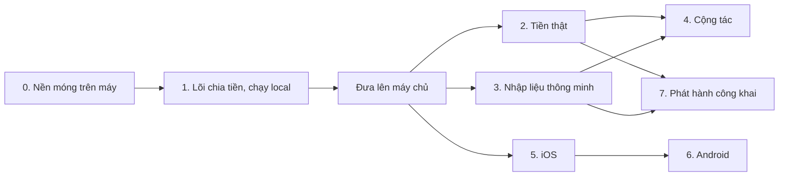

# 07 — Product Roadmap

Cập nhật: 2026-11-11. Trạng thái: đã duyệt ngày 2026-11-11; bản sửa đổi cùng ngày (thêm mốc 1D ô gõ nhanh, mốc cũ 1D thành 1E, đổi 3D) đã duyệt; bản sửa đổi thứ hai (phát triển trên máy local trước, hạ tầng tách thành bước riêng sau giai đoạn 1) đã duyệt. Bản sửa đổi thứ ba (nội bộ trước, phát hành công khai sau; đăng ký bằng email) đã duyệt.

Roadmap xếp thứ tự công việc và định nghĩa khi nào một giai đoạn được coi là xong. Nó **không có ngày tháng**: thời lượng phụ thuộc vào số giờ mỗi tuần dành cho dự án, điều chưa được xác định. Cột "Khối lượng" là ước lượng tương đối để so sánh giữa các giai đoạn (S nhỏ, M vừa, L lớn, XL rất lớn), với giai đoạn 1 trước khi thêm ô gõ nhanh là mốc chuẩn L.

## 1. Toàn cảnh

| Giai đoạn | Mục tiêu một câu | Khối lượng | Phụ thuộc |
|---|---|---|---|
| 0. Nền móng | Có bộ tài liệu được duyệt và một khung dự án chạy được trên máy của người phát triển | S | — |
| 1. Lõi chia tiền | App đủ hình dạng và đủ tính năng lõi, chạy trên máy local | L + S | 0 |
| Đưa lên máy chủ | Một nhóm bạn dùng được thật cho một chuyến đi | S | 1 |
| 2. Tiền thật | Trả nợ bằng quét QR; quản lý quỹ; biết tiền đi đâu | L | 1 |
| 3. Nhập liệu thông minh | Chụp hoá đơn là xong | L | 1 |
| 4. Cộng tác | Trao đổi và thêm chi tiêu ngay trong nhóm chat | M | 2, 3 |
| 5. iOS | App iPhone native | XL | 1; nên sau 2 |
| 6. Android | App Android native | L | 5 |
| 7. Phát hành công khai | Người lạ đăng ký và dùng được một cách an toàn | L | Đưa lên máy chủ; nên sau 2 và 3 |

Giai đoạn 2 và 3 độc lập với nhau, có thể đổi thứ tự. Giai đoạn 5 có thể bắt đầu sớm hơn nếu app iPhone quan trọng hơn các tính năng nâng cao, với điều kiện hợp đồng API của giai đoạn 1 đã ổn định.

## 2. Quy trình cho mỗi giai đoạn

Mỗi giai đoạn đi qua cùng năm bước; không viết code trước khi bước 2 được duyệt.

| Bước | Sản phẩm |
|---|---|
| 1. Khảo sát | Trả lời các câu hỏi mở của giai đoạn (xem PRD mục 7); thử nghiệm kỹ thuật nếu cần |
| 2. Tài liệu | SRS, thiết kế database và API, user flow và mockup cho giai đoạn đó; cập nhật SAD và ADR nếu kiến trúc thay đổi |
| 3. Kế hoạch triển khai | Danh sách công việc theo thứ tự, mỗi việc có bước tự chạy thử và danh sách kiểm tay |
| 4. Xây dựng | Agent viết code theo `AGENTS.md`; cố vấn review từng commit; chủ dự án kiểm tay |
| 5. Phát hành và dùng thử | Đưa lên production, dùng với nhóm thật, ghi nhận phản hồi vào danh sách chờ |

## 3. Chi tiết từng giai đoạn

### Giai đoạn 0 — Nền móng

Toàn bộ giai đoạn này chạy trên máy của người phát triển. Không cần máy chủ, tên miền hay tài khoản dịch vụ nào.

**Sản phẩm**
- Bộ tài liệu 01–07 được duyệt.
- Kho mã monorepo với cấu trúc trong SAD; kiểm tra kiểu và lint chạy được.
- Luật làm việc cho agent (`AGENTS.md`), quy ước code và skill.
- Một lệnh khởi động tất cả trên máy: Postgres (chạy bằng Docker), API và web.
- API trả lời endpoint kiểm tra sức khoẻ; web hiện một trang; cả hai kết nối được với Postgres.
- **Đăng nhập thử:** một trang chỉ có ở môi trường phát triển, chọn một trong vài người dùng mẫu (Minh, Lan, Hùng, Thu) để vào app. Nó dùng cùng cơ chế phiên với đăng nhập thật, nên phần còn lại của app không biết sự khác biệt. Nhờ đó thử được nhiều người cùng lúc bằng hai cửa sổ trình duyệt.
- Bộ màu, chữ và hình của hướng G + E được dựng thành thành phần giao diện dùng chung.

**Tiêu chí hoàn thành:** chạy một lệnh, mở `localhost` trên trình duyệt, chọn "Minh", thấy màn hình danh sách nhóm trống đúng thiết kế.

**Cần chuẩn bị:** Node.js và Docker trên máy. Không gì khác.

### Giai đoạn 1 — Lõi chia tiền

Phạm vi: toàn bộ [03 — SRS](03-srs.md) mục 2. Mọi mốc đều phát triển và thử trên máy local. Chia thành năm mốc, mỗi mốc dùng được:

| Mốc | Nội dung | SRS | Dùng được để |
|---|---|---|---|
| 1A | Nhóm, thành viên, chi tiêu chia đều, số dư, lượt chuyển tối giản | FR-1.10–1.12, 1.20–1.23, 1.25, 1.40, 1.41, 1.47–1.50, 1.60–1.62 | Một người tự ghi sổ cho cả nhóm |
| 1B | Link mời, tham gia, ba vai trò, realtime | FR-1.24, 1.30–1.36, 1.14, 1.80–1.82 | Cả nhóm cùng dùng |
| 1C | Bốn cách chia, nhiều người trả, chuyển khoản, thu nhập, ghi nhận thanh toán | FR-1.42–1.44, 1.51–1.56, 1.63, 1.64 | Mọi tình huống chia tiền thực tế |
| 1D | Ô gõ nhanh: bộ đọc theo quy tắc, thẻ xác nhận, chuyển sang form khi không hiểu | FR-1.90–1.100 | Ghi một khoản chi bằng một câu |
| 1E | Sửa, xoá, khôi phục, lịch sử, xoá nhóm; hoàn thiện trạng thái trống, lỗi, ngoại tuyến | FR-1.13, 1.45, 1.46, 1.70, 1.71, NFR còn lại | Dùng lâu dài, sửa sai an toàn |

Màn hình nhóm dạng dòng trò chuyện và hình của thành viên (FR-1.25) có từ mốc 1A; ở 1A–1C ô ở đáy màn hình mở form. Mốc 1D đứng sau 1C vì bộ đọc cần đủ các cách chia. Nếu giai đoạn 1 kéo dài, 1D là mốc lùi được sau 1E mà không ảnh hưởng mốc nào khác.

**Đăng nhập** (FR-1.1–1.9) làm ở mốc 1B, khi có lời mời và nhiều người dùng: Google, và email kèm mật khẩu. Trên máy local, thư xác minh và thư đặt lại mật khẩu in ra console, nên không cần dịch vụ gửi thư. Google cho phép đăng nhập thử trên `localhost` mà không cần tên miền; việc cần làm là tạo một ứng dụng OAuth miễn phí trên Google Cloud Console, mất khoảng mười phút. Đây cũng là lúc xác nhận thư viện đăng nhập (ADR-007). Trang đăng nhập thử vẫn được giữ cho việc phát triển và test.

**Tiêu chí hoàn thành**
- Mọi yêu cầu P0 và P1 của giai đoạn 1 trong PRD đạt, kiểm trên máy local.
- Bất biến về tiền và bảng quyền được chủ dự án kiểm tay theo danh sách kiểm của từng mốc (ADR-016).
- Đi trọn một chuyến đi mẫu trên máy local bằng nhiều người dùng: tạo nhóm, mời, gõ và nhập tay các khoản chi, sửa, xoá, thanh toán hết nợ.

### Đưa lên máy chủ

Làm sau khi giai đoạn 1 đã chạy tốt trên máy local, và chỉ khi muốn người khác dùng thật. Trước thời điểm đó không cần động tới hạ tầng.

**Sản phẩm**
- Docker Compose chạy trên VM Ubuntu sẵn có, với tên miền và HTTPS.
- Đăng nhập Google hoạt động trên tên miền thật; trang đăng nhập thử bị tắt ở môi trường này.
- Một dịch vụ gửi thư cho xác minh email và đặt lại mật khẩu.
- Đăng ký ở chặng nội bộ: mở, nhưng địa chỉ ứng dụng chưa được công bố.
- Sao lưu database hằng đêm ra ngoài VM, đã khôi phục thử một lần.

**Cần chuẩn bị:** tên miền; nơi lưu sao lưu ngoài VM.

**Tiêu chí hoàn thành:** một chuyến đi hoặc một tháng chi tiêu thật được ghi trọn vẹn bằng ứng dụng, không lần nào phải sửa dữ liệu trực tiếp trong database.

### Giai đoạn 2 — Tiền thật

Phạm vi: FR-2.1 đến 2.9.

| Mốc | Nội dung |
|---|---|
| 2A | Thông tin nhận tiền của thành viên; mã VietQR trên mỗi lượt chuyển; xác nhận đã nhận |
| 2B | Thống kê theo thời gian, danh mục, thành viên; danh mục tuỳ chỉnh; xuất CSV |
| 2C | Quỹ chung |
| 2D | Ngân sách và cảnh báo |
| 2E | Mở thẳng MoMo, ZaloPay — chỉ làm nếu khảo sát cho thấy khả thi |

**Khảo sát trước:** định dạng VietQR và danh sách mã ngân hàng; khả năng mở app ví với số tiền điền sẵn; mô hình dữ liệu của quỹ.

**Tiêu chí hoàn thành:** một lượt trả nợ thật được thực hiện bằng cách quét QR từ ứng dụng; một quỹ thật được theo dõi trọn một tháng.

### Giai đoạn 3 — Nhập liệu thông minh

Phạm vi: FR-3.1 đến 3.6.

| Mốc | Nội dung |
|---|---|
| 3A | Hạ tầng: worker, hàng đợi, lưu ảnh; đính kèm ảnh vào giao dịch |
| 3B | Đọc hoá đơn: tổng tiền, danh sách món, thuế và phí |
| 3C | Gán món cho người; phân bổ thuế và phí |
| 3D | AI đọc câu gõ mà bộ quy tắc của mốc 1D từ chối; gợi ý danh mục |

**Khảo sát trước:** thử ít nhất 30 hoá đơn thật (nhà hàng, siêu thị, viết tay) với các dịch vụ AI ứng viên; đo tỉ lệ đọc đúng tổng tiền và từng món, chi phí mỗi lượt. Quyết định dịch vụ và đặt trần chi phí hằng tháng trước khi xây.

**Tiêu chí hoàn thành:** với hoá đơn in rõ, từ lúc chụp đến lúc lưu mất dưới một phút và không phải gõ lại món nào trong phần lớn trường hợp.

### Giai đoạn 4 — Cộng tác

Phạm vi: FR-4.1 đến 4.7.

| Mốc | Nội dung |
|---|---|
| 4A | Bình luận và phản đối trên giao dịch |
| 4B | Thông báo trong ứng dụng và email; nhắc nợ |
| 4C | Bot Telegram: liên kết nhóm, thêm chi tiêu, hỏi số dư — dùng lại bộ đọc của 1D và 3D |
| 4D | Duyệt chi theo ngưỡng |
| 4E | Bot Zalo — chỉ làm nếu khảo sát cho thấy khả thi |

**Tiêu chí hoàn thành:** một nhóm thật thêm chi tiêu qua Telegram trong một tuần mà không cần mở web.

### Giai đoạn 5 — iOS

Phạm vi: FR-5.1 đến 5.5.

| Mốc | Nội dung |
|---|---|
| 5A | Ổn định hợp đồng API; sinh client Swift; đăng nhập Apple và Google |
| 5B | Các màn hình lõi của giai đoạn 1 |
| 5C | Thông báo đẩy; mở link mời vào thẳng app |
| 5D | Các tính năng giai đoạn 2–4 đã có trên web tại thời điểm đó; chụp hoá đơn bằng camera |
| 5E | Phát hành qua TestFlight |

**Cần chuẩn bị:** tài khoản Apple Developer (có phí hằng năm).

**Tiêu chí hoàn thành:** nhóm dùng thử cài qua TestFlight và dùng hằng ngày thay cho web.

### Giai đoạn 6 — Android

Phạm vi: FR-6.1. Cấu trúc mốc như giai đoạn 5, dùng client Kotlin sinh từ cùng file OpenAPI. Phát hành bằng file cài trực tiếp hoặc kênh thử nghiệm nội bộ của Google Play.

### Giai đoạn 7 — Phát hành công khai

Mở ứng dụng cho bất kỳ ai ở Việt Nam, miễn phí. Điều kiện vào: chủ dự án đã tự dùng thử và quyết định mở.

| Mốc | Nội dung |
|---|---|
| 7A | Nhận diện cho tên "Sòng Phẳng" (logo, biểu tượng app), tên miền chính thức, trang giới thiệu |
| 7B | Điều khoản sử dụng, chính sách quyền riêng tư; rà soát theo quy định bảo vệ dữ liệu cá nhân của Việt Nam; xuất dữ liệu cá nhân |
| 7C | Chống lạm dụng: giới hạn tần suất toàn hệ thống, chặn đăng ký hàng loạt, giới hạn số nhóm và thành viên mỗi tài khoản |
| 7D | Vận hành: giám sát và cảnh báo, theo dõi lỗi, sao lưu có kiểm tra định kỳ, kế hoạch khôi phục; xem lại các giới hạn ở SAD mục 10 |
| 7E | Rà soát bảo mật độc lập trước khi mở |

**Tiêu chí hoàn thành:** một người lạ tìm thấy ứng dụng, đăng ký, tạo nhóm và mời bạn mà không cần ai hỗ trợ; không có sự cố dữ liệu trong tháng đầu.

## 4. Danh sách chờ

Các ứng viên chưa xếp giai đoạn. Sau mỗi giai đoạn, xem lại danh sách này cùng phản hồi dùng thật để quyết định đưa gì vào giai đoạn kế.

| Ứng viên | Ghi chú |
|---|---|
| Đa tiền tệ với tỉ giá theo giao dịch | Chỉ phát hành ở Việt Nam nên ưu tiên thấp; vẫn có ích cho chuyến đi nước ngoài; mô hình dữ liệu đã chừa chỗ |
| Giao dịch định kỳ | Hợp với tình huống ở chung nhà; cần worker của giai đoạn 3 |
| Tìm kiếm và lọc giao dịch | Hợp lý để ghép vào 2B |
| Lưu trữ và nhân bản nhóm | Nhỏ; ghép vào giai đoạn nào cũng được |
| Ghi được khi mất mạng | Thay đổi lớn về kiến trúc client; chỉ làm nếu thực tế cho thấy cần |
| Nhóm lồng nhau | Chưa rõ nhu cầu |
| Widget màn hình chính | Sau giai đoạn 5 |

## 5. Điểm quyết định

| Thời điểm | Câu hỏi | Ảnh hưởng |
|---|---|---|
| Mốc 1B | Thư viện đăng nhập có đáp ứng cả web và mobile không? | ADR-007 |
| Cuối giai đoạn 1 | Đưa lên máy chủ ngay, hay làm tiếp tính năng trên máy local? | Thứ tự roadmap |
| Cuối mốc 1D | Câu gõ thật có khớp bộ quy tắc không? Mẫu nào cần thêm, mẫu nào để AI? | Phạm vi 3D |
| Cuối giai đoạn 1 | Làm giai đoạn 2, 3 hay 5 tiếp theo? | Thứ tự roadmap |
| Cuối giai đoạn 1 | Có cần đa tiền tệ sớm không? | Danh sách chờ |
| Cuối giai đoạn 1 | Giai đoạn 7 đứng trước hay sau iOS? | Thứ tự roadmap |
| Trước bước đưa lên máy chủ | Đăng ký tên miền `songphang` và tra nhãn hiệu "Sòng Phẳng" | Mốc 7A; tên miền dùng ngay từ chặng nội bộ |
| Trước giai đoạn 3 | Dịch vụ AI nào, trần chi phí bao nhiêu? | Phạm vi 3B |
| Trước giai đoạn 5 | Hợp đồng API đã đủ ổn định để ba client cùng phụ thuộc chưa? | Chính sách phiên bản API |

## 6. Rủi ro về tiến độ

| Rủi ro | Dấu hiệu | Ứng phó |
|---|---|---|
| Giai đoạn 1 kéo dài vì cầu toàn | Mốc 1A chưa dùng được sau thời gian dài | Phát hành 1A cho chính mình dùng trước; hoàn thiện ở 1E |
| Tính năng mới chen vào giữa giai đoạn | Phạm vi SRS thay đổi sau khi duyệt | Ghi vào danh sách chờ; chỉ xem lại ở cuối giai đoạn |
| Hoãn hạ tầng quá lâu, đến lúc đưa lên máy chủ mới lộ vấn đề | App chỉ chạy được trên máy phát triển | Dùng cùng Postgres và cùng Docker Compose ở local và máy chủ; cấu hình đọc từ biến môi trường ngay từ đầu |
| Tích hợp bên ngoài không khả thi | Khảo sát cho kết quả xấu | Các mốc 2E, 4E đã được đánh dấu là tuỳ chọn |
| Làm ba client khiến mỗi tính năng tốn gấp ba | Tốc độ ra tính năng giảm mạnh sau giai đoạn 5 | Giữ logic ở server; cân nhắc tính năng nào chỉ cần có trên web |

## 7. Amendment 2026-11-12 — phase 1 in one run

Approved by the project owner. Where this section differs from the text above, this section applies.

- Phase 1 (1A–1E) is built in one agent run on the branch `phase-1`, following `docs/superpowers/specs/2026-11-12-phase-1-single-run-design.md` and ADR-018. Section 2, step 4 becomes: the agent builds the whole phase; the advisor reviews the branch; the owner checks by hand once.
- FR-1.63 (pairwise debts when "Gộp nợ" is off) moves from 1C to 1A.
- Google sign-in is written in 1B without real credentials and stays unverified until the owner creates the OAuth app. The sign-in library decision point of section 5 is closed by ADR-017.
- Moved to the waiting list: "bơm hình" (hold a shape to grow a share); activity lines inside the expense stream. The 6 × 8 member palette and the desktop layout remain design work.

## 8. Amendment 2026-11-24 — UI/UX v2 & Core Product Depth before launch (Phase 5.5)

Approved by the project owner on 2026-11-24. Where this section differs from the sequence in earlier sections or `docs/superpowers/specs/2026-11-15-roadmap-remaining-phases-overview.md` §2, this section applies.

1. **Baseline status:** Phases 0–5 (including native iOS parity in `apps/ios/`) are merged on `main` (`378df4d`, PR #2). Physical iPhone acceptance surfaced layout and UX technical debt (`TD-001`–`TD-007` in `docs/tech-debt.md`) and missing bundled `Be Vietnam Pro` `.ttf`/`.otf` font files for iOS.
2. **Revised post-Phase-5 execution sequence:**
   - **Wave 5.5A (`phase-5-5a`):** UI/UX v2, Design System v2 (Light + Dark Mode, bundled `Be Vietnam Pro` `.ttf` fonts), technical debt resolution (`TD-001`, `TD-003`–`TD-007`), iOS 4-tab navigation and 3-segment group detail, dedicated Web Desktop multi-column layout, full-width transaction cards, native iOS interaction polish (Haptics, Swipe Actions, hold-to-grow "Bơm hình"), Cross-group Overview and Personal Ledger, and Group Archive & Clone.
   - **Wave 5.5B (`phase-5-5b`):** Settlement Vault (transfer proof/receipt attachment + payment channel/note, dedicated settlement history and reconciliation view), Settlement Cycles / Closeout (locking historical expenses into read-only cycles while carrying unpaid balances forward seamlessly so group balances always sum to `0`), opt-in revocable Guest Read-only Link with VietQR, and shareable Summary and "Nhắc nợ khéo" cards for Zalo/Messenger.
   - **Wave 5.5C (`phase-5-5c`):** Manual-form VAT/service fee/shipping/voucher discounts, Recurring Expenses (fixed auto-post and variable-amount reminders), Household / Couple debt grouping on settlement calculation, iOS Share Extension (import receipt or transfer proof from Zalo/Photos), and iOS Home Screen Widget & Quick Actions.
   - **Server Step (`server-step`):** Production Compose deployment on Ubuntu VM plus real external provider verification (SMTP, Google/Apple OAuth, APNs, Telegram webhook, 30-receipt AI evaluation, and TestFlight).
   - **Phase 7 — Public Release (`phase-7`):** Public v1 launch targeting **iOS + Web**.
   - **Phase 6 — Android (`phase-6`):** Built after v1 launch so Android is implemented once against the mature UI/UX v2 design system and Wave 5.5A–C feature set.
3. **Scope boundaries & product rules:**
   - **iOS-first design with 100% Web parity** for core features in each wave (plus a dedicated Web Desktop responsive layout); OS-exclusive capabilities (Haptics, Share Extension, Home Screen Widget) stay iOS-only.
   - **VND-only:** multi-currency remains on the waiting list.
   - **Server-authoritative with read-only snapshots:** offline write queue remains on the waiting list.
   - **Additive API v1:** all API and OpenAPI schema changes remain strictly additive per Phase 5A compatibility rules.
4. **References:**
   - Master overview: `docs/superpowers/specs/2026-11-24-ui-ux-v2-and-5-5-overview-design.md`
   - Wave 5.5A spec: `docs/superpowers/specs/2026-11-24-phase-5-5a-ui-ux-v2-design.md`
