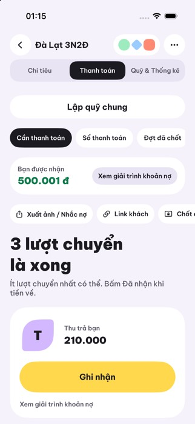
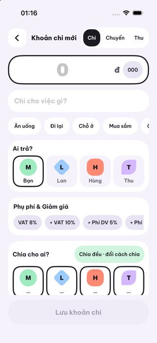
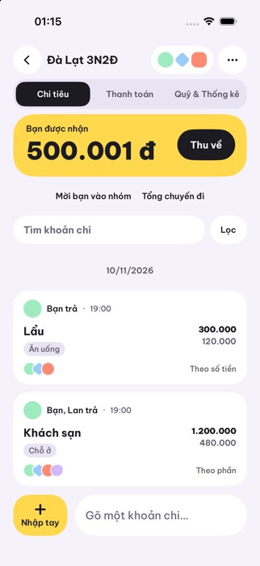
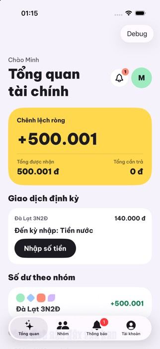
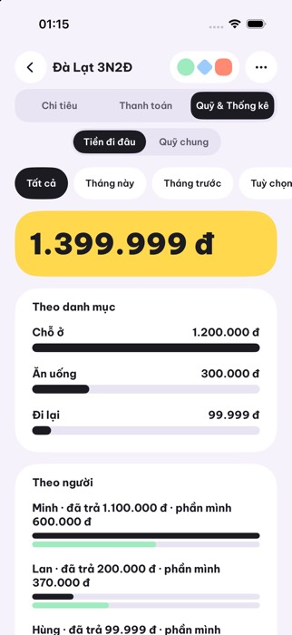
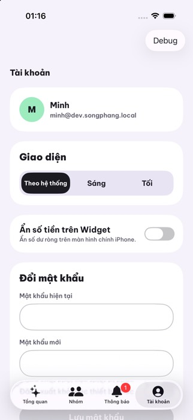

> **Part 1 — main screens.** Verbatim Markdown copy of the review page published on 2026-11-28 as a private artifact (https://claude.ai/artifact/V2pnPiiaDgYFnUP4VrwutS). Wording is unchanged (only formatting was adapted to Markdown); screenshots are in `img/`; HTML mockups are kept as text blocks, and interactive demos exist only on the original page. Findings are tracked with IDs in [findings.md](findings.md). Owner decisions made after this page are recorded in `docs/superpowers/specs/2026-11-28-ui-ux-v3-roadmap-overview-design.md` and take precedence over the questions asked here.

_Đánh giá UI/UX · iOS · 28/11/2026_

# Sòng Phẳng v3: gọn hơn, rõ hơn, sống động hơn

Đánh giá dựa trên bản build `main@6839bbf` chạy trên iPhone 17 Pro (chế độ scripted, dữ liệu mẫu "Đà Lạt 3N2Đ"), bộ screenshot ngày 17/11, mã nguồn SwiftUI và spec UI/UX v2. Ưu tiên iOS, cùng nguyên tắc áp dụng cho Web sau.

**Kết luận ngắn**

Linh hồn của app vẫn tốt: hình thành viên, màu vàng, số to, ô gõ như nhắn tin. Vấn đề nằm ở ba chỗ:

- **Mọi tính năng đều được bày ra cùng lúc.** Các tính năng của 5.5B và 5.5C được cắm thẳng vào màn hình chính dưới dạng chip, nút và tab con, nên người mới thấy cả chục lựa chọn trước khi thấy câu trả lời họ cần.
- **Lời lẽ kiểu kế toán.** "Chênh lệch ròng", "Giải trình khoản nợ", "Đợt đã chốt", "Ghi nhận" bắt người dùng phải dịch lại trong đầu.
- **App gần như tĩnh.** Hơn 23.000 dòng mã giao diện chỉ có 17 lệnh animation, không có transition, không có âm thanh. Lưu một khoản chi hay trả xong nợ đều không có phản hồi gì đáng nhớ.

_Đo từ mã nguồn_

## Những con số đáng chú ý

**963** chuỗi chữ trong app (README cũ ghi 670). Chữ tăng 44% qua 3 wave.

**54** chuỗi chữ khác nhau chỉ trên tab "Thanh toán" của một nhóm. Form thêm chi có 82.

**10** khối hiện cùng lúc trên form thêm chi: loại, số tiền, mô tả, danh mục, ai trả, phụ phí, chia cho ai, ngày giờ, định kỳ, ảnh.

**17 / 0 / 0** lệnh animation / transition / âm thanh trong toàn bộ iOS. Haptic có ở 8 file.

_Giữ lại_

## Điều đang làm tốt

### Hình thành viên

Tròn, thoi, vuông bo, lá: nhận diện người không cần đọc tên. Đây là tài sản thương hiệu mạnh nhất, nên dùng nhiều hơn chứ không ít đi.

### Ô gõ như nhắn tin

"Lẩu 300k Minh trả chia đều" là cách nhập nhanh nhất thị trường. Nên là cửa chính, không phải tính năng phụ.

### Một con số lớn

Thẻ vàng "Bạn được nhận 500.001 đ" trả lời đúng câu hỏi số một. Chỉ cần đừng lặp lại nó 3 lần.

### Câu chữ thân thiện ở vài chỗ

"3 lượt chuyển là xong", "Mình chưa hiểu hết câu này" có giọng người thật. Nên đưa giọng này ra toàn app.

_Bằng chứng_

## Từng màn hình đang gây ngợp ở đâu



### Nhóm › Thanh toán: ba tầng điều hướng trước khi tới việc chính

- **[Nặng]** Segment (Chi tiêu / Thanh toán / Quỹ) → tab con (Cần thanh toán / Sổ thanh toán / Đợt đã chốt) → hàng nút (Xuất ảnh / Link khách / Chốt đợt). Người mới không biết bấm đâu.
- **[Nặng]** Nút "Lập quỹ chung" nằm trên cùng của màn thanh toán, dù không liên quan tới việc trả nợ.
- **[Vừa]** Số "Bạn được nhận 500.001 đ" lặp lại lần thứ ba (Tổng quan, thẻ vàng tab Chi tiêu, tab này). "Xem giải trình khoản nợ" xuất hiện 2 lần.
- **[Vừa]** Khoản chuyển đầu tiên (việc thật sự cần làm) bị đẩy xuống gần đáy màn hình.

**Hướng sửa:** bỏ tab con và hàng nút. Màn này chỉ còn danh sách "Ai trả ai" kèm nút "Đã nhận" ngay trên hàng. Lịch sử, chốt đợt, link khách và ảnh nhắc nợ vào menu "•••" hoặc trang Thông tin nhóm.



### Form thêm chi: 10 khối cho một việc cần 3 thông tin

- **[Nặng]** Phụ phí và giảm giá (VAT 8%, VAT 10%, Phí DV 5%…) hiện sẵn cho mọi khoản, dù đa số khoản chi không cần.
- **[Vừa]** Ô số tiền không tự mở bàn phím. Người dùng phải chạm thêm một lần trước khi gõ.
- **[Vừa]** "Ai trả?" và "Chia cho ai?" cùng hiện 4 ô hình lớn. Hai lưới gần giống nhau làm người dùng phải dò xem mình đang ở lưới nào.
- **[Nhẹ]** Ba kiểu điều khiển khác nhau: toggle xám hệ thống (Lặp lại định kỳ), toggle vàng tự vẽ (Gộp nợ), ô ngày giờ xám của hệ thống.

**Hướng sửa:** số tiền (bàn phím mở sẵn) → việc gì → một dòng tóm tắt "Bạn trả · chia đều 4 người ›". Ngày, lặp lại, ảnh, phụ phí, danh mục thu về hàng chip "Thêm chi tiết"; chip nào được dùng mới mở rộng.



### Nhóm › Chi tiêu: chỉ 2 khoản chi lọt vào màn hình đầu

- **[Nặng]** Mỗi thẻ có hai con số không nhãn (300.000 và 120.000). Người dùng phải đoán số thứ hai là gì. Khi thiếu `myDelta`, số này còn hiện màu xám, không dấu.
- **[Vừa]** Mỗi thẻ có 7 mẩu thông tin: hình người trả, "Bạn trả", giờ, tên, danh mục, cụm hình người tham gia, cách chia. Giờ và cách chia ít khi cần trong danh sách.
- **[Vừa]** Thẻ vàng, hai liên kết chữ, ô tìm kiếm và nút Lọc chiếm nửa màn hình trước khi tới khoản chi đầu tiên.

**Hướng sửa:** thẻ một dòng (hình người trả, tên khoản, "Bạn trả · 4 người", bên phải là phần của bạn có màu và dấu, tổng nhỏ bên dưới). Tìm kiếm chuyển thành kéo xuống để hiện, như Mail và Tin nhắn.



### Tổng quan và Nhóm: hai tab nói cùng một điều

- **[Nặng]** Tab Tổng quan và tab Nhóm đều có lời chào, tên nhóm, hình thành viên và số dư. Chuông thông báo xuất hiện ở cả header lẫn tab bar, và ảnh đại diện trùng với tab Tài khoản.
- **[Vừa]** "Chênh lệch ròng" cùng hai số "Tổng được nhận" và "Tổng cần trả", trong khi một trong hai thường bằng 0.
- **[Nhẹ]** Khi cuộn, nội dung chạy xuyên qua thanh trạng thái mà không có lớp mờ phía sau.

**Hướng sửa:** gộp thành một màn hình chính "Nhóm" có một câu tổng ở trên ("Tính chung, bạn được nhận 500.001 đ"). Tab bar còn 3 mục.



### Quỹ & Thống kê: thêm một tầng tab nữa

- **[Vừa]** Segment → "Tiền đi đâu / Quỹ chung" → chip thời gian: ba hàng chọn chồng lên nhau.
- **[Vừa]** "Minh · đã trả 1.100.000 đ · phần mình 600.000 đ" là một câu dài xuống 2 dòng, kèm hai thanh bar không có chú thích.

**Hướng sửa:** thống kê là trang con mở từ "•••", không phải một segment lúc nào cũng hiện. Quỹ chung chỉ hiện khi nhóm đã có quỹ.



### Tài khoản: form đổi mật khẩu nằm ngay trang chính

- **[Vừa]** Ba ô mật khẩu luôn hiện, dù việc này làm vài lần mỗi năm. Trang dài và trông như một form phải điền.

**Hướng sửa:** danh sách kiểu Cài đặt iOS (Giao diện, Âm thanh và rung, Thông báo, Bảo mật ›). Đổi mật khẩu là một trang con.

_Nguyên tắc_

## Năm luật cho mọi màn hình v3

### Một màn, một việc

Mỗi màn có đúng một nút chính. Nếu cần hai nút chính, đó là hai màn.

### Đưa đáp án, giấu phép tính

Hiện "Thu trả bạn 210.000 đ". Cách ra con số đó chỉ hiện khi chạm vào.

### Nói như bạn bè

"Ai nợ ai", "Xong rồi", "Đã nhận tiền". Không dùng từ của kế toán.

### Tính năng hiện khi cần

Quỹ, chốt đợt, định kỳ, phụ phí: chỉ xuất hiện khi nhóm đã dùng, hoặc khi người dùng tự mở.

### Tiền đổi thì app phản hồi

Số dư thay đổi luôn đi kèm chuyển động, rung và (tuỳ chọn) âm thanh.

_Kiến trúc_

## Từ 4 tab và 3 segment xuống 3 tab và 1 màn nhóm

Phần lớn cảm giác ngợp đến từ cấu trúc, không phải từ màu sắc. Sửa cấu trúc trước thì các bước làm gọn sau sẽ dễ hơn nhiều.

_Hiện tại_

- Tab Tổng quan · Số ròng, định kỳ, số dư theo nhóm, giao dịch gần đây
- Tab Nhóm · Đang mở / Đã lưu trữ, thẻ nhóm, Tạo nhóm
- Tab Thông báo
- Tab Tài khoản
- Trong nhóm: Chi tiêu · Thanh toán · Quỹ & Thống kê · + 3 tab con Thanh toán, + 2 tab con Quỹ, + menu 6 mục

_Đề xuất v3_

- Tab Nhóm (màn hình chính) · Một câu tổng ở trên + danh sách nhóm. Nhóm lưu trữ nằm cuối danh sách, thu gọn.
- Tab Hoạt động · Thông báo + sổ cá nhân gộp làm một dòng thời gian
- Tab Tôi · Danh sách cài đặt; mỗi mục là trang con
- Trong nhóm: một màn duy nhất · Thẻ số dư có nút theo ngữ cảnh (Thu về / Trả ngay / Xong rồi) → danh sách chi tiêu → ô gõ
- Sheet "Ai trả ai" · Mở từ thẻ số dư. Lịch sử và chốt đợt là liên kết ở cuối sheet.
- Thông tin nhóm (chạm vào tên nhóm) · Thành viên, quỹ, thống kê, định kỳ, link khách, Telegram, cài đặt. Giống trang thông tin nhóm của Tin nhắn.

_Mockup_

## Trông sẽ như thế nào

Bốn màn hình phác theo đúng màu, font và hình của app. Màn thứ ba chạy được: bấm "Đã nhận" để xem chuyển động, rung (mô phỏng) và âm thanh đề xuất. Bản Markdown này chỉ giữ chữ của mockup; phần bấm thử chỉ có trên trang gốc.

### Màn hình chính

Gộp Tổng quan và Nhóm. Một câu, một danh sách, ba tab.

```text
Nhóm +
Tính chung, bạn được nhận 500.001 đ
Đà Lạt 3N2Đ
+500.001
Nhà Q7 tháng 11
Xong rồi
Đã lưu trữ (2) ›
Nhóm Hoạt động Tôi
```

### Màn nhóm

Không còn segment. Số màu có dấu là phần của bạn, số xám là tổng. Kéo xuống để tìm kiếm.

```text
‹ Đà Lạt 3N2Đ › •••
Bạn được nhận
500.001 đ
HÔM NAY
Lẩu
Bạn trả · 3 người
+180.000 300.000
Khách sạn
Bạn, Lan trả · 4 người
+320.000 1.200.000
Vé
Hùng trả · 3 người
−49.999 99.999
Lan nhận hoàn cọc
Khoản thu · 4 người
+50.000 200.000
+ Lẩu 300k Minh trả…
```

### Ai trả ai (bấm thử)

Mỗi lần "Đã nhận": hàng trượt đi, số còn lại đếm xuống, có tiếng "tách". Hết nợ thì hình thành viên bung ra cùng một hợp âm ngắn.

```text
Ai trả ai ×
Còn chờ nhận 500.001 đ
Thu trả bạn
210.000 đ
Hùng trả bạn
170.001 đ
Lan trả bạn
120.000 đ
Lịch sử thanh toán ›
Sòng phẳng rồi! Cả nhóm đã xong tiền chuyến này
```

### Thêm chi

Ba câu hỏi, bàn phím số mở sẵn. Phần mở rộng chỉ là các chip nhỏ, chạm vào mới hiện.

```text
× Khoản chi mới
300.000 đ
Lẩu
trả, chia đều ›
+ Danh mục + Ngày + Ảnh + Phụ phí + Lặp lại
1 2 3 4 5 6 7 8 9 000 0 ⌫
Lưu
```

_Cảm giác_

## Hệ thống chuyển động, rung và âm thanh

Không cần thêm thư viện. SwiftUI trên iOS 26 có sẵn mọi thứ cần dùng: `.contentTransition(.numericText())`, `.sensoryFeedback`, `.symbolEffect`, `matchedGeometryEffect`, `PhaseAnimator`, `Canvas`/`TimelineView` cho hiệu ứng bung hình. Mọi chuyển động có phương án thay thế khi bật Giảm chuyển động.

| Khoảnh khắc | Chuyển động | Rung | Âm thanh |
|---|---|---|---|
| **Mọi con số tiền thay đổi** | Chữ số lăn tới giá trị mới (`numericText`) | Không | Không |
| **Gõ câu, app hiểu** | Từ khoá sáng lần lượt trái sang phải, hình người "nảy" vào theo thứ tự | Chạm nhẹ khi hiểu xong | Không |
| **Lưu khoản chi** | Thẻ bay từ ô gõ vào đầu danh sách, số dư lăn | `.success` | "Tách" ngắn kiểu đồng xu |
| **Đã nhận / Đã chuyển** | Nút đổi thành dấu tích, hàng trượt ra, hình người nhún một cái | `.success` | "Ting" nhẹ |
| **Cả nhóm hết nợ** | Hình thành viên bung ra như pháo giấy, thẻ "Sòng phẳng rồi!" | Chuỗi 3 nhịp | Hợp âm ngắn, dưới 1 giây |
| **Chọn chip, đổi tab, chọn người** | Lò xo nhanh; biểu tượng tab nảy (`.symbolEffect(.bounce)`) | `.selection` | Không |
| **Vuốt xoá / sửa** | Hành động lộ ra theo ngón tay | Tích khi qua ngưỡng | Không |
| **Lỗi nhập liệu** | Ô lắc ngang 2 lần | `.warning` | Không |
| **Đang tải** | Bốn hình thành viên nhún lần lượt thay cho vòng xoay; khung xương có ánh sáng chạy | Không | Không |
| **Có thông báo mới** | Chuông lắc (`.symbolEffect(.wiggle)`) | Không | Không |

### Luật cho âm thanh

- Tối đa 4 âm, mỗi âm dưới 400 ms, âm lượng thấp, file `.caf` vài KB.
- Dùng audio session `.ambient`: tự im khi máy ở chế độ im lặng và không ngắt nhạc đang phát.
- Thêm mục "Âm thanh và rung" trong tab Tôi, có thể tắt riêng từng loại.
- Chỉ phát cho hành động của chính người dùng. Không phát khi người khác thêm chi qua realtime.

### Luật cho chuyển động

- Ba token lò xo dùng chung: **nhanh** (chọn, đổi tab), **nảy** (thành công), **êm** (mở sheet). Đặt trong `DesignSystem/Tokens`.
- Chỉ một khoảnh khắc "ăn mừng" lớn: khi cả nhóm hết nợ. Còn lại giữ nhỏ và nhanh để app vẫn đáng tin khi xử lý tiền.
- Chuyển helper `Haptics` sang modifier `.sensoryFeedback` để rung gắn với thay đổi trạng thái, không gọi tay.

_Câu chữ_

## Viết lại theo giọng bạn bè

| Hiện tại | Đề xuất | Lý do |
|---|---|---|
| Chênh lệch ròng | **Tính chung, bạn được nhận** | Một câu thay cho ba con số |
| Xem giải trình khoản nợ | **Vì sao?** | Ngắn, đúng câu người dùng tự hỏi |
| Cần thanh toán / Sổ thanh toán / Đợt đã chốt | **Ai trả ai** + liên kết "Lịch sử" | Bỏ hai tab con |
| Ghi nhận | **Đã nhận tiền** | Nói rõ việc vừa xảy ra |
| Gộp nợ | **Ít lượt chuyển nhất** | Mô tả kết quả, không mô tả thuật toán |
| Đọc-ghi / Chỉ xem | **Được thêm chi / Chỉ xem** | Nói bằng hành động |
| Quỹ & Thống kê · Tiền đi đâu | **Chi tiêu theo loại** (trong Thông tin nhóm) | Không còn là segment |
| Chia đều · đổi cách chia | **Chia đều 4 người ›** | Dấu › đã nói "chạm để đổi" |

Quy ước: nhãn tối đa 3 từ; câu gợi ý tối đa 1 dòng; mọi đoạn giải thích dài hơn 60 ký tự (hiện có 38 chuỗi) chuyển vào nút "Vì sao?" hoặc trang trợ giúp.

_Lần đầu dùng app_

## Học bằng cách làm, không có slide hướng dẫn

- **Nhóm trống:** ô gõ tự gõ thử một câu mẫu ("Lẩu 300k Minh trả chia đều") rồi xoá đi, như con trỏ đang làm mẫu. Chạm vào là dùng câu đó.
- **Mỗi màn tối đa một gợi ý**, hiện một lần rồi biến mất vĩnh viễn (ví dụ "Vuốt trái để sửa" ở khoản chi đầu tiên).
- **Mở dần tính năng:** chip "Phụ phí" chỉ xuất hiện sau khoản chi thứ 3; "Chốt đợt" chỉ hiện khi nhóm có trên 20 khoản; "Quỹ" chỉ hiện khi có người lập quỹ. Người dùng lâu năm vẫn tìm được mọi thứ trong Thông tin nhóm.
- **Khoản chi đầu tiên được ăn mừng** bằng một hiệu ứng nhỏ. Mục tiêu là người mới thêm được khoản chi đầu tiên trong vòng một phút.

_Lộ trình_

## Ba đợt, cái dễ và vui làm trước

**[R1 · Cảm giác]**

### Làm app "sống"

- Token chuyển động, rung và 4 âm thanh
- Số tiền lăn ở mọi chỗ
- Lưu chi, đã nhận, hết nợ có phản hồi
- Hình thành viên làm biểu tượng đang tải
- Mục "Âm thanh và rung"

Không đổi cấu trúc màn hình. Rủi ro thấp. Khoảng 1 wave nhỏ.

**[R2 · Làm gọn]**

### Bớt chữ, bớt khối

- Viết lại câu chữ theo bảng trên
- Form thêm chi 3 bước, phần mở rộng thu gọn
- Thẻ khoản chi một dòng, có nhãn rõ
- Thống nhất toggle, segment, ô ngày
- Tài khoản dạng danh sách

Đổi chữ và bố cục bên trong màn. Cần cập nhật chuỗi cho cả Web để giữ đồng bộ.

**[R3 · Cấu trúc]**

### 3 tab, 1 màn nhóm

- Gộp Tổng quan vào Nhóm; Hoạt động thay Thông báo
- Bỏ 3 segment; thêm sheet Ai trả ai
- Trang Thông tin nhóm
- Mở dần tính năng theo ngữ cảnh
- Áp dụng sang Web (rail 3 mục, inspector giữ nguyên)

Đổi điều hướng, cần sửa spec 5.5 và `user-flows.md`. Lớn nhất.

Cách kiểm tra (dự án không viết test tự động): mời 3 đến 5 người chưa dùng app, giao 3 việc ("thêm bữa lẩu 300k chia đều", "xem mình được nhận bao nhiêu", "đánh dấu Thu đã trả"), đếm số lần chạm và số lần khựng lại. Làm một lần trước R1 và một lần sau R3.

_Cần bạn quyết định_

## Ba câu hỏi trước khi viết spec

1. **Phạm vi cấu trúc:** đồng ý gộp xuống 3 tab và bỏ 3 segment trong nhóm (R3)? Đây là thay đổi ngược với ADR-034 của 5.5A.
2. **Âm thanh:** bật sẵn hay tắt sẵn khi cài app? Đề xuất: bật sẵn, âm lượng thấp, tự im theo công tắc im lặng.
3. **Thứ tự:** làm R1 (cảm giác) trước để có kết quả thấy ngay, hay làm R3 (cấu trúc) trước để không phải chỉnh chuyển động hai lần?

**Nguồn tham khảo**

- [NN/g: Progressive Disclosure](https://www.nngroup.com/articles/progressive-disclosure/)
- [Apple HIG: Playing haptics](https://developer.apple.com/design/human-interface-guidelines/playing-haptics) và [Playing audio](https://developer.apple.com/design/human-interface-guidelines/playing-audio)
- [So sánh các app chia tiền 2026 (HippoSplit)](https://hipposplit.com/blog/best-expense-splitting-apps/), [Splittalo](https://splittalo.com/blog/best-bill-splitting-apps-2026/), [Divvi](https://justdivvi.com/blog/best-bill-splitting-apps-2026) (bài của chính các hãng, chỉ dùng tham khảo)
- [Microinteractions trong fintech (DeepInspire)](https://deepinspire.com/blog/the-role-of-microinteractions-in-fintech-design-a-closer-look-at-user-engagement)
- [SwiftUI animation techniques 2026](https://nathanfennel.com/blog/swiftui-animation-techniques-2026)

Tôi không tìm được nghiên cứu định lượng công khai nào về tác động của âm thanh trong app tài chính; phần âm thanh dựa trên hướng dẫn của Apple và cách Apple Pay làm.
