> **Part 2 — detail screens.** Verbatim Markdown copy of the review page published on 2026-11-28 as a private artifact (https://claude.ai/artifact/1pPqWyGEvhC3iJHnRKjz34). Wording is unchanged (only formatting was adapted to Markdown); screenshots are in `img/`; HTML mockups are kept as text blocks, and interactive demos exist only on the original page. Findings are tracked with IDs in [findings.md](findings.md). Owner decisions made after this page are recorded in `docs/superpowers/specs/2026-11-28-ui-ux-v3-roadmap-overview-design.md` and take precedence over the questions asked here.

_Sòng Phẳng · UI/UX v3 · Phần 2_

# Từng màn, từng sheet, từng chữ

Phần 1 xem các màn chính. Phần này đi vào bên trong: thanh toán, sổ thanh toán, đợt đã chốt, giải trình, xuất ảnh, link khách, quỹ, chia tiền, thành viên, cài đặt. Trọng tâm là bốn thứ bạn nêu: cách chuyển giữa các màn, bottom sheet, chữ và thành phần bị lặp, và chỗ nào nên có animation. Ảnh chụp từ bản build `main` ngày 28/11/2026, chế độ scripted, iPhone 17 Pro.

Đọc kèm [phần 1: Sòng Phẳng UX Review](https://claude.ai/artifact/V2pnPiiaDgYFnUP4VrwutS).

**Tóm lại sau khi rà 26 màn và 27 chỗ mở sheet**

- App đang tự vẽ lại thanh điều hướng ở 17 màn, rồi phải vá thêm cử chỉ vuốt lùi và dải che thanh trạng thái. Đây là gốc của phần lớn lỗi chuyển màn. Trang chi tiết khoản chi hiện cả hai nút quay lại cùng lúc.
- 19 trên 27 sheet mở hết chiều cao màn hình dù nội dung chỉ chiếm một phần ba. Mỗi sheet đóng bằng một chữ khác nhau.
- Lặp chủ yếu theo ba kiểu: một thông tin giống nhau in lại ở mỗi hàng, một nút chính đặt ở mỗi hàng, và một câu hỏi được trả lời hai lần trên cùng màn.
- Animation không cần thêm nhiều. Cần đặt đúng vào khoảng 8 khoảnh khắc liên quan tới tiền, và để hệ thống lo phần chuyển màn.

**17** màn ẩn nút quay lại của hệ thống để tự vẽ header

**19/27** sheet không khai báo chiều cao, nên luôn mở toàn màn hình

**6** chữ khác nhau để đóng một thứ: Xong, Huỷ, Thôi, Đóng, Quay lại, Để sau

**3** lần chữ “chỉ xem” trên một sheet link khách chỉ có 2 khối

_A · Chuyển màn hình_

## Cảm giác “giật” đến từ việc làm lại thứ hệ thống đã có

iOS cho sẵn ba kiểu chuyển: đẩy sang (push) cho đi sâu vào nội dung, sheet trượt lên cho một việc ngắn, và toàn màn hình cho việc dài hoặc camera. App hiện dùng đúng tên các kiểu này nhưng tắt đi phần hệ thống tự làm, rồi vá lại bằng tay. Kết quả là mỗi màn chuyển hơi khác nhau một chút.

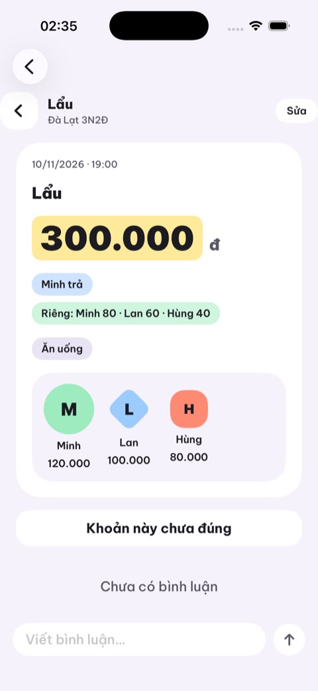

### Chi tiết khoản chi: hai nút quay lại

- **[Lỗi]** Nút tròn kính mờ phía trên là của hệ thống, nút vuông phía dưới là header tự vẽ. Header còn tràn ra hai mép: nút quay lại và nút “Sửa” bị cắt. Nguyên nhân: `TransactionDetailView` là màn duy nhất trong nhóm này quên `.navigationBarBackButtonHidden(true)`.
- **[Gốc]** Sửa một dòng thì hết lỗi này, nhưng lỗi sẽ quay lại ở màn mới tiếp theo. 17 màn tự vẽ header, kèm `PopGestureEnabler` để bật lại cử chỉ vuốt lùi và `StatusBarCover` để che chữ chạy dưới đồng hồ. Ba thứ vá cho một quyết định.

**Hướng:** trả thanh điều hướng về cho hệ thống ở mọi màn đẩy sang. Tiêu đề, nút quay lại, nút phụ bên phải đặt bằng `toolbar`. Khi đó có sẵn: vuốt lùi đúng chuẩn, tiêu đề lớn thu nhỏ khi cuộn, nền kính mờ Liquid Glass ở mép trên, và không cần hai miếng vá. Giữ được màu, font và hình thành viên của Sòng Phẳng vì phần đó nằm trong nội dung, không nằm ở thanh điều hướng.

| Chỗ | Hiện tại | Người dùng cảm thấy | Đề xuất |
|---|---|---|---|
| **Tổng quan → mở nhóm** | Đổi sang tab Nhóm và thay cả ngăn xếp (`groupsPath = [...]`) | Màn hình nhảy sang tab khác, không có hiệu ứng đẩy. Bấm quay lại thì về danh sách nhóm, không về Tổng quan. | Đẩy nhóm vào ngay ngăn xếp của tab đang đứng. Quay lại về đúng chỗ vừa bấm. |
| **Thông báo → khoản chi** | Cũng đổi tab rồi đẩy | Như trên: mất chỗ đang đọc trong hộp thông báo. | Đẩy trong tab Thông báo. |
| **Mọi màn đẩy sang** | Ẩn tab bar (`.toolbar(.hidden, for: .tabBar)`) | Tab bar biến mất khi đi vào và hiện bật lại ở cuối lúc quay ra, nhìn như giật. | Giữ tab bar ở màn nội dung (chi tiết, thành viên, lịch sử). Chỉ ẩn ở màn làm việc tập trung, và các màn đó nên là toàn màn hình (xem dòng dưới). Cần thử trên máy thật để xác nhận mức giật. |
| **Thêm / sửa khoản chi, nhập nhanh, ghi nhận đã nhận** | Đẩy sang như một trang | Đây là việc cần làm xong hoặc huỷ, nhưng trông như một trang để đọc. Vuốt lùi giữa chừng là mất dữ liệu đang nhập mà không hỏi. | Mở dạng toàn màn hình hoặc sheet lớn, có “Huỷ” bên trái, nút lưu ở dưới. Vuốt xuống khi đã nhập thì hỏi lại. |
| **Thẻ khoản chi → chi tiết** | Đẩy sang thường | Ổn, nhưng không nối được thẻ với trang. | Chuyển kiểu phóng to từ thẻ (`.navigationTransition(.zoom)`). Đây là chỗ duy nhất tôi đề xuất kiểu chuyển riêng. Bản iOS 26.x còn lỗi thẻ gốc biến mất khi vuốt lùi giữa chừng, nên phải thử trên bản iOS mới nhất trước khi chốt. |
| **Quét hoá đơn → kiểm tra**; **Sheet trả tiền → Ghi nhận luôn** | Đóng sheet rồi mới đẩy màn mới | Hai chuyển động nối nhau, màn hình “thở” hai lần. | Làm tiếp ngay trong sheet (đẩy bên trong sheet), hoặc thay nội dung sheet. Một chuyển động cho một ý. |
| **Nhân bản nhóm** | Đẩy nhóm mới lên trên nhóm cũ | Quay lại thì về nhóm cũ, rồi quay lại nữa mới ra danh sách. | Thay nhóm cũ bằng nhóm mới trong ngăn xếp. |
| **Đổi segment trong nhóm** | Đổi màu nền nút; nội dung cả màn mờ đi rồi hiện lại | Viên chọn không trượt, cả màn nháy. | Nếu giữ segment: viên chọn trượt theo (`matchedGeometryEffect`), nội dung đổi ngay không mờ. Nếu theo cấu trúc mới ở phần 1 thì segment không còn. |

_B · Bottom sheet_

## Sheet đang to hơn việc nó làm

Bộ lọc là sheet làm đúng nhất trong app: có thanh kéo, cao vừa nửa màn, nổi lên dạng kính mờ của iOS 26, nhìn thấy màn phía sau. Các sheet còn lại phần lớn mở toàn màn hình, nên trông như một trang mới chứ không phải một việc nhỏ đặt lên trên.

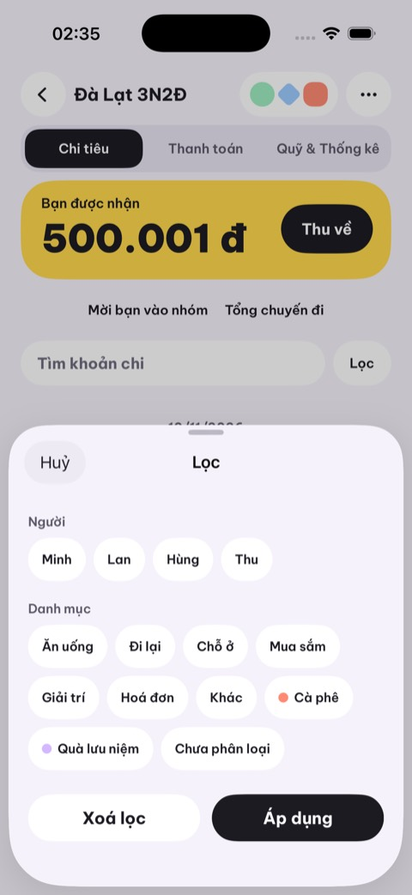

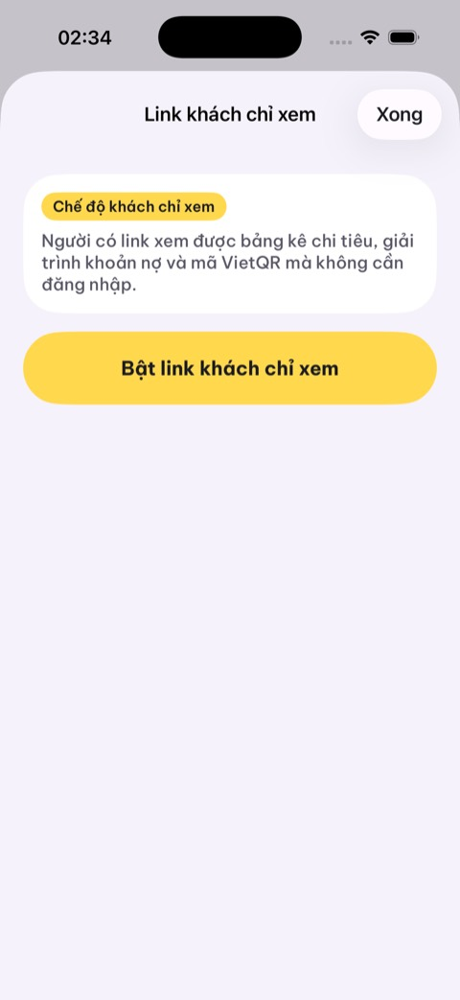

### So sánh: bộ lọc (trái) và link khách (phải)

- **[Mẫu]** Bộ lọc: cao vừa nội dung, có thanh kéo, nút chính ở dưới cùng. Chỉ cần bỏ bớt một trong ba nút (“Huỷ”, “Xoá lọc”, “Áp dụng”) và cho chip Người có hình thành viên.
- **[Cao]** Link khách: nội dung chiếm một phần ba, phần còn lại trống. Chữ “chỉ xem” xuất hiện ở tiêu đề, nhãn vàng và nút. Khi bật lên, đường link thô hiện nguyên văn, chữ “link” lặp 6 lần, và “Thu hồi link” to bằng “Đổi link mới”.

**Hướng cho link khách:** sheet cao theo nội dung. Một câu giải thích, một thẻ xem trước trang khách sẽ thấy, một nút “Gửi link” mở bảng chia sẻ của iOS (có sẵn nút sao chép trong đó). “Đổi link” và “Tắt link” vào menu dấu ba chấm, tắt thì hỏi lại.

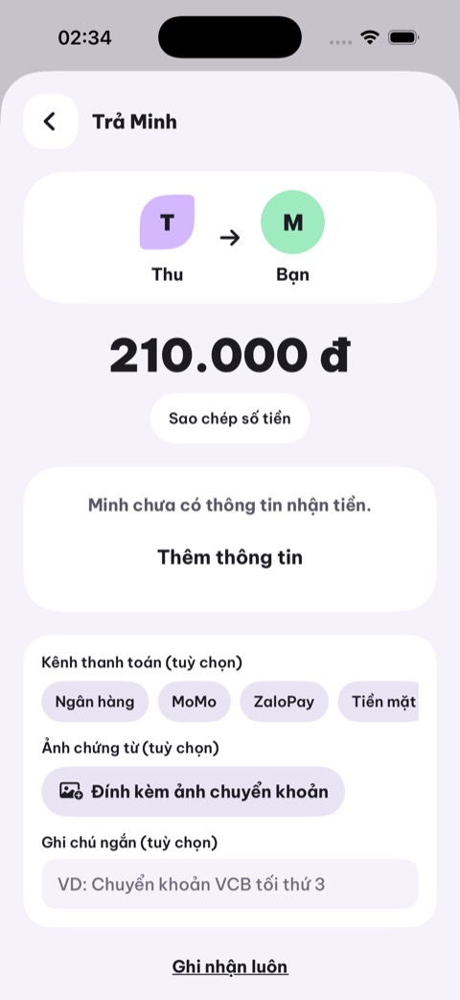

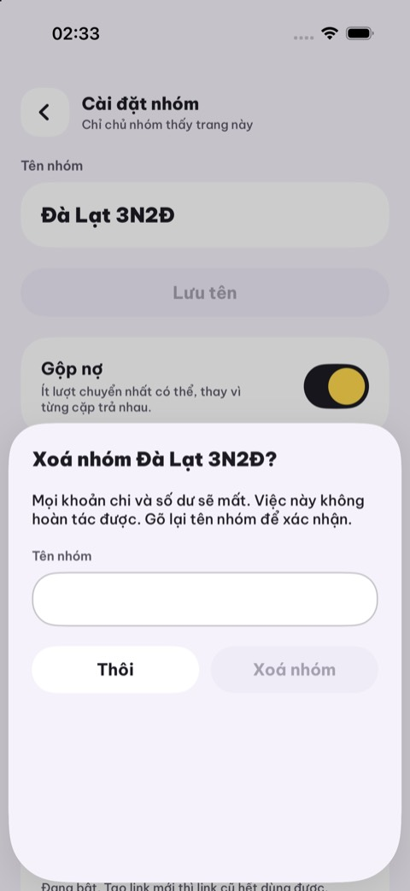

### Sheet trả tiền và sheet xoá nhóm

- **[Sai vai]** Tôi đăng nhập là Minh, bấm “Ghi nhận” ở hàng “Thu trả bạn”. Sheet mở ra tiêu đề “Trả Minh”, có nút “Sao chép số tiền” và dòng “Minh chưa có thông tin nhận tiền”. Đây là màn của người trả, đưa cho người nhận. Tiêu đề luôn là `pay.title = "Trả {to}"`, không xét ai đang xem.
- **[Kiểu]** Sheet có nút mũi tên quay lại, một tín hiệu của màn đẩy sang. Việc chính (“Ghi nhận luôn”) là một dòng chữ gạch chân ở đáy, còn ba ô tuỳ chọn thì to. “(tuỳ chọn)” lặp 3 lần.
- **[Cao]** Xoá nhóm dùng nửa màn nhưng nội dung chỉ cần khoảng 300 điểm, phần dưới trống.

**Hướng:** tách hai sheet theo vai. Người trả thấy QR và số tài khoản. Người nhận thấy “Thu đã chuyển 210.000 đ cho bạn?” với một nút “Đã nhận” và một dòng “Thêm ảnh hoặc ghi chú” mở rộng khi cần. Gộp ba nhãn “(tuỳ chọn)” thành một tiêu đề nhỏ “Thêm chi tiết”, gập sẵn.

| Sheet | Chiều cao hiện tại | Đề xuất | Ghi chú |
|---|---|---|---|
| **Trả tiền / Đã nhận** | Toàn màn | **[Vừa nội dung]** rồi kéo lên được | Tách theo vai, bỏ mũi tên quay lại |
| **Link khách** | Toàn màn | **[Vừa nội dung]** | Bảng chia sẻ iOS thay cho nút Sao chép + Gửi |
| **Giải trình khoản nợ** | Toàn màn | **[Nửa + toàn]** | Nửa màn đủ thấy số dư và 3 khoản lớn nhất |
| **Xuất ảnh / Nhắc nợ** | Toàn màn | **[Toàn màn]** giữ | Đảo lại: ảnh xem trước ở trên, tuỳ chỉnh ở dưới |
| **Chốt đợt** | Toàn màn | **[Vừa nội dung]** | Một câu xác nhận và một nút |
| **Lập quỹ** | Nửa màn | **[Nửa màn]** giữ | Đã đúng |
| **Xoá nhóm** | Nửa màn | **[Vừa nội dung]** | Bớt khoảng trống ở dưới |
| **Thông tin nhận tiền** | Toàn màn, có mũi tên quay lại | **[Nửa + toàn]** | Nút đóng thay cho mũi tên |
| **Khoản chi định kỳ, Hộ gia đình** | Toàn màn | **[Toàn màn]** giữ | Form dài, hợp với toàn màn |
| **Quét hoá đơn** | Toàn màn rồi đẩy tiếp | **[Toàn màn]** | Làm tiếp trong cùng màn, không đóng rồi mở |

### Một sheet, một việc

Sheet dành cho việc làm xong trong vài giây. Việc nhiều bước thì mở toàn màn hình. Không mở sheet chồng lên sheet.

### Cao bằng nội dung

Đo nội dung rồi đặt chiều cao theo đó. iOS 26 tự cho sheet thấp nổi lên và có nền kính mờ, chỉ cần không tô nền đè lên.

### Đóng bằng hai chữ

Sheet chỉ để xem: nút X góc trái. Sheet có thay đổi: “Huỷ” trái, việc chính ở dưới. Bỏ “Thôi”, “Đóng”, “Quay lại”, “Để sau”.

Hiện có 6 chữ: Xong · Huỷ · Thôi · Đóng · Quay lại · Để sau

### Không có mũi tên quay lại

Mũi tên trái nghĩa là màn này được đẩy sang. Trong sheet nó làm người dùng tưởng vuốt sang phải sẽ quay lại.

_C · Lặp chữ, lặp thành phần_

## Nói một lần, ở chỗ cao nhất

Lặp trong app rơi vào ba kiểu. Thứ nhất, một thông tin giống nhau được in lại ở mỗi hàng, trong khi nó có thể làm tiêu đề nhóm. Thứ hai, một nút chính đặt ở mỗi hàng, nên trên màn có nhiều nút chính cùng lúc. Thứ ba, một câu hỏi được trả lời hai lần với hai cách nói khác nhau. Bảng dưới là các chỗ tôi đếm được trên ảnh chụp.

**Thanh toán · Cần thanh toán · 2 ×**

Chữ “Xem giải trình khoản nợ” ở thẻ số dư và lại ở dưới thẻ “Thu trả bạn”.

Hiện: hai lối vào cùng một sheet, cách nhau một màn.

Đổi: bấm vào số dư hoặc vào hàng để mở giải trình. Bỏ cả hai dòng chữ.

**Thành viên · 3 × 2**

“Chưa ai nhận hình này” và nút “Đây là tôi” lặp dưới Lan, Hùng, Thu.

Hiện: mỗi người chưa nhận hình chiếm hai khối.

Đổi: gom thành một mục “3 người chưa nhận hình”. Hình chưa nhận vẽ viền nét đứt. Bấm vào người để nhận.

**Giao dịch của bạn · 4 ×**

“Đà Lạt 3N2Đ • 10/11/2026” in lại ở mỗi hàng.

Hiện: 4 hàng, cùng nhóm, cùng ngày.

Đổi: tiêu đề mục theo ngày, tên nhóm chỉ hiện khi khác hàng trên.

**Lịch sử · 3 + 5 ×**

Ba tiêu đề chồng nhau (“Lịch sử”, “Đà Lạt 3N2Đ”, “Ai đã đổi gì”). “Minh” và “21:23” lặp ở cả 5 hàng.

Đổi: một tiêu đề. Gom các thay đổi liên tiếp của một người trong một phút thành một mục: “Minh thêm 4 khoản · 21:23”, bấm để mở.

**Sổ thanh toán · 2 ×**

“Chờ xác nhận 0” ở thẻ tổng và lại là chip lọc ngay dưới. Các số 0 vẫn hiện.

Đổi: ẩn số đếm bằng 0. Chip lọc chỉ hiện khi có trên 5 dòng.

**Chi tiết khoản chi · 2 bộ số**

Chip “Riêng: Minh 80 · Lan 60 · Hùng 40” và ngay dưới là Minh 120.000, Lan 100.000, Hùng 80.000. Hai bộ số cho cùng ba người. Tên “Lẩu” ở header và ở thẻ.

Đổi: chỉ hiện phần mỗi người chịu. Cách tính (riêng + chia đều) nằm trong một dòng gập “Cách chia”.

**Nhập nhanh · 2 ×**

Câu vừa gõ hiện hai lần trong cùng ô: một bản tô màu, một bản chữ thường.

Đổi: chỉ một bản. Tô màu ngay trên chữ đang gõ.

**Menu ba chấm của nhóm · 3 → 1**

“Phân loại”, “Telegram” và “Cài đặt” mở cùng một trang cài đặt.

Đổi: một mục “Thông tin nhóm”, như đề xuất cấu trúc ở phần 1.

**Đợt đã chốt · 2 bảng**

Thẻ đợt in cả danh sách chuyển tiền (Thu → Minh…) và số dư từng người. Hai bảng nói cùng một chuyện. Số “3” không có nhãn.

Đổi: thẻ đợt gồm tên, ngày, tổng, và “3 khoản chi · đã xong”. Chi tiết mở khi bấm.

### Gom theo thứ chung

Thứ gì giống nhau ở mọi hàng thì đưa lên làm tiêu đề mục: ngày, nhóm, người.

Đà Lạt 3N2Đ • 10/11 · Vé 10/11 · Đà Lạt 3N2Đ → Vé, Hoàn cọc, Khách sạn

### Trạng thái là hình, không phải câu

Trạng thái lặp lại thì vẽ bằng hình (viền đứt, mờ, dấu chấm). Câu chữ chỉ giải thích một lần ở đầu mục.

### Không có số 0, không có ô trống

Số đếm bằng 0, bộ lọc khi mới có 2 dòng, tab khi chưa có dữ liệu: ẩn đi. Hiện lại khi có thứ để xem.

### Một câu trả lời cho một câu hỏi

Mỗi màn trả lời một câu hỏi bằng một con số. Muốn biết cách tính thì bấm mở. Không in kết quả và cách tính cạnh nhau.

_D · Nút trên mỗi hàng_

## Nút “Đã nhận” nên to hay nhỏ?

Câu hỏi của bạn là có nên rút nút ở mỗi hàng thành một biểu tượng. Câu trả lời của tôi phụ thuộc vào số hàng và vào việc nút đó có đụng tới tiền hay không. Bấm thử ba cách bên dưới, bấm vào nút trên từng hàng để thấy chuyện gì xảy ra.

```text
Còn 3 lượt là xong
Bạn nhận 330.000 đ · trả 170.001 đ
```

### Nút lớn (như hiện tại)

Dễ thấy, dễ bấm, chữ rõ nghĩa.

Ba hàng là ba nút vàng. Không còn nút nào là “việc chính”. Mỗi hàng cao gấp đôi, danh sách bị đẩy khỏi màn hình.

**Dùng khi:** chỉ có một hàng. Lúc đó nó chính là việc chính của màn.

### Chỉ icon

Gọn nhất, nhìn sạch.

Dấu tích có thể hiểu là “đã xong”, “chọn”, hoặc “đồng ý”. Với hành động xác nhận tiền, đoán sai là sai số dư của người khác. NN/g ghi nhận icon không kèm chữ khó hiểu hơn icon có chữ, trừ vài icon rất quen.

**Dùng khi:** hành động phụ, ai cũng biết, và làm sai thì không hại gì (sao chép, chia sẻ, mở thêm).

### Nút gọn có chữ, đặt ở cuối hàng

Vẫn đọc được “Đã nhận”, chỉ to bằng một viên thuốc. Hàng thấp bằng một nửa. Nút vàng chỉ dành cho hàng bạn phải trả, nên mắt biết ngay việc nào là của mình.

Nút nhỏ hơn, cần giữ vùng bấm tối thiểu 44 điểm.

**Đề xuất:** dùng kiểu này khi có từ 2 hàng. Bấm xong không mở sheet, chỉ đánh dấu ngay và hiện “Hoàn tác” vài giây, vì đây là việc làm nhiều lần liên tiếp. Thêm vuốt hàng sang trái làm đường tắt cho người quen tay, không thay cho nút. Bấm vào phần còn lại của hàng thì mở chi tiết.

### Ba hàng không cùng một nút

Hàng người khác trả bạn: “Đã nhận”. Hàng bạn trả người khác: “Trả” mở QR, tô vàng vì đó là việc của bạn. Hàng giữa hai người khác: không có nút, chỉ có “Nhắc” trong menu của hàng. Đặt cùng một nút cho cả ba là một nguồn lặp nữa.

_E · Ngân sách animation_

## Chỗ nào chuyển động, chỗ nào đứng yên

Nguyên tắc: chuyển động chỉ dùng khi nó trả lời câu hỏi “vừa có gì thay đổi?” Mỗi màn có nhiều nhất một chuyển động chính. Phần chuyển màn để hệ thống làm, vì nó đã được tối ưu và đúng với cử chỉ tay.

| Khoảnh khắc |  | Chuyển động | Vì sao |
|---|---|---|---|
| **Lưu khoản chi** | **[Có]** | Thẻ mới trượt vào đầu danh sách, số dư đếm tới số mới, rung nhẹ | Cho biết đã lưu và lưu vào đâu |
| **Đánh dấu đã nhận / đã trả** | **[Có]** | Hàng mờ rồi thu lại, số còn lại đếm xuống, rung thành công | Tiền vừa đổi chủ |
| **Hết nợ cả nhóm** | **[Có]** | Hình thành viên bung ra một lần, có âm thanh nếu bật | Khoảnh khắc hiếm, đáng ăn mừng |
| **Chia tiền: đổi cách chia, kéo phần** | **[Có]** | Số của từng người đếm theo, thanh “khớp” đổi màu khi đủ | Người dùng đang điều khiển con số |
| **Thẻ → chi tiết** | **[Có]** | Phóng to từ thẻ (hệ thống) | Nối thẻ với trang |
| **Nút sao chép** | **[Có]** | Biểu tượng đổi thành dấu tích 1 giây (`symbolEffect`) | Không có toast, vẫn biết đã chép |
| **Lỗi khi lưu** | **[Có]** | Ô sai lắc nhẹ, rung cảnh báo | Chỉ ra chỗ sai |
| **Đổi segment / tab con** | **[Nhỏ]** | Viên chọn trượt, nội dung đổi ngay | Không làm mờ cả màn |
| **Mở màn, tải xong dữ liệu** | **[Không]** | Hiện thẳng, không cho từng thẻ trôi vào | Lặp lại mỗi lần mở, nhanh chóng thành chậm |
| **Cuộn danh sách** | **[Không]** | Không hiệu ứng theo cuộn, không parallax | Tốn nhiều nhất, có ích ít nhất |
| **Kéo để làm mới** | **[Không]** | Số giữ nguyên nếu không đổi, chỉ đếm khi khác | Không đếm lại số cũ |
| **Số trên mỗi hàng** | **[Không]** | Chỉ số chính của màn được đếm | Mười số cùng đếm là ồn |

### Chỉ đổi vị trí và độ mờ

Animation bằng dịch chuyển, phóng, độ mờ là nhẹ. Animation thay đổi bố cục của danh sách dài (chiều cao, thêm bớt nhiều hàng) là nặng. Muốn thu một hàng thì làm mờ trước rồi mới rút.

### Ngắn và có lò xo

Phản hồi nút 100–150 ms, đổi trạng thái 200–300 ms, ăn mừng tối đa khoảng 1 giây. Dùng lò xo mặc định của SwiftUI thay cho đường cong tự chọn.

### Tôn trọng Giảm chuyển động

Khi người dùng bật Giảm chuyển động: bỏ bung hình và phóng to, giữ đổi màu và rung.

### Đo trước khi đoán

Mỗi chuyển động mới được kiểm bằng SwiftUI Instrument trên máy thật, ở danh sách nhóm lớn (cờ `--scenario-large`). `drawingGroup` chỉ dùng khi đo thấy có lợi.

_F · Từng màn_

## Giữ gì, bỏ gì, đổi gì

Mỗi thẻ là một màn đã chụp. Ba dòng ngắn: thứ đáng giữ, thứ nên bỏ, thứ nên đổi. Những màn chưa chụp được ghi ở cuối mục.

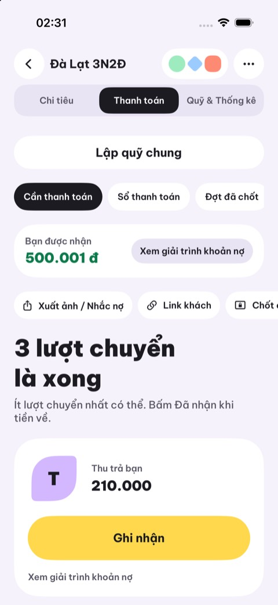

### Thanh toán · Cần thanh toán

- **[Giữ]** Câu “3 lượt chuyển là xong”: rõ, có tinh thần.
- **[Bỏ]** “Lập quỹ chung” ở trên cùng, hàng nút bị cắt (“Chốt” lòi một nửa), dòng giải trình thứ hai.
- **[Đổi]** Nút “Ghi nhận” thành nút gọn “Đã nhận” cuối hàng (mục D). Xuất ảnh, link khách, chốt đợt vào menu.

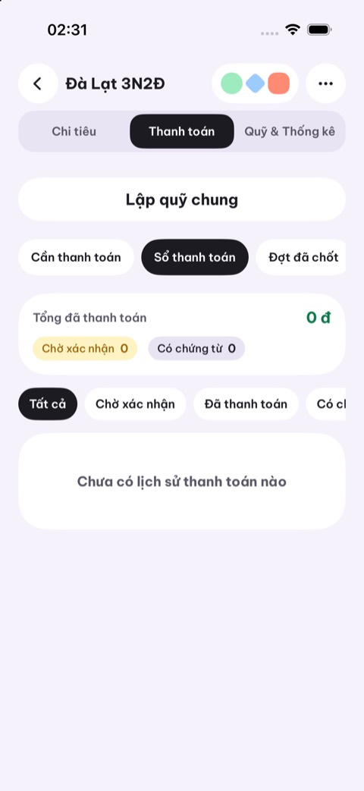

### Sổ thanh toán

- **[Giữ]** Có nơi xem lại các lần chuyển.
- **[Bỏ]** Số 0, chip lọc khi chưa có dòng nào.
- **[Đổi]** Trạng thái trống có câu hướng dẫn: “Khi ai đó bấm Đã nhận, lần chuyển sẽ hiện ở đây.” Có thể gộp vào Lịch sử.

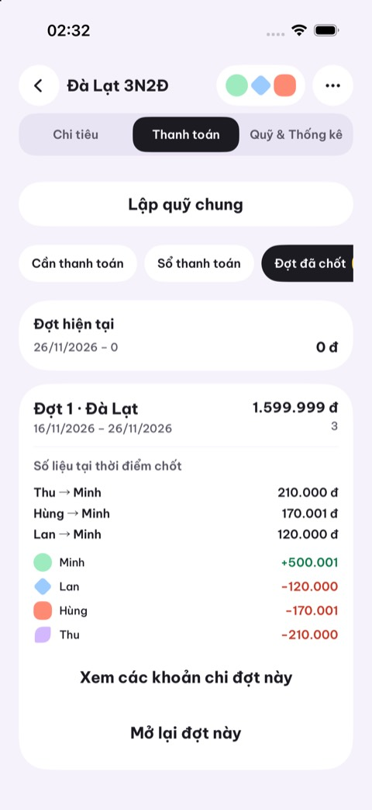

### Đợt đã chốt

- **[Giữ]** Ý tưởng chốt sổ theo đợt.
- **[Bỏ]** “26/11/2026 – 0” (ngày kết thúc hiện thành số 0), số “3” không nhãn, một trong hai bảng số.
- **[Đổi]** “Mở lại đợt này” vào menu và hỏi lại, không đứng ngang hàng với “Xem các khoản chi”.

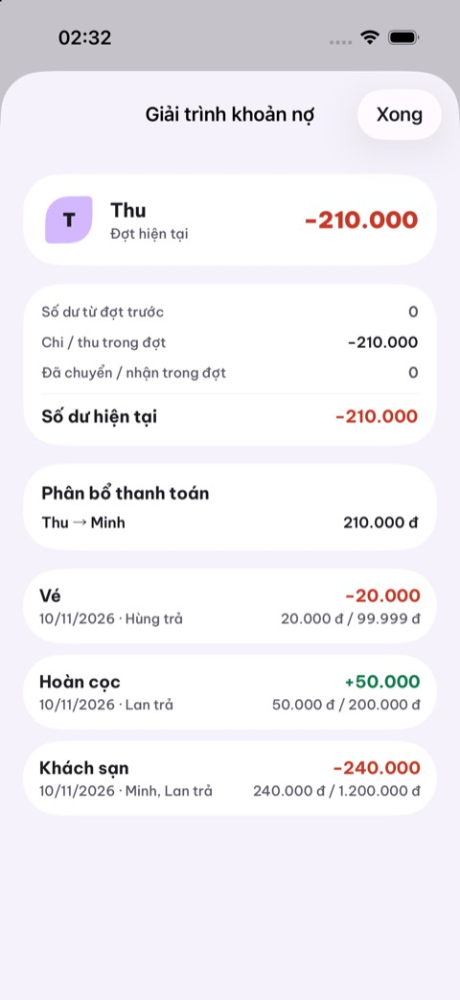

### Giải trình khoản nợ

- **[Giữ]** Đi từ số dư về từng khoản: đây là điểm mạnh về minh bạch.
- **[Bỏ]** Chữ “giải trình”, kiểu “20.000 đ / 99.999 đ” không giải thích.
- **[Đổi]** Tên “Vì sao Thu nợ 210.000 đ”. Mỗi khoản viết thành câu: “Vé 99.999 đ · Hùng trả · phần Thu 20.000 đ”. Thống nhất có hay không có chữ “đ”.

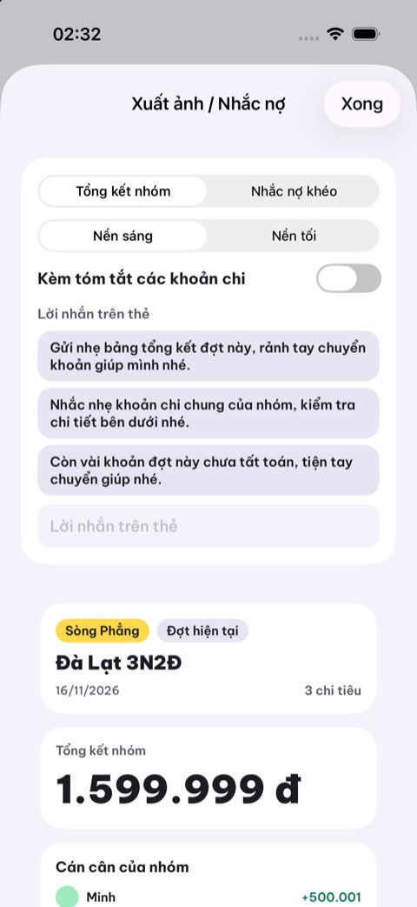

### Xuất ảnh / Nhắc nợ

- **[Giữ]** Ba câu nhắn mẫu, giọng nhẹ nhàng.
- **[Bỏ]** Hai thanh chọn chồng nhau trông giống hệt nhau. Nhãn “Lời nhắn trên thẻ” lặp cả ở placeholder.
- **[Đổi]** Ảnh xem trước lên đầu, chiếm nửa màn. Tuỳ chỉnh thành hàng chip dưới ảnh. Nút “Gửi” cố định ở đáy.

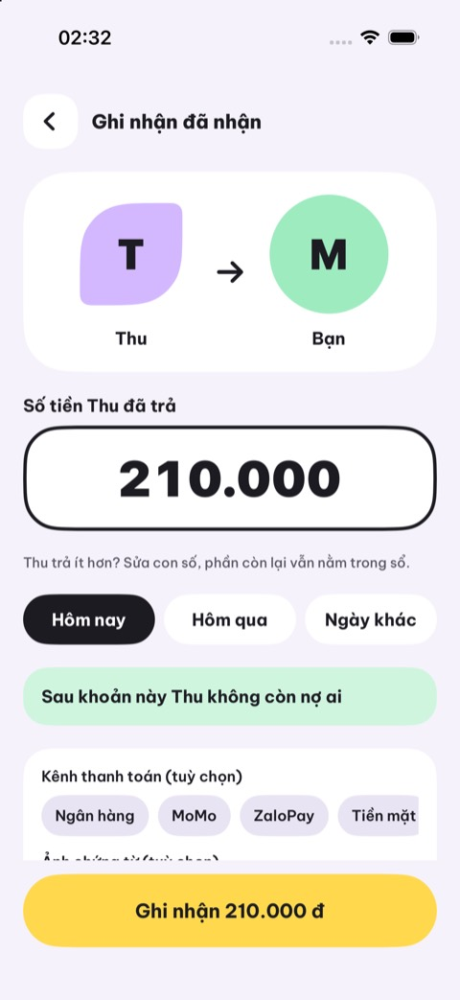

### Ghi nhận đã nhận

- **[Giữ]** Số tiền to, sửa được. Câu “Sau khoản này Thu không còn nợ ai” rất hay.
- **[Bỏ]** Tiêu đề “Ghi nhận đã nhận” (hai chữ nhận). Phần tuỳ chọn bị nút đáy che.
- **[Đổi]** Tiêu đề “Thu trả bạn”. Kênh, ảnh, ghi chú gập vào “Thêm chi tiết”. Nên là sheet, không phải màn đẩy sang.

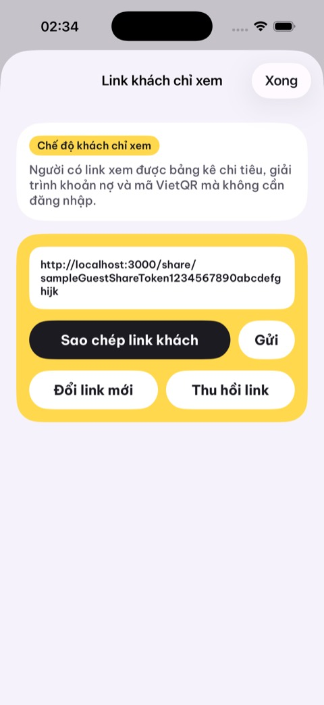

### Link khách (đã bật)

- **[Giữ]** Không cần tài khoản vẫn xem được: giá trị lớn.
- **[Bỏ]** Đường link thô, 4 nút cùng cỡ.
- **[Đổi]** Thẻ xem trước + “Gửi link” + menu. Xem mục B.

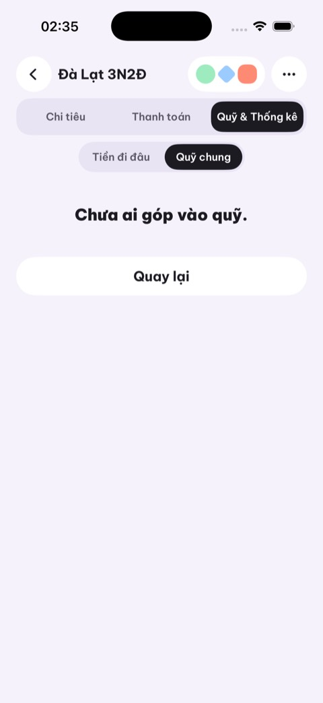

### Quỹ chung (chưa có)

- **[Giữ]** Câu ngắn.
- **[Bỏ]** Nút “Quay lại”: ở trong một tab thì không có chỗ để quay lại.
- **[Đổi]** Giải thích quỹ trong một câu và nút “Lập quỹ” ngay tại đây. Gỡ “Lập quỹ chung” khỏi đầu tab Thanh toán.

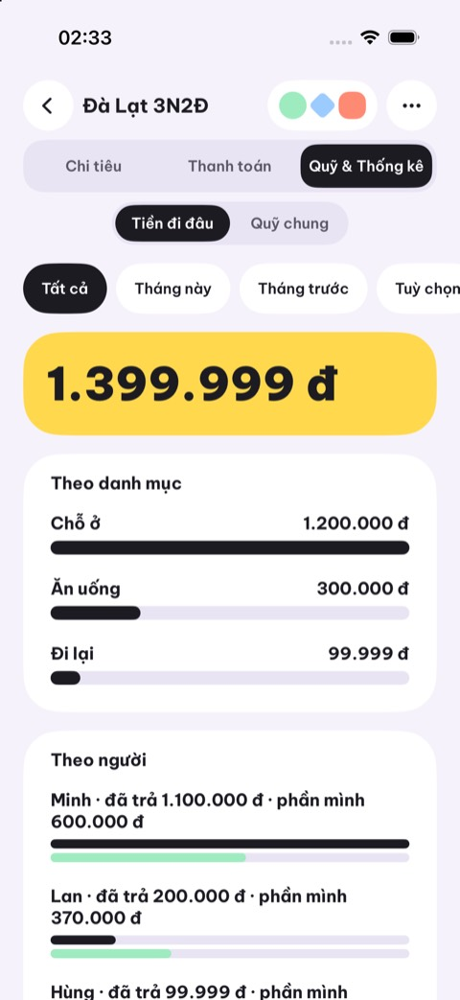

### Thống kê

- **[Giữ]** Thanh theo danh mục dễ đọc.
- **[Bỏ]** Ba tầng chọn (segment, tab con, khoảng thời gian).
- **[Đổi]** Số vàng cần nhãn: “Cả nhóm đã chi”. Theo người: hai thanh thành một thanh có vạch “phần mình”, bớt một dòng chữ dài.

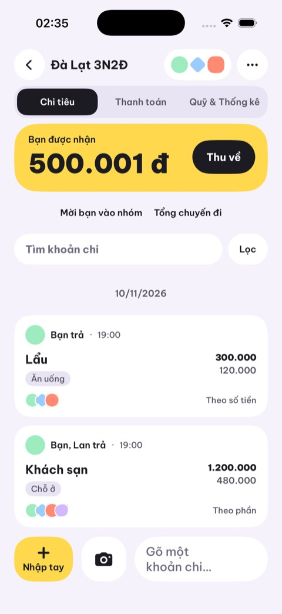

### Chi tiêu

- **[Giữ]** Thanh nhập ở đáy, hình thành viên chồng nhau.
- **[Bỏ]** “Theo số tiền”, “Theo phần” trên thẻ: thuật ngữ cách chia không cần ở danh sách. Hai link chữ “Mời bạn vào nhóm”, “Tổng chuyển đi” lơ lửng.
- **[Đổi]** Số thứ hai có nhãn: “phần bạn 120.000”. Hình người trả có chữ cái, đang là chấm xanh trơn.

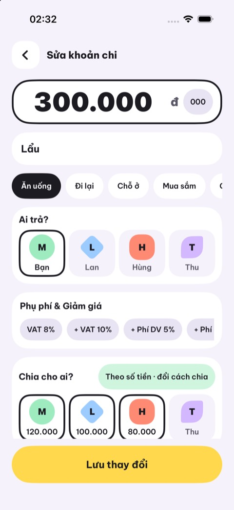

### Sửa khoản chi

- **[Giữ]** Chọn người bằng hình.
- **[Bỏ]** Hàng VAT luôn hiện. Danh sách người lặp ở “Ai trả” và “Chia cho ai”.
- **[Đổi]** Một hàng người, chạm để đổi vai (trả / chịu). Phụ phí thành chip “+ Thêm”.

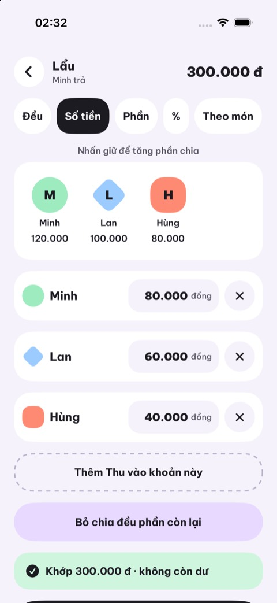

### Chia tiền

- **[Giữ]** Dải “Khớp 300.000 đ · không còn dư”: phản hồi tốt.
- **[Bỏ]** Gợi ý “Nhấn giữ để tăng phần chia” hiện cả ở chế độ Số tiền, nơi nó không đúng. Chữ “đồng” cạnh chữ “đ” ở header.
- **[Đổi]** Hàng hình phía trên và các ô phía dưới cho hai số khác nhau (120.000 và 80.000). Chỉ giữ một: ô nhập, kèm số cuối cùng nhỏ bên cạnh.

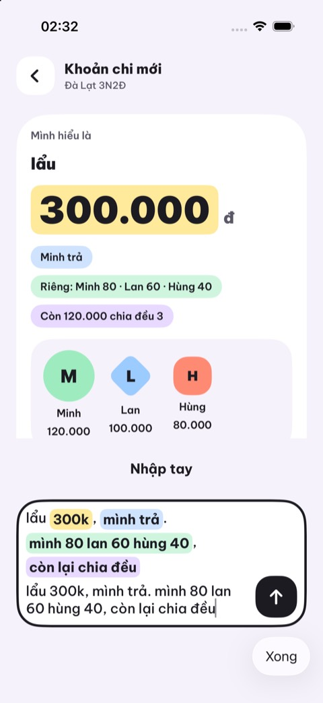

### Nhập nhanh

- **[Giữ]** Thẻ “Mình hiểu là”: đây là điểm khác biệt của app.
- **[Bỏ]** Câu hiện hai lần trong ô. Chữ “Nhập tay” trôi giữa màn trông như tiêu đề. Nút “Xong” nổi lơ lửng.
- **[Đổi]** Khi trống: 2–3 câu mẫu bấm được. “Nhập tay” thành link nhỏ cạnh ô.

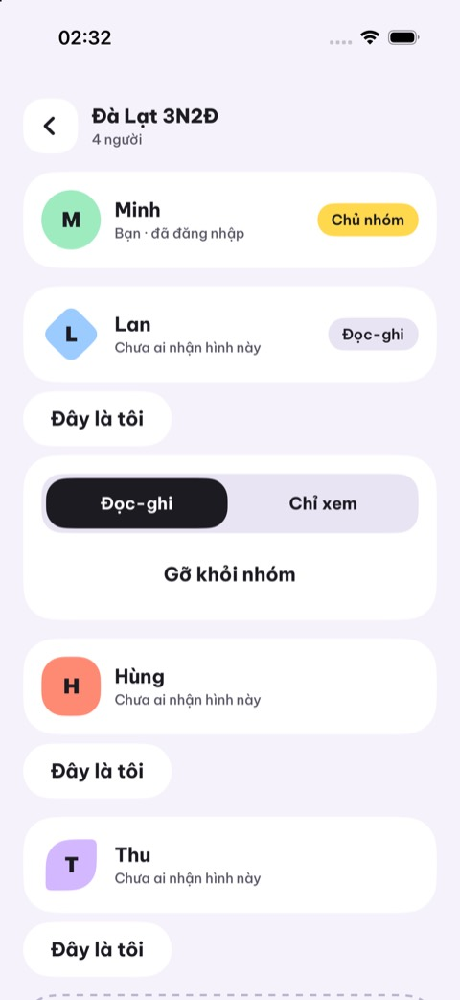

### Thành viên

- **[Giữ]** Mở hàng ra để đổi quyền.
- **[Bỏ]** Ba lần “Chưa ai nhận hình này” và “Đây là tôi”.
- **[Đổi]** Quyền thành menu trên hàng. “Gỡ khỏi nhóm” màu đỏ, nằm trong menu.

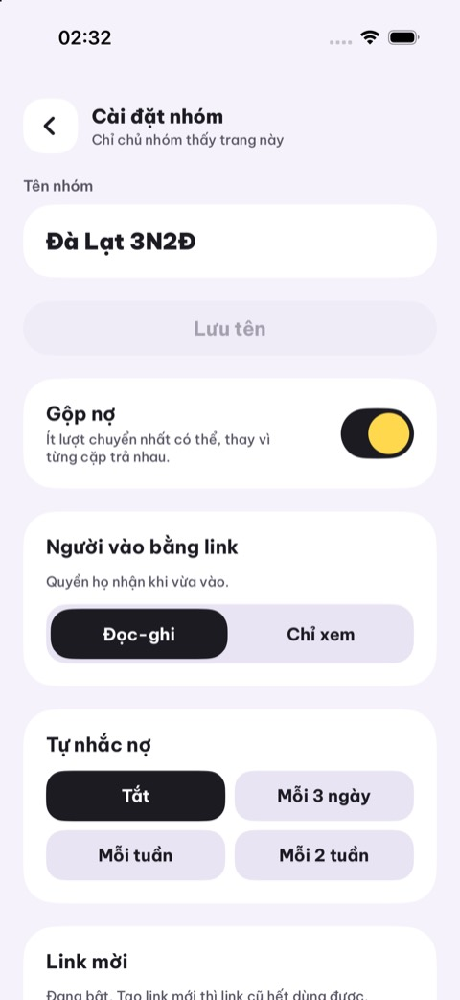

### Cài đặt nhóm

- **[Giữ]** Giải thích “Gộp nợ” bằng một câu.
- **[Bỏ]** Dòng “Chỉ chủ nhóm thấy trang này”, nút “Lưu tên” riêng.
- **[Đổi]** Tên lưu khi rời ô. “Tự nhắc nợ” từ lưới 4 nút thành một menu chọn.

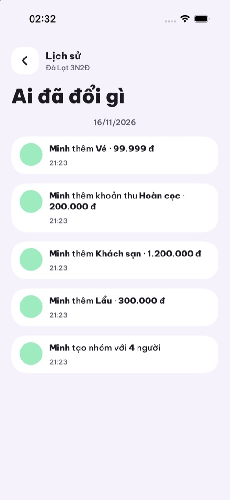

### Lịch sử

- **[Giữ]** Câu kiểu “Minh thêm Vé · 99.999 đ”.
- **[Bỏ]** Hai tiêu đề thừa. Chấm xanh không có chữ cái.
- **[Đổi]** Gom theo người và phút (mục C).

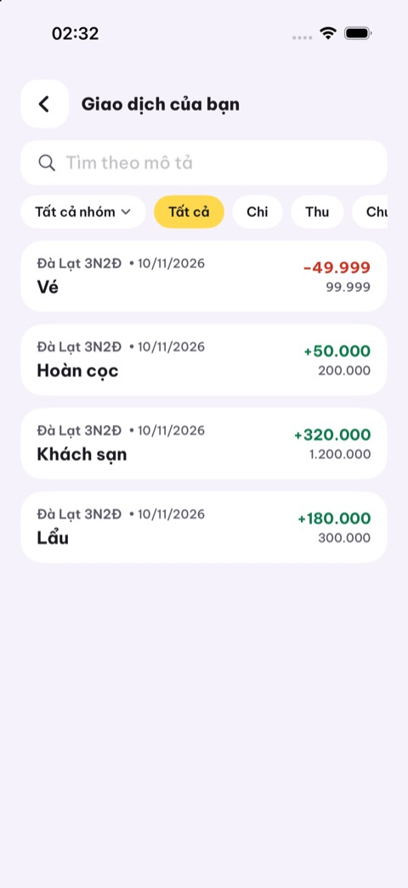

### Giao dịch của bạn

- **[Giữ]** Tìm kiếm, lọc theo nhóm.
- **[Bỏ]** Tên nhóm và ngày ở mỗi hàng.
- **[Đổi]** Số lớn có nhãn “bạn được nhận” hoặc “bạn chịu”. Số nhỏ là tổng khoản.

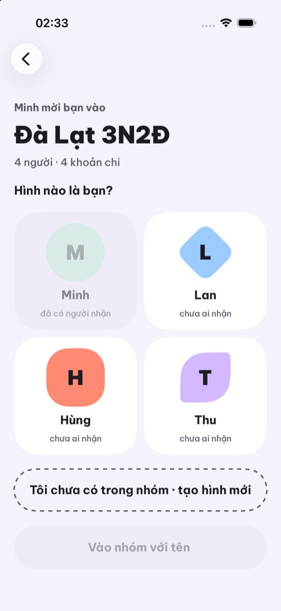

### Vào nhóm

- **[Giữ]** Gần như tốt nhất app: một câu hỏi, chọn hình, một nút.
- **[Bỏ]** Nút “Vào nhóm với tên” bị cụt khi chưa chọn.
- **[Đổi]** Khi chọn hình: hình phóng lên, nút đổi thành “Vào nhóm là Lan”. Đây là chỗ đáng có một chuyển động.

Chưa chụp, mới xem qua code: quét hoá đơn và kiểm tra món, khoản chi định kỳ, hộ gia đình, thông tin nhận tiền, ghép Telegram, sheet chốt đợt, trang khách xem qua link. Tôi sẽ chụp các màn này trước khi viết spec cho phần liên quan.

_G · Chi tiết làm nên cảm giác “có người thiết kế”_

## Mười quy ước nhỏ

Thứ làm app trông như được làm vội thường không phải bố cục lớn, mà là những chỗ không nhất quán nhỏ cộng lại. Đây là những chỗ tôi thấy trong ảnh chụp, viết thành quy ước để áp cho mọi màn.

### 1. Luôn nói từ phía người xem

Danh sách ghi “Bạn trả”, trang chi tiết lại ghi “Minh trả”, sheet trả tiền ghi “Trả Minh”. Cùng một người, ba cách gọi.

### 2. Một kiểu viết tiền

Hiện có “300.000 đ”, “300.000” và “80.000 đồng”. Chọn: số chính có “đ”, số phụ trong cùng hàng thì không.

### 3. Số luôn có nhãn

Không con số nào đứng một mình. Nhãn có thể nhỏ, nhưng phải có.

### 4. Hình thành viên ở mọi nơi có tên người

Lịch sử, chip lọc và thẻ chi tiêu đang dùng chấm tròn trơn hoặc chữ. Hình là nhận diện của app, nên ở đâu có tên người thì ở đó có hình.

### 5. Trạng thái trống có việc tiếp theo

“Chưa ai góp vào quỹ” + “Quay lại” là ngõ cụt. Trạng thái trống nào cũng chỉ ra việc đầu tiên nên làm.

### 6. Việc nguy hiểm không đứng cạnh việc thường

“Mở lại đợt”, “Thu hồi link”, “Gỡ khỏi nhóm” đang cùng cỡ, cùng màu với nút thường. Đưa vào menu, tô đỏ, hỏi lại.

### 7. Không để chữ bị cắt

Hàng nút cuộn ngang đang cắt “Chốt”, chip “Có ch…”, danh mục “C”. Nếu phải cuộn thì để lộ rõ nửa nút cuối, hoặc gom bớt.

### 8. Lề và vùng bấm thẳng hàng

Header chi tiết đang tràn mép. Dùng thanh điều hướng của hệ thống thì phần này tự đúng.

### 9. Rung có nghĩa

Rung nhẹ khi chọn, rung thành công khi tiền đổi chủ, rung cảnh báo khi lỗi. Không rung khi chỉ đổi tab.

### 10. Chữ cái đầu chỉ là chỗ tạm

Ô tên nhóm mới không có gợi ý. Dùng gợi ý cụ thể như “Đà Lạt cuối tuần”, đúng giọng app.

_H · Để thảo luận tiếp_

## Những chỗ tôi muốn nghe ý bạn

1. **Trả thanh điều hướng về cho iOS?** Đổi lại thì mất header tự vẽ hiện tại (nút tròn trắng, tiêu đề + phụ đề), được Liquid Glass và chuyển màn chuẩn. Tôi nghiêng về trả lại. Web sẽ giữ header riêng.
2. **Thêm, sửa khoản chi mở dạng toàn màn hình thay vì đẩy sang?** Kéo theo: không còn vuốt lùi để thoát form, phải bấm Huỷ. Đổi lại: không mất dữ liệu do vuốt nhầm.
3. **Đánh dấu “Đã nhận” không cần sheet xác nhận, chỉ cần Hoàn tác?** Nhanh hơn nhiều khi thu 5–6 người liên tiếp. Rủi ro: bấm nhầm thì số dư đổi trong vài giây trước khi hoàn tác, và người kia có thể nhận thông báo. Cần xem server có hỗ trợ huỷ ngay không.
4. **Gộp Sổ thanh toán vào Lịch sử?** Hai màn đều là danh sách những gì đã xảy ra. Gộp lại thì bớt một tab con.
5. **Mức chi tiết của trang chi tiết khoản chi** Người dùng mới chỉ cần biết mình chịu bao nhiêu. Cách chia nên gập sẵn hay mở sẵn?

_Thấy trong lúc rà_

## Lỗi nên sửa sớm, không cần chờ redesign

- **Hai nút quay lại** ở chi tiết khoản chi, header tràn mép. `TransactionDetailView` thiếu `.navigationBarBackButtonHidden(true)`.
- **Sheet trả tiền sai vai:** người nhận thấy “Trả Minh” và “Sao chép số tiền”. `PayView` luôn dùng `pay.title`.
- **Quỹ chung trống** chỉ có nút “Quay lại”, không có cách lập quỹ ngay tại chỗ.
- **Đợt hiện tại** hiện “26/11/2026 – 0” thay vì ngày hoặc “đến nay”.

_Nguồn_

- [Apple HIG: Sheets](https://developer.apple.com/design/human-interface-guidelines/sheets)
- [WWDC25: Build a SwiftUI app with the new design (Liquid Glass, sheet, toolbar)](https://developer.apple.com/videos/play/wwdc2025/323/)
- [Nil Coalescing: Presenting Liquid Glass sheets in SwiftUI on iOS 26](https://nilcoalescing.com/blog/PresentingLiquidGlassSheetsInSwiftUI)
- [Apple Developer Forums: thẻ gốc biến mất khi ngắt chuyển zoom](https://developer.apple.com/forums/thread/796805)
- [Apple Developer Forums: chuyển zoom vào sheet nửa màn](https://developer.apple.com/forums/thread/788257)
- [NN/g: Icon Usability](https://www.nngroup.com/articles/icon-usability/)
- [WWDC23: Demystify SwiftUI performance](https://developer.apple.com/wwdc23/10160)
