> **Part 3 — direction and decisions.** Verbatim Markdown copy of the review page published on 2026-11-28 as a private artifact (https://claude.ai/artifact/XhnuFd9j59r6ywDopcHugz). Wording is unchanged (only formatting was adapted to Markdown); screenshots are in `img/`; HTML mockups are kept as text blocks, and interactive demos exist only on the original page. Findings are tracked with IDs in [findings.md](findings.md). Owner decisions made after this page are recorded in `docs/superpowers/specs/2026-11-28-ui-ux-v3-roadmap-overview-design.md` and take precedence over the questions asked here.

_Sòng Phẳng · UI/UX v3 · Phần 3_

# Đáp án trước, lý do khi cần

Phần này ghi lại những gì đã thống nhất, hai lựa chọn tôi đề xuất thay bạn, thảo luận sâu về trang chi tiết, và lượt rà thêm 24 màn và trạng thái chưa xem ở phần 2. Ảnh chụp từ bản build `main` ngày 28/11/2026.

[Phần 1: các màn chính](https://claude.ai/artifact/V2pnPiiaDgYFnUP4VrwutS) · [Phần 2: màn chi tiết](https://claude.ai/artifact/1pPqWyGEvhC3iJHnRKjz34)

Câu 1 · Điều hướng · **[Đã thống nhất]**

Trả thanh điều hướng về cho iOS ở mọi màn đẩy sang.

Câu 2 · Form thêm/sửa · **[Tôi chọn]**

Sheet lớn, chặn vuốt đóng khi đã nhập. Xem mục A.

Câu 3 · Đã nhận · **[Tôi chọn]**

Ghi ngay, hoàn tác trong 5 giây, chỉ gửi lên server khi hết 5 giây. Xem mục B.

Câu 4 · Sổ thanh toán · **[Đã thống nhất]**

Gộp vào Lịch sử, thêm bộ lọc “Thanh toán”.

Câu 5 · Trang chi tiết · **[Đang thảo luận]**

Mô hình ba tầng: đáp án, lý do, bằng chứng. Xem mục C.

Lỗi đã thấy · **[Sửa trong v3]**

4 lỗi ở phần 2 và 5 lỗi mới ở cuối trang này.

_A · Câu 2_

## Thêm và sửa khoản chi mở bằng sheet lớn

Ba cách mở form, xét theo hai việc người dùng làm nhiều nhất: ghi một khoản chi thật nhanh rồi quay lại danh sách, và lỡ tay muốn bỏ.

Cách 1 · hiện tại

### Đẩy sang như trang

- Vuốt mép trái để thoát quen tay

- Vuốt mép trái nhầm là mất dữ liệu, không hỏi
- Trông như trang để đọc, không như việc cần làm xong
- Lưu xong phải tự bật ngược về danh sách

Cách 2 · đề xuất

### Sheet lớn

- Thấy mép danh sách phía sau, biết mình đang ở trong nhóm nào
- Vuốt xuống để huỷ khi chưa nhập gì: nhanh, đúng thói quen iOS
- Khi đã nhập: chặn vuốt, bấm Huỷ thì hỏi “Bỏ khoản chi này?”
- Lưu xong sheet hạ xuống, thẻ mới trượt vào danh sách: chuyển động duy nhất của luồng này

- Cần tự chặn vuốt khi đã nhập (`interactiveDismissDisabled`)

Cách 3

### Toàn màn hình

- Không bao giờ đóng nhầm

- Không vuốt xuống được, kể cả khi chưa nhập gì
- Mất ngữ cảnh nhóm phía sau
- Nặng nề cho việc mất 10 giây

### Vì sao chọn sheet lớn

- Apple xếp tạo mới là một việc có phạm vi rõ, gắn với ngữ cảnh hiện tại. Đó đúng là chỗ dành cho sheet. Apple cũng khuyên hỏi lại trước khi đóng một form đã nhập, để không mất dữ liệu.
- Các app gốc của iOS đều mở form tạo mới theo cách này: sự kiện mới trong Lịch, liên hệ mới trong Danh bạ, lời nhắc mới.
- Toàn màn hình chỉ dùng cho camera quét hoá đơn, vì đó là việc cần cả màn hình.

### Áp dụng cụ thể

- Mở sheet là bàn phím số bật ngay ở ô số tiền.
- “Huỷ” ở góc trái, “Lưu” to ở đáy, luôn nhìn thấy trên bàn phím.
- Sửa khoản chi dùng đúng sheet này, tiêu đề “Sửa khoản chi”.
- Nhập nhanh vẫn nằm ở thanh đáy của nhóm. Thẻ “Mình hiểu là” hiện thành sheet nửa màn, có “Lưu” và “Sửa chi tiết”. Bấm sửa thì sheet kéo lên thành form đầy đủ, không đóng rồi mở lại.
- Trang chi tiết khoản chi vẫn đẩy sang, vì đó là đọc chứ không phải làm.

_B · Câu 3_

## Bấm “Đã nhận” là xong, có 5 giây để đổi ý

Tôi đã đọc code trước khi chọn. App có hai luồng. Người trả bấm “Tôi đã trả” thì tạo một yêu cầu chờ người nhận xác nhận, đã là hai bước. Người nhận bấm “Đã nhận” thì ghi thẳng một khoản thanh toán vào sổ. Câu hỏi này là về luồng thứ hai.

Cách 1 · hiện tại

### Mở sheet rồi bấm lần nữa

- Sửa được số tiền, thêm ảnh ngay

- Hai lần bấm, hai chuyển động cho việc làm nhiều lần liên tiếp
- Thu 5 người là mở 5 sheet

Cách 2

### Hộp hỏi “Chắc chưa?”

- Chặn được bấm nhầm

- Người dùng nhanh chóng bấm đồng ý theo phản xạ, hộp hỏi mất tác dụng
- Vẫn chậm như cách 1

Cách 3 · đề xuất

### Ghi ngay, hoàn tác 5 giây

- Một lần bấm
- Bấm nhầm thì sửa được ngay tại chỗ
- Người trả không nhận thông báo sai, vì chưa có gì gửi đi

- Cần một hàng đợi nhỏ phía app

### Vì sao phải đợi 5 giây mới gửi

Server gửi thông báo ngay khi có thanh toán mới. Nếu gửi ngay rồi hoàn tác bằng cách xoá, Thu vẫn nhận được thông báo “Minh đã ghi nhận 210.000 đ” cho một việc không còn tồn tại. Gmail làm nút “Hoàn tác gửi” theo cùng cách: giữ thư lại vài giây rồi mới gửi.

0 GIÂY · **Bấm Đã nhận** Hàng mờ đi, số còn lại đếm xuống, rung nhẹ. Thanh “Hoàn tác” hiện ở đáy.

0–5 GIÂY · **Còn đổi ý được** Chưa gửi gì lên server. Bấm Hoàn tác thì hàng trở lại như cũ.

5 GIÂY, HOẶC RỜI MÀN · **Gửi lên server** Dùng khoá chống gửi trùng sẵn có (`idempotencyKey`). Rời màn hoặc đưa app xuống nền thì gửi luôn, không chờ.

SAU ĐÓ · **Muốn sửa nữa** Vào Lịch sử, mở khoản thanh toán, xoá như một khoản bình thường.

### Khi nào vẫn mở sheet

- **Nhận thiếu:** chạm vào hàng (không phải nút) để mở sheet sửa số tiền, thêm ảnh, ghi chú.
- **Ghi hộ hai người khác** (chủ nhóm ghi Thu đã trả Lan): đây là tiền của người khác, nên luôn mở sheet xác nhận.
- **Mất mạng:** vẫn bấm được, hàng có dấu “chờ gửi”, gửi khi có mạng.

NN/g khuyên chỉ dùng hộp xác nhận cho việc không đảo ngược được hoặc tốn kém. Đánh dấu đã nhận thì đảo ngược được, nên hoàn tác hợp hơn hỏi lại.

_C · Câu 5 · thảo luận_

## Bạn đúng, với ba điều cần thêm

Trải nghiệm của bạn khớp với cách các app chia tiền lớn đang làm. Tricount mô tả mình là app “cho biết chính xác bạn nợ bao nhiêu”. Settle Up tính lại số dư và gợi ý lượt chuyển sau mỗi khoản chi. Người ta mở app để biết một con số và một cái tên, chỉ đào sâu khi con số đó trông lạ. Có ba chỗ tôi muốn thêm vào nhận định của bạn.

Thêm 1 · thời điểm

### Có hai lúc người ta mở app

Lúc quyết toán, câu hỏi là “trả ai bao nhiêu”, đúng như bạn nói. Nhưng lúc có thông báo khoản chi mới, câu hỏi là “khoản này mình chịu bao nhiêu”. Vì vậy trang chi tiết khoản chi phải mở đầu bằng **phần của bạn**, không phải tổng hoá đơn.

Thêm 2 · vai

### Người ứng tiền hỏi câu khác

Người trả hộ (thường là chủ nhóm) hỏi “ai còn nợ mình, ai trả rồi” và cần nhắc. Cùng một màn, chỉ đổi câu đầu: “Bạn cần trả” hay “Bạn sẽ nhận”. Không cần màn riêng cho chủ nhóm. Khác biệt nằm ở quyền sửa và ở trang Thông tin nhóm.

Thêm 3 · gộp nợ

### Gộp nợ làm đứt mạch “vì sao”

Khi bật Gộp nợ, Thu có thể phải trả Minh dù cả chuyến chỉ ăn với Hùng. Splitwise ghi nhận người dùng bối rối đúng chỗ này và nói họ đã thử làm rõ nhưng chưa thành công. Vì vậy phần “vì sao” phải giải thích theo **số dư của bạn** trước, rồi mới nói vì sao trả cho người này.

### Ba tầng, mỗi tầng cách nhau một lần bấm

Mockup nhìn từ phía Hùng. Số liệu là minh hoạ, cộng trừ khớp với nhau nhưng không lấy từ dữ liệu mẫu của app.

**Tầng 1 · Đáp án** Màn nhóm. Một con số, một cái tên, một nút.

```text
‹ Đà Lạt 3N2Đ
[Bạn cần trả] 170.001 đ cho Minh · là xong cả chuyến
Khoản mới nhất 10/11
Lẩu
Minh trả 300.000
phần bạn 80.000
Khách sạn
Minh, Lan trả 1.200.000
phần bạn 220.000
Mỗi khoản chỉ có một số đậm là phần của bạn. Tổng hoá đơn nằm nhỏ bên dưới.
```

**Tầng 2 · Lý do** Sheet nửa màn. Một phép tính bằng chữ.

```text
Vì sao bạn cần trả 170.001 đ
Phần bạn chịu 270.000
Bạn đã trả trước (Vé) − 99.999
Còn lại 170.001 đ
Phần của bạn trong từng khoản 4 khoản
Khách sạn
Minh, Lan trả
220.000
Lẩu
Minh trả
80.000
Vé
Bạn trả
20.000
Hoàn cọc
Lan nhận lại
− 50.000
Gộp nợ đang bật: để ít lượt chuyển nhất, bạn trả hết cho Minh thay vì chia ra cho Minh và Lan.
```

**Tầng 3 · Bằng chứng** Trang chi tiết khoản chi, đẩy sang.

```text
‹ Lẩu Sửa
Phần bạn 80.000 đ Minh trả cả 300.000 đ · 10/11, 19:00 · Ăn uống
Cách chia · theo số tiền ▾
Minh
120.000
Lan
100.000
Bạn
80.000
40.000 riêng + 40.000 phần chia đều
Ảnh hoá đơn · 2 bình luận ›
Sai số tiền Tôi không có mặt Chia sai Khác
```

### Ghi chú cho mô hình

- Tầng 1 đến tầng 3 luôn là **con số → bấm → lý do → bấm → bằng chứng**. Không quá hai lần bấm từ con số khó hiểu tới hoá đơn gốc.
- Chủ nhóm và thành viên thấy cùng ba tầng. Chỉ khác chữ đầu (“cần trả” hay “sẽ nhận”) và nút “Sửa”.
- Ở tầng 3 chỉ còn một bộ số: phần của từng người. Cách tính (riêng + chia đều) là một dòng nhỏ, không phải một bộ số thứ hai.
- “Khoản này chưa đúng” hiện có ô “Lý do” tự gõ, sheet trống một nửa. Đổi thành 4 lý do bấm được. Lý do giúp người tạo khoản sửa đúng chỗ mà không phải hỏi lại.

### Hai điều tôi muốn bạn quyết

1. Danh sách chi tiêu lấy “phần bạn” làm số đậm và tổng hoá đơn làm số nhỏ (ngược với hiện tại)?
2. Gộp nợ bật sẵn cho nhóm mới như hiện tại, hay tắt sẵn và gợi ý bật khi nhóm có từ 4 người?

_D · Rà thêm_

## 24 màn và trạng thái chưa xem ở phần 2

Gồm đăng nhập, tổng quan, tài khoản, trang khách, vai chỉ xem, nhóm trống, nhóm lớn, mất mạng, chưa xác minh email, cả nhóm đã xong, phần cuối trang thành viên, hai sheet, chế độ tối và cỡ chữ lớn nhất.

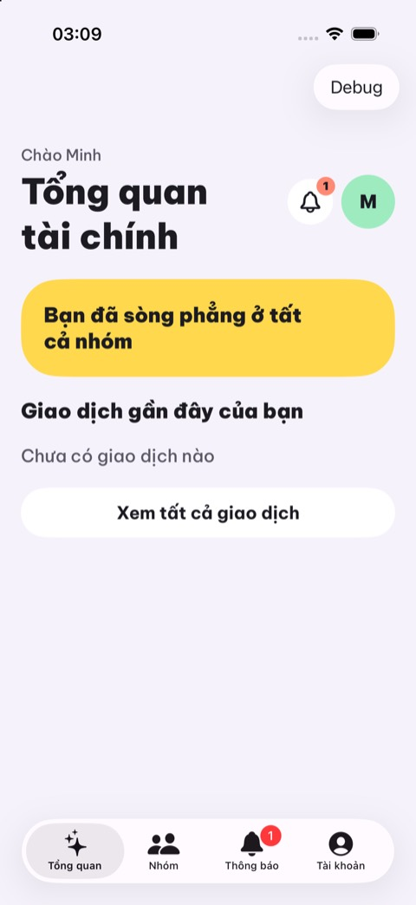

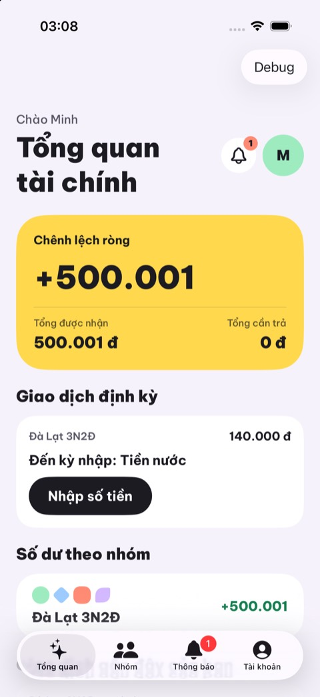

### Lần đầu mở app

- **[Cao]** Người dùng mới chưa có nhóm nào thấy thẻ vàng “Bạn đã sòng phẳng ở tất cả nhóm”. Đây là màn đầu tiên họ thấy, và câu này sai: họ chưa có nhóm nào. Bên dưới là “Chưa có giao dịch nào” và nút “Xem tất cả giao dịch” dẫn tới một danh sách trống.
- **[Lặp]** Khi có nhóm, thẻ vàng ghi “Chênh lệch ròng +500.001”, rồi “Tổng được nhận 500.001 đ” và “Tổng cần trả 0 đ”. Một con số in hai lần, kèm một số 0. Tiêu đề có ba tầng: “Chào Minh”, “Tổng quan tài chính”, chuông và ảnh đại diện.

**Hướng:** người mới thấy một việc: “Tạo nhóm đầu tiên” hoặc “Có link mời? Dán vào đây”, kèm các hình thành viên làm minh hoạ. Khi có nhóm: một câu “Bạn sẽ nhận 500.001 đ”. Chỉ hiện tách hai chiều khi cả hai đều khác 0.

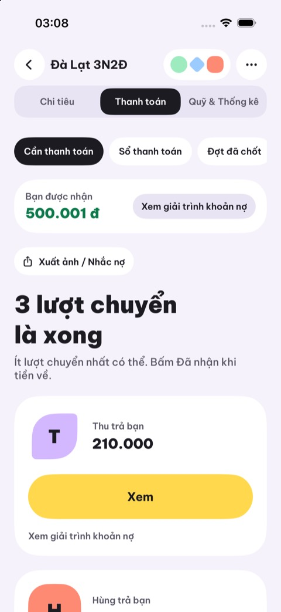

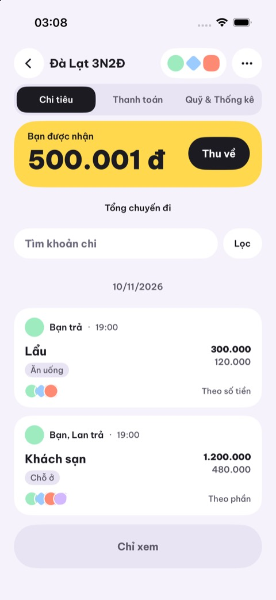

### Vai chỉ xem

- **[Lặp]** Người chỉ xem thấy một nút vàng to “Xem” ở mỗi hàng, cộng “Xem giải trình khoản nợ” ở dưới, cộng nút cùng tên ở thẻ số dư. Ba lối vào một việc. Màu vàng là màu của việc chính, nên người xem tưởng phải bấm.
- **[Kiểu]** Thanh nhập ở đáy biến thành một nút xám “Chỉ xem” bị tắt, chiếm chỗ như một nút thật.

**Hướng:** người chỉ xem không có nút trên hàng. Bấm vào hàng để xem. Thanh đáy ẩn đi, thay bằng một dòng nhỏ ở đầu nhóm: “Bạn đang xem nhóm này”. Đây cũng là bằng chứng thêm cho mục D của phần 2: nút trên hàng phải tuỳ vai.

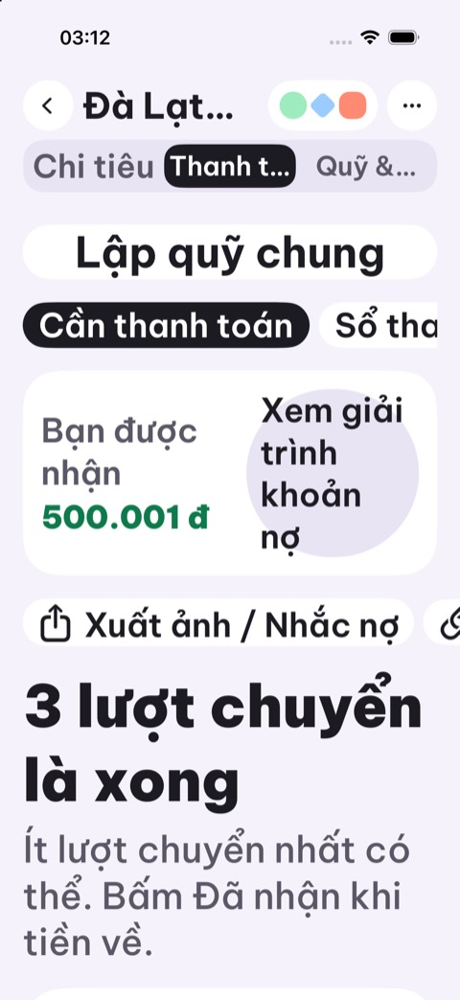

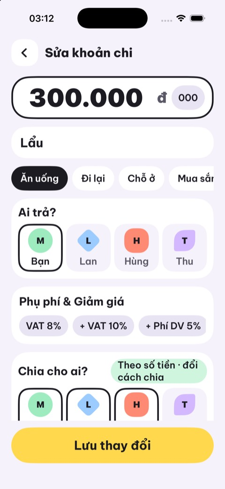

### Cỡ chữ lớn (Trợ năng)

- **[Không đều]** Một nửa app phóng chữ, một nửa không. Tab Thanh toán phóng to đến mức nút “Xem giải trình khoản nợ” thành một khối tròn bốn dòng, segment bị cắt thành “Thanh t…”, “Quỹ &…”. Form sửa khoản chi gần như giữ nguyên cỡ chữ.

**Hướng:** mọi chữ đi qua thang chữ của `Typography` có hỗ trợ cỡ chữ động. Ở cỡ chữ lớn, các hàng ngang tự xếp dọc. Đặt cỡ lớn nhất là một bước kiểm tra bắt buộc cho mỗi màn trong v3.

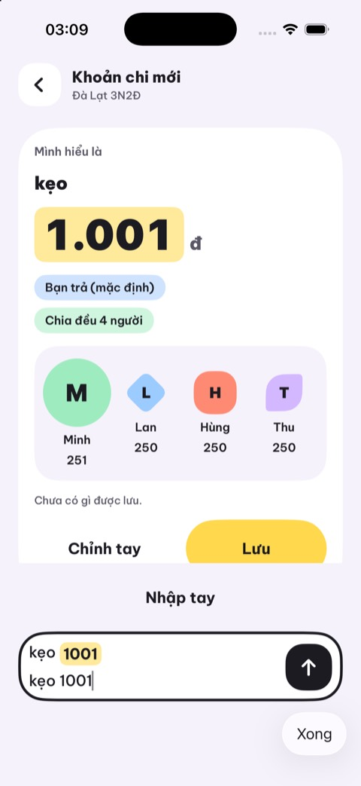

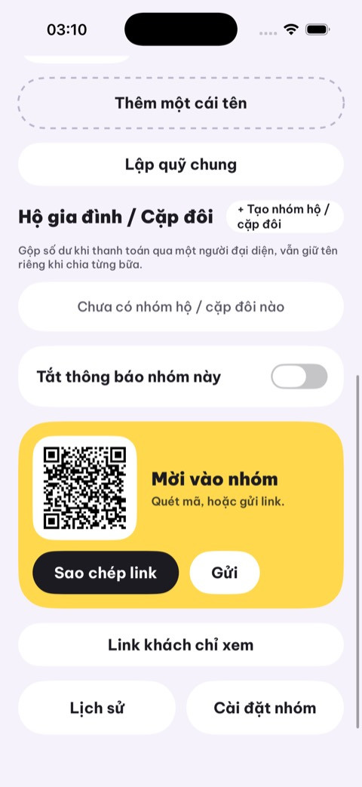

### Nhập nhanh và cuối trang thành viên

- **[Lỗi]** Nhập nhanh: nút “Chỉnh tay” và “Lưu” của thẻ “Mình hiểu là” bị chữ “Nhập tay” đè lên và cắt mất nửa dưới. Đây là hai nút quan trọng nhất của màn.
- **[Dồn]** Cuối trang thành viên có 8 khối khác loại: thêm tên, lập quỹ, hộ gia đình, tắt thông báo, mã mời, link khách, lịch sử, cài đặt. “Lập quỹ chung” có ở ba nơi trong app. “Lịch sử” và “Cài đặt” trùng với menu ba chấm.

**Hướng:** trang này trở thành “Thông tin nhóm” như phần 1 đề xuất, chia ba mục rõ: Người, Mời, Nhóm. Mỗi chức năng chỉ có một lối vào.

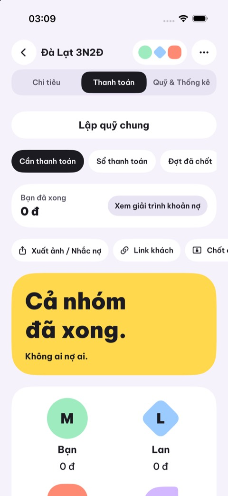

### Cả nhóm đã xong

- **[Giữ]** “Cả nhóm đã xong. Không ai nợ ai.” Đây là chỗ cho chuyển động ăn mừng.
- **[Bỏ]** “Bạn đã xong 0 đ” kèm “Xem giải trình khoản nợ” cho số 0. Bốn ô ai cũng “0 đ”.
- **[Đổi]** Gợi ý việc tiếp theo: “Chốt đợt này” hoặc “Gửi ảnh tổng kết”.

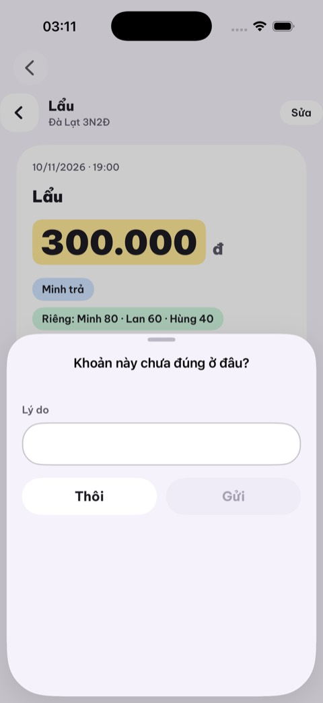

### Khoản này chưa đúng

- **[Giữ]** Câu hỏi “Khoản này chưa đúng ở đâu?” rất tự nhiên.
- **[Bỏ]** Sheet nửa màn trống một nửa. “Thôi”.
- **[Đổi]** 4 lý do bấm được, ô ghi chú tuỳ ý, sheet cao theo nội dung.

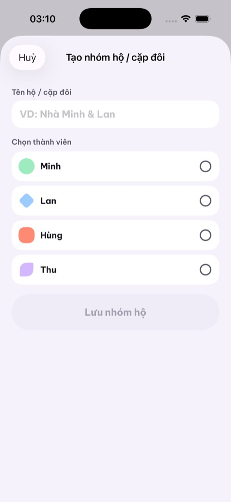

### Tạo hộ / cặp đôi

- **[Giữ]** Ví dụ “Nhà Minh & Lan” trong ô tên.
- **[Bỏ]** “hộ / cặp đôi” lặp ở tiêu đề, nhãn, nút. Nửa dưới trống.
- **[Đổi]** Gọi chung là “Hộ”, giải thích một lần. Hình thành viên có chữ cái. Chọn đủ 2 người thì tự gợi ý tên.

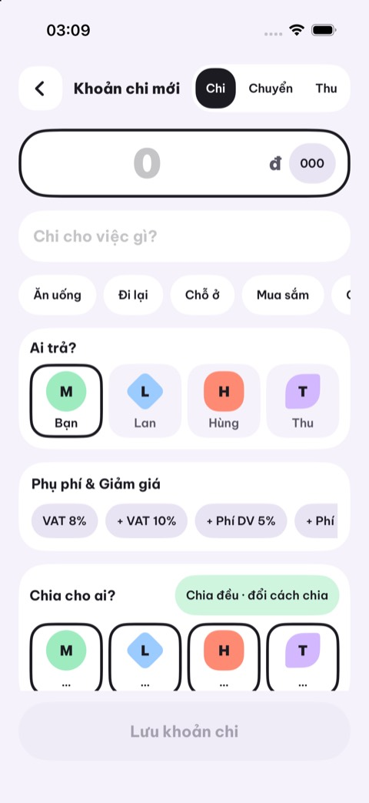

### Khoản chi mới

- **[Giữ]** Chi / Chuyển / Thu ở đầu form.
- **[Bỏ]** Ô “Chia cho ai” hiện “…” khi số tiền là 0. Bàn phím không tự bật.
- **[Đổi]** Theo mục A: sheet lớn, bàn phím bật sẵn, phần chia hiện khi đã có số tiền.

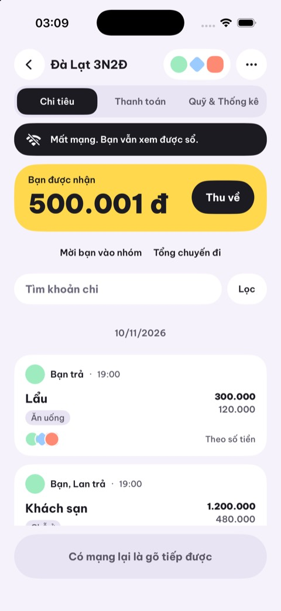

### Mất mạng

- **[Giữ]** “Mất mạng. Bạn vẫn xem được sổ.” và “Có mạng lại là gõ tiếp được”: câu chữ tốt nhất app.
- **[Bỏ]** Nút “Thu về” vẫn sáng khi mất mạng.
- **[Đổi]** Cho phép ghi khi mất mạng theo hàng đợi ở mục B, thay vì chặn.

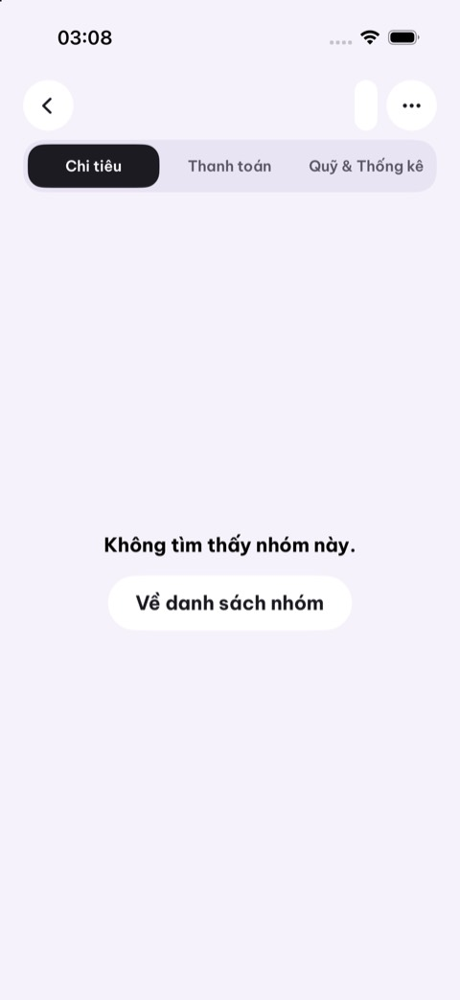

### Không tìm thấy nhóm

- **[Giữ]** Có nút về danh sách nhóm.
- **[Bỏ]** Header vẫn vẽ một viên trắng rỗng (chỗ hình thành viên) và segment, dù không có nhóm.
- **[Đổi]** Trạng thái lỗi dùng một màn trống riêng, không có header nhóm.

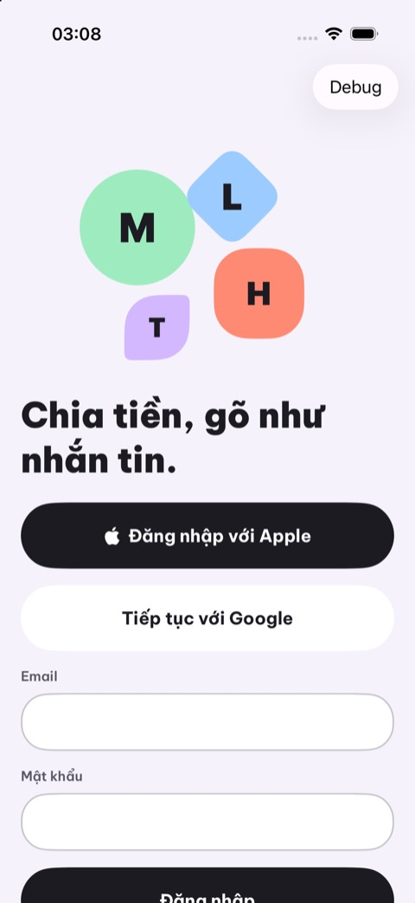

### Đăng nhập

- **[Giữ]** “Chia tiền, gõ như nhắn tin.” và cụm hình thành viên: nhận diện tốt.
- **[Bỏ]** Form email hiện sẵn dưới Apple và Google, đẩy nút đăng nhập xuống đáy.
- **[Đổi]** Apple, Google, rồi “Dùng email” mở form. Hình thành viên có thể chuyển động nhẹ một lần khi mở app.

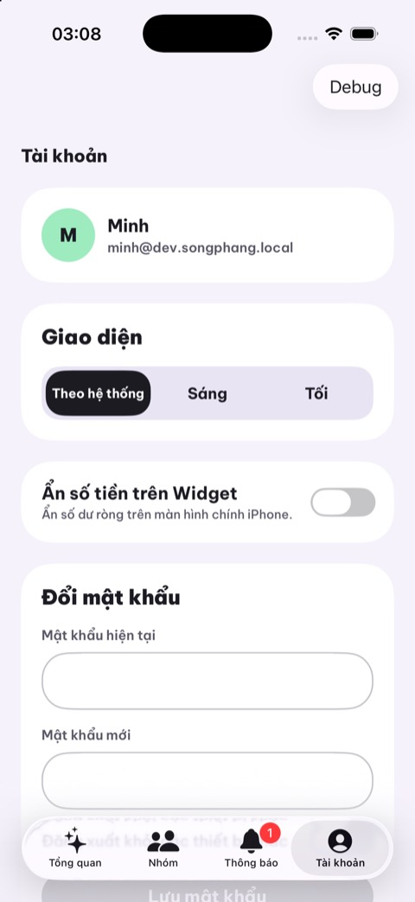

### Tài khoản

- **[Giữ]** Chọn giao diện sáng, tối, theo hệ thống.
- **[Bỏ]** Form đổi mật khẩu mở sẵn (đã nêu ở phần 1).
- **[Đổi]** Dạng danh sách cài đặt chuẩn iOS. Mỗi mục mở một trang con.

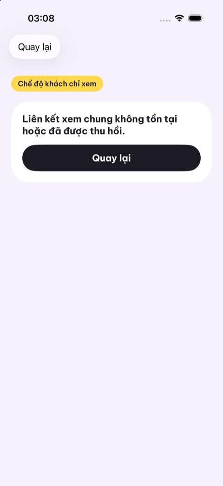

### Trang khách · link hỏng

- **[Giữ]** Nói rõ link không tồn tại hoặc đã bị thu hồi.
- **[Bỏ]** Hai nút “Quay lại” trên cùng một màn.
- **[Đổi]** Một nút, và gợi ý “Xin người gửi một link mới”.

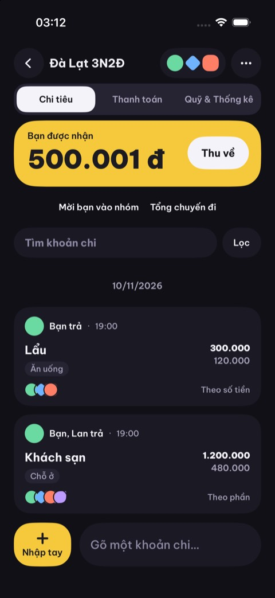

### Chế độ tối

- **[Giữ]** Độ tương phản ổn, màu vàng vẫn rõ, hình thành viên vẫn tươi.
- **[Bỏ]** Không thấy lỗi lớn ở 3 màn đã thử.
- **[Đổi]** Cần thử thêm sheet và ảnh chia sẻ ở chế độ tối.

_E · Độ phủ_

## Đã xem gì, còn thiếu gì

Bảng này để chúng ta biết phần nào đã có bằng chứng từ ảnh chụp và phần nào mới chỉ đọc code. Các màn ở cột “Chưa” cần thao tác mà simulator không làm sẵn được (chụp ảnh hoá đơn, ghép Telegram) hoặc cần một bước bấm dài hơn.

| Khu vực | Màn / trạng thái | Tình trạng |
|---|---|---|
| Vào app | Đăng nhập, tạo tài khoản, quên mật khẩu, vào nhóm, link mời hỏng | **[Đã chụp]** |
| Vào app | Xin quyền thông báo, cần cập nhật app, xác minh email | **[Chỉ code]** |
| Tổng quan | Có nhóm, người mới, giao dịch của bạn, thông báo | **[Đã chụp]** |
| Nhóm | Chi tiêu, thanh toán, sổ, đợt, quỹ trống, thống kê, chi tiết khoản chi, lịch sử, thành viên, cài đặt, xoá nhóm | **[Đã chụp]** |
| Nhóm · vai và trạng thái | Chỉ xem, nhóm lớn, mất mạng, chưa xác minh, cả nhóm đã xong, không tìm thấy | **[Đã chụp]** |
| Nhóm · vai biên tập | Biên tập viên không phải chủ nhóm | **[Chưa]** |
| Khoản chi | Thêm, sửa, chia tiền, nhập nhanh (đúng và sai), khoản này chưa đúng | **[Đã chụp]** |
| Khoản chi | Quét hoá đơn, gán món, duyệt khoản chi, khoản chi định kỳ, quản lý danh mục | **[Chưa]** |
| Thanh toán | Sheet trả tiền, ghi nhận đã nhận, giải trình, xuất ảnh (sáng, tối, nhắc nợ), link khách | **[Đã chụp]** |
| Thanh toán | Thông tin nhận tiền, QR VietQR có tài khoản, xác nhận yêu cầu chờ, chốt đợt, lập quỹ có tiền | **[Chưa]** |
| Thông tin nhóm | Hộ gia đình, mã mời | **[Đã chụp]** |
| Thông tin nhóm | Nhân bản nhóm, ghép Telegram, trang khách có nội dung | **[Chưa]** |
| Ngoài app | Widget, chia sẻ ảnh vào app (share extension), nội dung thông báo đẩy | **[Chưa]** |
| Toàn app | Chế độ tối | **[3 màn]** |
| Toàn app | Cỡ chữ lớn nhất | **[3 màn, có lỗi]** |
| Toàn app | VoiceOver, giảm chuyển động, màn nhỏ (iPhone SE), mạng chậm | **[Chưa]** |
| Web | Toàn bộ | **[Chưa]** |

Đề xuất: tôi chụp nốt các dòng “Chưa” của iOS trước khi viết spec. Riêng quét hoá đơn cần đưa ảnh mẫu vào thư viện ảnh của simulator, việc này làm được không cần thiết bị thật.

_Đưa vào v3_

## Lỗi mới thấy trong lượt rà này

- **Người mới thấy “Bạn đã sòng phẳng ở tất cả nhóm”** khi chưa có nhóm nào.
- **Nhập nhanh:** nút “Chỉnh tay” và “Lưu” bị chữ “Nhập tay” đè và cắt.
- **Cỡ chữ động không đều:** tab Thanh toán phóng vỡ bố cục, form gần như không phóng.
- **Vai chỉ xem:** mỗi hàng có nút vàng “Xem”, thanh đáy là nút tắt “Chỉ xem”.
- **Nhóm không tìm thấy** vẫn vẽ header nhóm với viên hình thành viên rỗng.

Cộng 4 lỗi ở phần 2: hai nút quay lại, sheet trả tiền sai vai, quỹ trống chỉ có “Quay lại”, “26/11/2026 – 0”.

_Tiếp theo_

## Câu hỏi cho lượt thảo luận sau

1. **Số đậm trên danh sách chi tiêu là phần của bạn?** Tổng hoá đơn thành số nhỏ bên dưới. Đổi thói quen đọc của người dùng hiện tại, nhưng khớp với câu hỏi họ thật sự có.
2. **Gộp nợ bật sẵn hay tắt sẵn?** Bật sẵn cho ít lượt chuyển nhất. Tắt sẵn cho dễ hiểu nhất. Tôi nghiêng về bật sẵn kèm câu giải thích ở tầng lý do.
3. **Chụp nốt các màn còn thiếu trước khi viết spec?** Khoảng 12 màn và 4 kiểm tra toàn app (VoiceOver, giảm chuyển động, màn nhỏ, mạng chậm).

_Nguồn_

- [Apple HIG: Modality](https://developer.apple.com/design/human-interface-guidelines/modality)
- [Apple HIG: Sheets](https://developer.apple.com/design/human-interface-guidelines/sheets)
- [NN/g: Confirmation Dialogs](https://www.nngroup.com/articles/confirmation-dialog/)
- [LogRocket: confirmation dialog và hoàn tác](https://blog.logrocket.com/ux-design/double-check-user-actions-confirmation-dialog)
- [Splitwise: Simplify debts làm gì](https://splitwise.uservoice.com/knowledgebase/articles/107220-what-does-the-simplify-debts-setting-do)
- [Splitwise: góp ý về việc gộp nợ gây bối rối](https://splitwise.uservoice.com/forums/162446-general/suggestions/5702058-enable-a-toggle-between-simplify-debts-on-and-o)
- [Tricount trên App Store](https://apps.apple.com/us/app/tricount/id349866256)
- [Settle Up trên App Store](https://apps.apple.com/ca/app/id737534985)
