> **Part 4 — remaining screens and global checks.** Verbatim Markdown copy of the review page published on 2026-11-28 as a private artifact (https://claude.ai/artifact/2j55wSDoTTZ6jfGGcLSsta). Wording is unchanged (only formatting was adapted to Markdown); screenshots are in `img/`; HTML mockups are kept as text blocks, and interactive demos exist only on the original page. Findings are tracked with IDs in [findings.md](findings.md). Owner decisions made after this page are recorded in `docs/superpowers/specs/2026-11-28-ui-ux-v3-roadmap-overview-design.md` and take precedence over the questions asked here.

_Sòng Phẳng · UI/UX v3 · Phần 4_

# Chụp nốt trước khi viết spec

Lượt này mở những màn mà phần 3 còn để trống: nhân bản nhóm, quét hoá đơn, khoản chi định kỳ, chốt đợt, danh mục, tài khoản, vai biên tập viên. Kèm theo đó là ba kiểm tra cho toàn app: mạng chậm, màn nhỏ (iPhone SE) và giảm chuyển động. Ảnh chụp từ bản build `main` ngày 28/11/2026, chạy với dữ liệu mẫu.

[Phần 1: các màn chính](https://claude.ai/artifact/V2pnPiiaDgYFnUP4VrwutS) · [Phần 2: màn chi tiết](https://claude.ai/artifact/1pPqWyGEvhC3iJHnRKjz34) · [Phần 3: hướng v3](https://claude.ai/artifact/XhnuFd9j59r6ywDopcHugz)

Màn mới chụp · **[17 màn]**

Cộng 3 màn vai biên tập và 7 màn trên iPhone SE.

Kiểm tra toàn app · **[3 / 4]**

Mạng chậm, màn nhỏ, giảm chuyển động. VoiceOver mới đọc code, chưa chạy thật.

Lỗi mới · **[Sửa trong v3]**

12 lỗi, liệt kê ở cuối trang. Tổng cộng 21 lỗi chờ v3.

Còn thiếu · **[7 màn iOS + Web]**

Cần dữ liệu mẫu hoặc thiết bị thật. Xem bảng độ phủ.

_A · Điều lượt này cho thấy_

## Bốn kiểu lỗi lặp lại

Các màn mới không mang thêm vấn đề lạ. Chúng lặp lại đúng bốn kiểu dưới đây, vì vậy spec nên sửa theo kiểu chứ không sửa từng màn.

### 1 · Một việc, hai bộ điều khiển

Chọn người trả ở form khoản chi là thẻ có hình. Ở form định kỳ lại là chip chữ. Ở hoá đơn có hai hàng người gần giống hệt nhau: một hàng để gán món, một hàng “Ai trả?”.

**Hướng sửa:** một bộ chọn người dùng chung cho mọi form, có tiêu đề nói rõ đang chọn cho việc gì.

### 2 · Sheet lớn, nội dung nhỏ

Nhân bản nhóm, chụp hoá đơn, chốt đợt đều mở sheet cao cả màn. Nội dung chỉ chiếm 30 đến 50 phần trăm, phần còn lại trống.

**Hướng sửa:** ba sheet này dùng chiều cao vừa nội dung. Sheet lớn chỉ dành cho form (câu 2 của phần 3).

### 3 · Xong việc rồi đi đâu

Nhân bản xong, nhóm mới chồng lên nhóm cũ, bấm quay lại thì về nhóm cũ. Chốt đợt xong, app lặng lẽ chuyển sang tab “Đợt đã chốt”. Menu “Danh mục của nhóm” mở đầu trang cài đặt, phải cuộn mới thấy danh mục.

**Hướng sửa:** mỗi hành động kết thúc ở đúng chỗ người dùng cần xem, kèm một xác nhận ngắn nói việc gì vừa xảy ra.

### 4 · Màn nhỏ đẩy đáp án ra ngoài

Trên iPhone SE, tab Thanh toán chỉ còn lộ mép trên của hàng “Thu trả bạn”. Phía trên nó là nút “Lập quỹ chung”, hàng chip và thẻ số dư.

**Hướng sửa:** đáp án đứng đầu, các nút phụ gom vào một chỗ (đúng mô hình ba tầng ở phần 3).

_B · Từng màn_

## Bằng chứng và hướng sửa

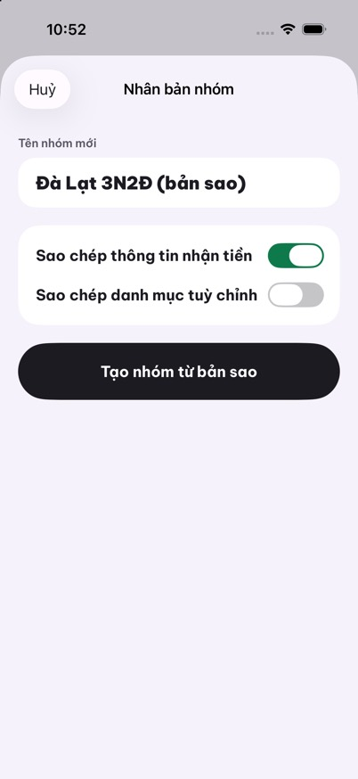

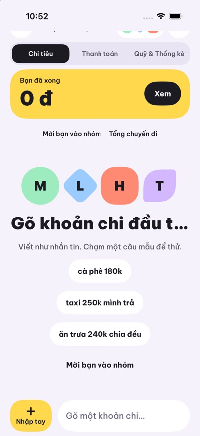

### Nhân bản nhóm

- **[Sheet]** Sheet chỉ có 3 dòng nhưng cao cả màn. Sheet cũng không nói rõ gì được chép và gì không: thành viên có, khoản chi không. Người dùng phải đoán.
- **[Lỗi]** Ở nhóm mới, header bị đẩy lên dưới đồng hồ và kéo xuống không về được. Nút quay lại gần như không bấm được.
- **[Lỗi]** Nhóm chưa có khoản chi nào vẫn hiện thẻ vàng “Bạn đã xong 0 đ” kèm nút “Xem”.
- **[Lặp]** “Mời bạn vào nhóm” xuất hiện 2 lần. Tiêu đề “Gõ khoản chi đầu t…” bị cắt.

**Hướng sửa:** sheet vừa nội dung, thêm một dòng “Chép 4 thành viên và thông tin nhận tiền. Không chép khoản chi.” Tạo xong thì thay nhóm cũ bằng nhóm mới trên ngăn xếp thay vì chồng lên. Nhóm trống chỉ hiện một lời mời nhập khoản chi đầu tiên.

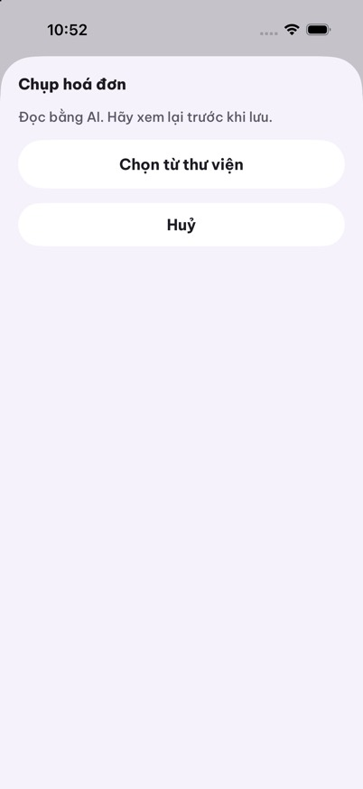

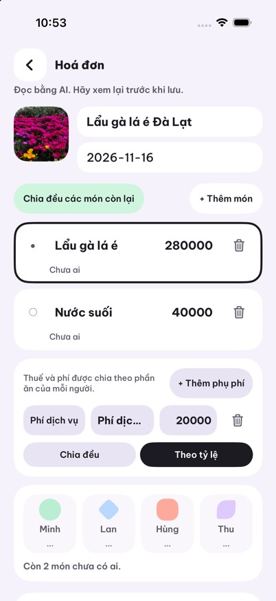

### Quét hoá đơn và gán món

- **[Sheet]** Sheet chụp hoá đơn chỉ có 2 nút mà cao cả màn. “Huỷ” là một nút to ngang hàng với nút chính.
- **[Lỗi]** Số tiền món ăn không có dấu chấm (`280000`), trong khi mọi chỗ khác viết `300.000`. Ngày hiện dạng `2026-11-16`.
- **[Lỗi]** Phụ phí có hai ô cùng chữ, ô thứ hai bị cắt thành “Phí dịc…”.
- **[Lặp]** Hai hàng 4 người gần giống nhau: hàng gán món và hàng “Ai trả?”. Hàng thứ hai còn bị cắt mất “Thu” ở mép phải.
- **[Giữ]** Ý tưởng chọn món rồi chạm người là đúng, và dòng “Còn 1 món chưa có ai” giải thích vì sao chưa lưu được.

**Hướng sửa:** nút camera mở thẳng camera toàn màn (đã chốt ở phần 3), thư viện ảnh là một nút nhỏ trong camera. Màn hoá đơn dùng chung ô tiền và ô ngày với form khoản chi. “Ai trả?” chuyển thành một dòng gọn ở đầu màn.

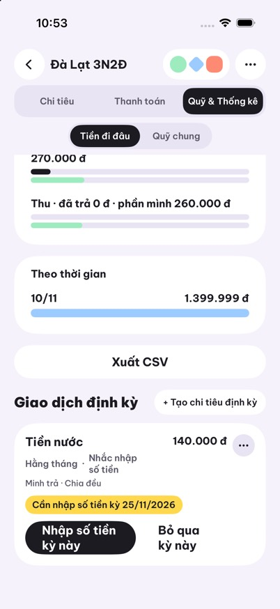

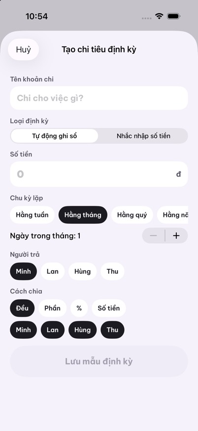

### Khoản chi định kỳ

- **[Chỗ đặt]** Định kỳ nằm dưới cùng tab thống kê, sau nút “Xuất CSV”. Khi đến kỳ, Tổng quan có nhắc, nhưng trong nhóm thì phải cuộn hết trang mới thấy.
- **[Lỗi]** Chữ xuống dòng giữa cụm: “Nhắc nhập / số tiền”. Hai nút “Nhập số tiền kỳ này” và “Bỏ qua kỳ này” mỗi nút 2 dòng.
- **[Lặp]** Nhãn vàng “Cần nhập số tiền kỳ 25/11/2026” ngay trên nút “Nhập số tiền kỳ này”. Tiêu đề viết “Giao dịch định kỳ”, nút lại viết “Tạo chi tiêu định kỳ”.
- **[Form]** Form định kỳ dùng chip chữ, còn form khoản chi dùng thẻ có hình: hai cách khác nhau cho cùng một việc. “Hằng năm” bị cắt mà không có dấu hiệu cuộn ngang. Hàng người thứ hai không có tiêu đề.
- **[Giữ]** Form này đã là sheet lớn, có “Huỷ” và nút lưu ở cuối, đúng mẫu đã chọn cho câu 2.

**Hướng sửa:** bỏ form riêng. Định kỳ thành một dòng “Lặp lại” trong form khoản chi chung. Khoản đến kỳ hiện như một hàng chờ ở đầu tab Chi tiêu: “Tiền nước tháng 11 · Nhập số tiền”.

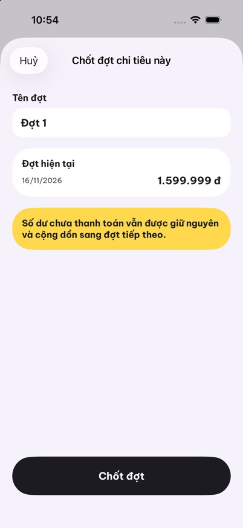

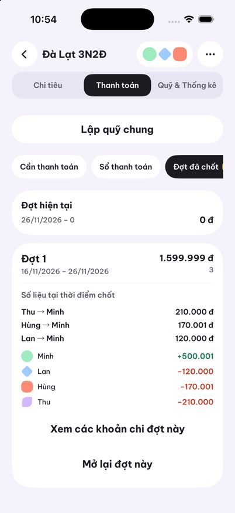

### Chốt đợt

- **[Sheet]** Nửa dưới sheet trống. Cảnh báo dùng cùng màu vàng với thẻ số dư chính, nên màu vàng đang mang 3 nghĩa khác nhau.
- **[Chuyển]** Chốt xong không có lời xác nhận nào. App tự chuyển sang tab “Đợt đã chốt”.
- **[Lặp]** Số liệu lúc chốt hiện 2 lần: một lần dạng ai chuyển ai, một lần dạng số dư từng người. Có một số “3” không nhãn dưới tổng tiền.
- **[Lỗi]** “26/11/2026 – 0” vẫn còn ở đợt hiện tại (đã ghi ở phần 2).
- **[Nguy hiểm]** “Mở lại đợt này” có cùng độ nổi với “Xem các khoản chi đợt này”.

**Hướng sửa:** sheet vừa nội dung. Chốt xong ở lại tab cũ, hiện một xác nhận kiểu “Đã chốt Đợt 1 · 3 khoản còn nợ chuyển sang đợt mới”. Ở đây đáng có một lần rung nhẹ và một hiệu ứng nhỏ, vì đây là một cột mốc thật. Số liệu lúc chốt chỉ hiện dạng ai chuyển ai. “Mở lại” chuyển vào menu.

Ghi chú: tổng 1.599.999 đ ở đây khác số 1.399.999 đ trên tab thống kê. Tôi đã kiểm tra: số ở tab thống kê là số cứng trong dữ liệu mẫu, nên đây không phải lỗi. Có điều số to nhất tab thống kê không có nhãn, và người đọc sẽ đem nó so với tổng các danh mục ngay bên dưới.

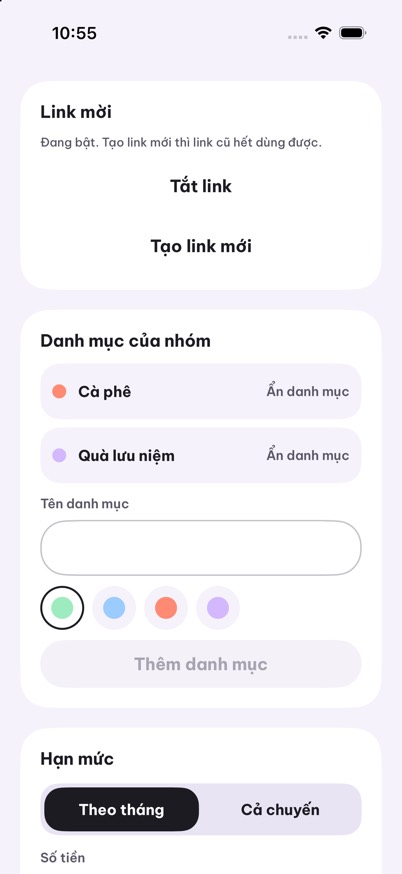

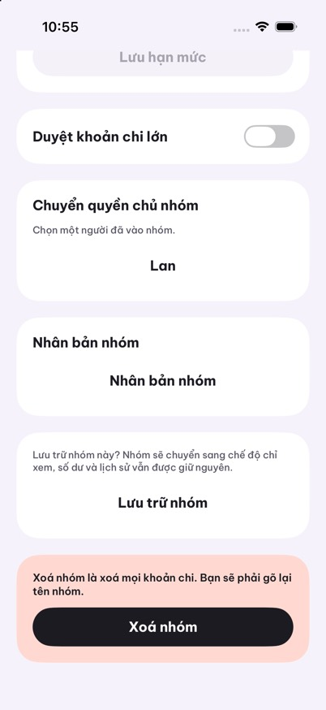

### Danh mục và cài đặt nhóm

- **[Lặp]** Mỗi hàng danh mục có chữ “Ẩn danh mục”, cùng một vấn đề với nút “Nhận” trên từng hàng mà bạn nêu. Danh mục mặc định (Ăn uống, Đi lại…) không có trong danh sách, nên không biết ẩn chúng ở đâu.
- **[Lặp]** Card “Nhân bản nhóm” có tiêu đề và nút cùng chữ. Mỗi card có nút lưu riêng (“Lưu tên”, “Lưu hạn mức”).
- **[Chỗ đặt]** Nhân bản và lưu trữ có cả ở menu ba chấm lẫn trong cài đặt.
- **[Lỗi]** Menu ba chấm hiện “Danh mục của nhóm” cho mọi người, nhưng mục này mở trang cài đặt chỉ chủ nhóm được vào. Biên tập viên bấm vào sẽ gặp màn “Bạn không có quyền làm việc này”, không có header, không có nút quay lại (ảnh ở mục C).

**Hướng sửa:** cài đặt nhóm thành danh sách iOS kiểu Settings, mỗi dòng đẩy sang một màn con nhỏ: Tên, Danh mục, Hạn mức, Quyền, Nguy hiểm. Ẩn danh mục bằng vuốt hàng hoặc nút sửa, không cần chữ trên từng hàng. Menu ba chấm chỉ còn những gì không có ở chỗ khác.

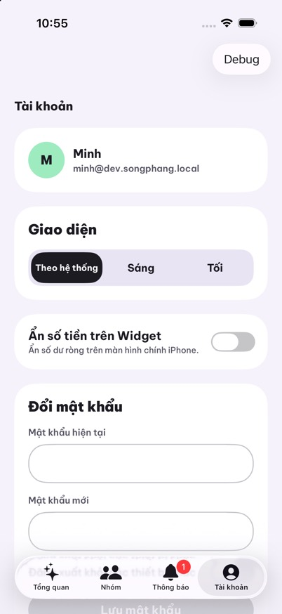

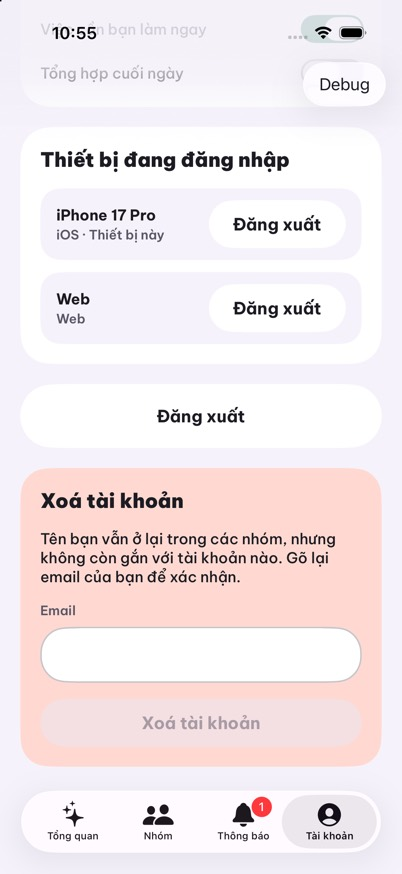

### Tài khoản

- **[Lặp]** “Đăng xuất” 3 lần trên một màn: hai lần cho từng thiết bị, một lần cho cả tài khoản.
- **[Ngợp]** Form đổi mật khẩu và form xoá tài khoản luôn mở sẵn, chiếm hơn nửa trang cho hai việc gần như không ai làm hằng ngày.
- **[Lỗi]** Chữ của trang trôi lên dưới đồng hồ và biểu tượng sóng. Các màn khác có lớp che, riêng tab này không có.

**Hướng sửa:** tab Tài khoản dùng `List` kiểu Settings của iOS. Đổi mật khẩu, thiết bị và xoá tài khoản mỗi mục là một dòng đẩy sang màn con. Một nút “Đăng xuất” duy nhất ở cuối.

_C · Kiểm tra toàn app_

## Mạng chậm, màn nhỏ, vai biên tập, chuyển động

### Mạng chậm 2 giây, không có dữ liệu lưu sẵn

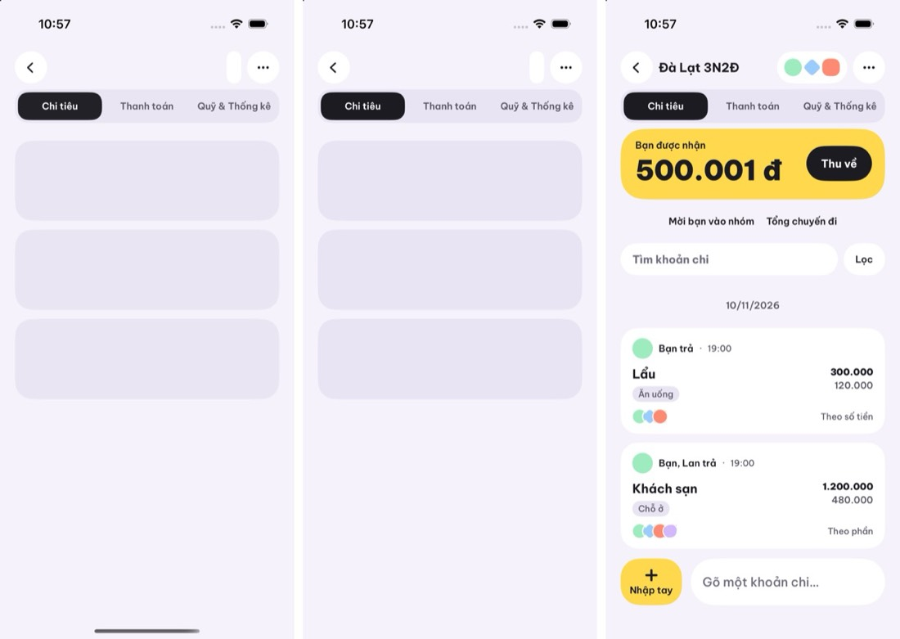

- **[Giữ]** Đã có khối xám giữ chỗ. Khi có dữ liệu lưu trên máy, Tổng quan hiện ngay, không cần chờ.
- **[Lỗi]** Tên nhóm trống trong lúc tải dù app đã biết tên từ danh sách nhóm. Viên hình thành viên là một vạch rỗng.
- **[Nhảy]** Khối xám là 3 thẻ giống nhau, không giống bố cục thật (thẻ số dư, hàng liên kết, ô tìm, các hàng). Ô nhập khoản chi chỉ hiện sau khi tải xong, nên cả màn nhảy một lần.

**Hướng sửa:** truyền tên và màu thành viên khi mở nhóm để header hiện ngay. Khối xám có hình giống bố cục thật. Ô nhập luôn có mặt ngay từ đầu.

### iPhone SE (màn 4,7 inch)

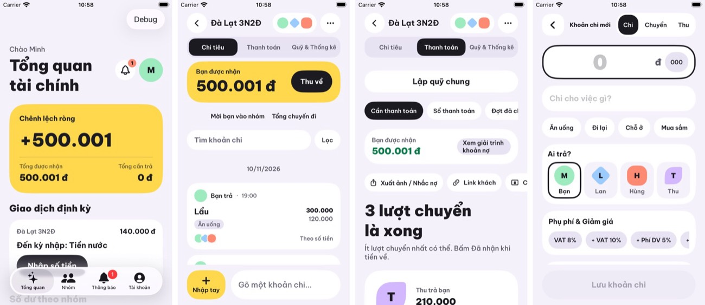

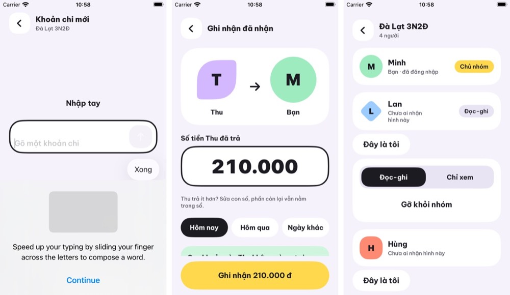

- **[Ưu tiên]** Tab Thanh toán: hàng cần bấm (“Thu trả bạn 210.000”) chỉ lộ mép trên. Đây là bằng chứng rõ nhất cho việc đưa đáp án lên đầu.
- **[Chật]** Tab Chi tiêu chỉ thấy 1 khoản chi trước khi phải cuộn. Tổng quan không thấy số dư theo nhóm vì thanh tab nổi che mất.
- **[Chật]** Ghi nhận đã nhận: ghi chú màu xanh bị nút chính che. “Xem giải trình khoản nợ” và “Chưa ai nhận hình này” xuống 2 dòng.
- **[Giữ]** Form khoản chi giữ nút “Lưu” ở đáy và vẫn dùng được.

### Vai biên tập viên

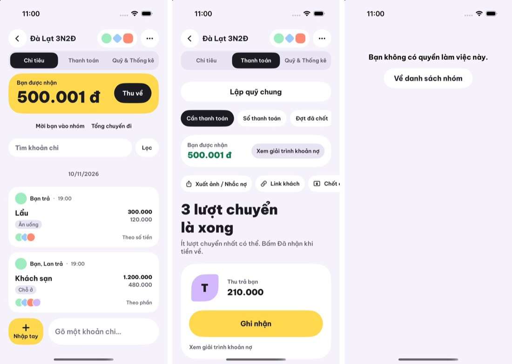

- **[Giữ]** Biên tập viên thấy Chi tiêu và Thanh toán giống hệt chủ nhóm, đúng với ý bạn ở câu 5: hai bên cùng một góc nhìn.
- **[Lỗi]** Màn không có quyền không có header và nút quay lại, chỉ có “Về danh sách nhóm”. Lối vào màn này là menu “Danh mục của nhóm”.
- **[Hỏi]** Biên tập viên vẫn thấy chip “Chốt đợt”. Tôi chưa kiểm tra server có cho phép biên tập viên chốt đợt không. Nếu không, chip này dẫn tới một lỗi nữa.

### Giảm chuyển động, VoiceOver, rung và âm thanh (đọc code)

- **Giảm chuyển động:** chỉ 4 file đọc cài đặt này (nhập nhanh, ghi nhận, chia tiền, hình thành viên), trong khi có 17 chỗ gọi animation. Ví dụ, chuyển segment trong nhóm vẫn chạy hiệu ứng mờ dần khi người dùng đã bật giảm chuyển động. **Hướng:** một bộ thông số chuyển động dùng chung, tự tắt hiệu ứng di chuyển khi bật cài đặt này. Đây cũng là chỗ để thêm hiệu ứng mới mà không phải kiểm tra từng màn.
- **VoiceOver:** có 80 nhãn đọc và 9 chỗ gộp phần tử. Khoảng 10 nút chỉ có biểu tượng cần kiểm tra nhãn. Tôi chưa bật VoiceOver để nghe thật, nên mục này mới là ước lượng.
- **Rung:** đã có sẵn 4 kiểu rung trong `Haptics.swift`, nhưng không dùng kiểu rung mới của SwiftUI (`sensoryFeedback`). App không có âm thanh nào. Phần 1 đã đề xuất nơi nên rung: lưu khoản chi, đã nhận, chốt đợt, cả nhóm sòng phẳng.

_D · Độ phủ_

## Bảng độ phủ sau lượt này

| Khu vực | Màn / trạng thái | Tình trạng |
|---|---|---|
| Vào app, Tổng quan, Nhóm | Mọi màn ở phần 1–3 | **[Đã chụp]** |
| Khoản chi | Quét hoá đơn, gán món, khoản chi định kỳ, nhập số tiền kỳ, danh mục | **[Đã chụp]** |
| Thanh toán | Chốt đợt, sau khi chốt | **[Đã chụp]** |
| Thông tin nhóm | Menu ba chấm, nhân bản nhóm, cài đặt đầy đủ, tài khoản | **[Đã chụp]** |
| Vai | Biên tập viên | **[Đã chụp]** |
| Toàn app | Mạng chậm, iPhone SE | **[Đã chụp]** |
| Toàn app | Giảm chuyển động, VoiceOver | **[Chỉ code]** |
| Thanh toán | Thông tin nhận tiền và VietQR, xác nhận yêu cầu đang chờ, quỹ có tiền, duyệt khoản chi lớn | **[Thiếu dữ liệu mẫu]** |
| Thông tin nhóm | Ghép Telegram, trang khách có nội dung | **[Thiếu dữ liệu mẫu]** |
| Ngoài app | Widget, chia sẻ ảnh vào app, xin quyền thông báo, cần cập nhật app | **[Chưa]** |
| Web | 28 trang | **[Chưa chạy]** |

Bảy màn iOS còn lại cần thêm dữ liệu vào bộ dữ liệu mẫu (`FakeWorld`), tức là phải sửa code, nên tôi chưa làm. Chúng không đổi kết luận: VietQR và yêu cầu chờ là hai trạng thái của sheet trả tiền mà phần 2 và 3 đã bàn. Web chưa chạy vì dự án chưa có file `.env`, và `pnpm dev` sẽ chạy seed vào database local của bạn.

_Đưa vào v3_

## 12 lỗi mới

- **Nhóm vừa nhân bản:** header bị đẩy dưới đồng hồ, không kéo về được.
- **Nhóm trống** hiện “Bạn đã xong 0 đ” kèm nút “Xem”.
- **Nhóm trống:** tiêu đề “Gõ khoản chi đầu t…” bị cắt.
- **Hoá đơn:** tiền không có dấu chấm, ngày dạng `2026-11-16`.
- **Hoá đơn:** phụ phí có hai ô cùng chữ, một ô bị cắt.
- **Ô gõ khoản chi** xuống 2 dòng khi có thêm nút camera.
- **Thẻ định kỳ:** chữ và hai nút xuống dòng giữa cụm.
- **Form định kỳ:** “Hằng năm” bị cắt, không có dấu hiệu cuộn ngang.
- **Menu “Danh mục của nhóm”** mở đầu trang cài đặt. Với biên tập viên thì mở màn không có quyền, không có nút quay lại.
- **Tab Tài khoản:** chữ trôi dưới đồng hồ.
- **Đang tải:** tên nhóm trống, viên thành viên rỗng, ô nhập hiện muộn làm màn nhảy.
- **Ghi nhận đã nhận trên iPhone SE:** ghi chú bị nút chính che.

Cộng 9 lỗi ở phần 2 và 3, tổng cộng 21 lỗi. Tất cả sửa trong đợt v3 như bạn đã chốt.

_Tiếp theo_

## Ba quyết định trước khi viết spec

1. **Số đậm trên danh sách chi tiêu là phần của bạn?** Câu hỏi từ phần 3, vẫn mở. Tôi đề xuất có.
2. **Gộp nợ bật sẵn cho nhóm mới?** Câu hỏi từ phần 3, vẫn mở. Tôi đề xuất bật, kèm một câu giải thích ở tầng lý do. Trong dữ liệu mẫu, nhóm Đà Lạt đang bật.
3. **Viết spec iOS ngay, Web làm sau?** Tôi đề xuất viết spec iOS bây giờ với những gì đã có. Sau khi spec iOS chốt, Web làm một lượt riêng: rà và áp cùng nguyên tắc. Để chạy được Web, cần bạn tạo file `.env` và đồng ý cho chạy seed.

_Nguồn_

- [Apple HIG: Sheets (chiều cao sheet vừa nội dung)](https://developer.apple.com/design/human-interface-guidelines/sheets)
- [Apple HIG: Motion (tôn trọng giảm chuyển động)](https://developer.apple.com/design/human-interface-guidelines/motion)
- [Apple HIG: Playing haptics](https://developer.apple.com/design/human-interface-guidelines/playing-haptics)
- [Apple HIG: Settings](https://developer.apple.com/design/human-interface-guidelines/settings)
